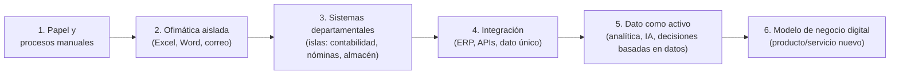

# Qué es digitalizar

## La idea en una frase

Digitalizar un proceso es rediseñarlo para que el dato se capture **una sola vez**, en el punto en
el que se produce, y **fluya sin intervención manual** hasta cada sitio donde se necesita. Ese
énfasis importa porque en los procesos no digitalizados el mismo dato suele reescribirse varias
veces: alguien lo apunta en papel, luego lo pasa a Excel, luego otro lo copia al ERP. Tener
ordenadores ayuda, pero no basta para decir que una empresa está digitalizada; convertir papel en
PDF tampoco. Lo que distingue un proceso digitalizado es que el dato *circula* y *se puede
consultar* sin que una persona lo vuelva a teclear ni haya que preguntarle a nadie.

## Tres palabras que en español son una sola

En inglés se distinguen tres niveles que en español caen bajo la misma palabra, y buena parte de la
confusión en empresas y en prensa viene de ahí:

| Término (inglés) | Qué es | Ejemplo | Cambia el proceso |
|---|---|---|---|
| **Digitization** (digitización) | Convertir información analógica a formato digital | Escanear facturas, grabar un audio en MP3 | No — el proceso es el mismo, cambia el soporte |
| **Digitalization** (digitalización) | Usar tecnología digital para cambiar cómo se hace un proceso | La factura llega por API al ERP y se contabiliza sin que nadie la lea | Sí — el flujo de trabajo se rediseña |
| **Digital transformation** (transformación digital) | Cambiar el modelo de negocio o la organización gracias a lo digital | Un banco cierra oficinas y opera por app; un fabricante vende el uso de la máquina por horas en vez de la máquina | Sí — cambia qué vende la empresa y cómo se organiza |

En castellano "digitalización" absorbe las tres, así que cuando alguien dice
"hemos digitalizado el archivo" cabría preguntar cuál de las tres quiere decir.

## El caso: una empresa "con ordenadores" no está digitalizada

Una gestoría de veinte empleados. Cada uno tiene un PC. Los clientes mandan las facturas por correo
electrónico como PDF o foto. Un administrativo abre cada correo, lee la factura y teclea importe,
proveedor y fecha en una hoja de cálculo compartida en una carpeta de red. A fin de mes, otra persona
copia esos datos al programa de contabilidad. Si un cliente llama para preguntar si su IVA
trimestral ya está calculado, hay que localizar a la persona que lleva su expediente.

Todos los datos están en formato digital. Nada está digitalizado:

- El mismo dato (el importe de una factura) se teclea **tres veces**: en la factura original del
  proveedor, en la hoja de cálculo y en el programa de contabilidad. Cada tecleo es una oportunidad
  de error y una hora de trabajo que no aporta nada.
- El **estado** del proceso ("¿está calculado el IVA de este cliente?") no existe como dato: vive en
  la cabeza de una persona.
- El proceso es **idéntico** al de hace treinta años con papel. La carpeta física es ahora un
  directorio; la máquina de escribir es Excel.

La misma gestoría, digitalizada: el cliente sube la factura a un portal (o su programa de facturación
la envía por API); un sistema de **OCR** extrae los campos y los valida contra el NIF del proveedor; el
apunte contable se genera automáticamente y queda pendiente de revisión; un panel muestra en tiempo
real qué clientes tienen el trimestre cerrado. El dato entra una vez y fluye. La persona que antes
tecleaba ahora revisa excepciones.

**Test rápido para saber si un proceso está digitalizado.** Basta con responder a cinco preguntas:

1. ¿Algún dato se introduce a mano más de una vez?
2. ¿Hay un papel, un PDF o un correo electrónico que alguien tiene que *leer* para que el proceso
   avance?
3. ¿Se puede saber el estado del proceso ahora mismo sin preguntar a una persona?
4. ¿Si la persona que lo lleva está de baja, el proceso sigue?
5. ¿Los datos que genera se pueden analizar en conjunto (todos los clientes, todo el año) sin
   copiarlos a mano a otro sitio?

Dos "sí" en las preguntas 1-2 o dos "no" en las 3-5 y el proceso no está digitalizado, tenga los
ordenadores que tenga.

## Niveles de madurez

No hay un modelo único de madurez digital (cada consultora vende el suyo), pero casi todos describen
la misma escalera:

Lo importante de la escalera no son los nombres de los peldaños sino dos observaciones:

- **La mayoría de las PYMES españolas está entre los peldaños 2 y 3**: tiene software, pero cada
  departamento usa el suyo y los datos no se hablan entre sí. El salto difícil es del 3 al 4,
  porque exige acordar definiciones comunes: qué es exactamente un cliente, un pedido o un producto,
  y quién manda sobre cada dato.
- **Los peldaños 5 y 6 son donde entra la IA**, y no se puede llegar a ellos saltándose el 4: un modelo
  de predicción de demanda necesita el histórico de ventas limpio, único y accesible. De ahí que
  "vamos a poner IA" en una empresa en el nivel 2 sea, en la práctica, un proyecto de integración de
  datos disfrazado.

## Las revoluciones industriales y el término "Industria 4.0"

| Revolución | Época | Tecnología habilitadora | Qué cambió |
|---|---|---|---|
| 1ª | finales s. XVIII | Máquina de vapor, mecanización | Producción mecánica |
| 2ª | finales s. XIX | Electricidad, cadena de montaje | Producción en masa |
| 3ª | años 70 del s. XX | Electrónica, PLC, informática | Automatización programable |
| 4ª | 2011 en adelante | Sistemas ciberfísicos, IoT, nube, datos, IA | Producción conectada y basada en datos |

"Industria 4.0" (*Industrie 4.0*) es un término acuñado por el gobierno alemán en la feria de
Hannover de 2011 como estrategia industrial; no es un estándar técnico. En España el programa
equivalente se llamó *Industria Conectada 4.0*, y de ahí sale la lista oficial de "tecnologías
habilitadoras digitales" que usa el currículo de este módulo (ver
[UD2-01](../ud2-tecnologias-arquitectura/01-tecnologias-habilitadoras.md)). La Comisión Europea
introdujo en 2021 "Industria 5.0" (centrada en la persona, sostenible, resiliente) — más un
reposicionamiento político que una revolución tecnológica distinta. Conviene saber que existen ambos
términos y que su contenido es, en gran medida, quien los defina.

La diferencia real entre la 3ª y la 4ª revolución, para un desarrollador, es esta: en la 3ª la
máquina está automatizada pero **aislada** (el PLC controla la prensa y nadie fuera de la planta sabe
qué hace); en la 4ª la máquina **produce datos que salen de la planta** y se integran con el negocio.

## Repercusión por sector

| Sector | Qué se ha digitalizado | Consecuencia visible |
|---|---|---|
| Banca | Operativa completa por app; scoring automático de crédito | Cierre masivo de oficinas; neobancos sin sucursales |
| Comercio | Inventario en tiempo real, omnicanalidad (tienda + web + app con el mismo stock) | Amazon; el pequeño comercio compite o desaparece |
| Industria | Sensorización de máquinas, mantenimiento predictivo, trazabilidad | Menos paradas no planificadas; fábricas que venden "horas de máquina" |
| Agricultura | Sensores de humedad, drones, riego automatizado | Agricultura de precisión: menos agua y fertilizante |
| Sanidad | Historia clínica electrónica, receta electrónica, imagen digital | El dato del paciente sigue al paciente entre centros |
| Logística | Trazabilidad del envío, optimización de rutas | El cliente ve el camión en el mapa |
| Administración pública | Sede electrónica, certificado digital, cita previa | Trámites sin ventanilla (y ventanillas que ya no atienden sin cita) |
| **Software** | CI/CD, nube, control de versiones, IA asistida | (Ver siguiente apartado) |

## El sector del título también se digitaliza

Puede parecer que el sector del software está digitalizado por definición. No: su **proceso de
producción** ha pasado por la misma escalera que cualquier otro.

- Hace veinte años el código se copiaba a un servidor por FTP a mano, las pruebas las hacía una
  persona siguiendo un documento Word, y "desplegar" era un viernes por la tarde con el teléfono
  encendido. Es el nivel B: herramientas digitales, proceso manual.
- El control de versiones (**Git**) es la digitalización del *dato* del sector: el código y su historia
  se capturan una vez y fluyen (clonar, ramas, revisión). La integración continua digitaliza las
  pruebas; el despliegue continuo digitaliza la entrega; la infraestructura como código digitaliza
  el servidor mismo.
- La IA generativa (UD1, [09](09-ia-para-el-desarrollo-de-software.md)) es el peldaño E aplicado al
  propio sector: el código, los tickets, la documentación y los logs son datos con los que se entrena
  y a los que se aplica un modelo.

Esta lectura importa para el proyecto: cuando un alumno propone digitalizar una empresa, está
proponiendo *también* un proceso para desarrollar y operar ese software, y ese proceso tiene su propio
nivel de madurez (ver ciclos de vida en [05](05-ciclos-de-vida-conway-y-el-caso-movil.md)).

## Casos límite y material de debate

**Digitalizar un proceso malo lo empeora más rápido.** Si el proceso de aprobación de un gasto exige
cuatro firmas porque nadie se fía de nadie, convertirlo en un flujo electrónico con cuatro
aprobaciones produce exactamente el mismo cuello de botella, con la diferencia de que ahora se puede
medir. La secuencia correcta es simplificar el proceso y luego digitalizarlo; el orden inverso es el
error más común y el más caro.

**A veces el papel gana.** Las listas de comprobación quirúrgicas, las comandas de una cocina en hora
punta o el cuaderno de un operario con guantes en una planta a -20 °C son procesos en los que la
interfaz de papel es más rápida, más robusta y más barata que una pantalla. Digitalizar no es un
valor en sí mismo: es una decisión de coste/beneficio, y la respuesta puede ser "no" o "todavía no".

**Digital no es lo mismo que *online*.** Un sistema de control de una depuradora puede estar
totalmente digitalizado y no tener conexión a Internet por decisión de seguridad. Confundir
"digitalizar" con "poner en la nube" es un error de categoría frecuente (ver
[UD2-05](../ud2-tecnologias-arquitectura/05-donde-vive-la-logica.md)).

**Coste y dependencia.** Una empresa que digitaliza sobre un proveedor único (un ERP concreto, una
nube concreta) gana eficiencia y pierde autonomía. Las decisiones de digitalización son también
decisiones de a quién se le da poder sobre el negocio. Se retoma con el *lock-in* en
[UD2-03](../ud2-tecnologias-arquitectura/03-niveles-y-funciones-de-la-nube.md).

**Digitalización sin dato.** Un kiosco de autopedido en un restaurante de comida rápida es
digitalización del interfaz con el cliente; si el pedido se imprime en cocina y nadie lo almacena, el
restaurante no ha ganado ningún dato con el que mejorar. La versión completa registra qué se pide, a
qué hora, cuánto tarda y qué se devuelve — y esa es la diferencia entre el peldaño C y el E.
