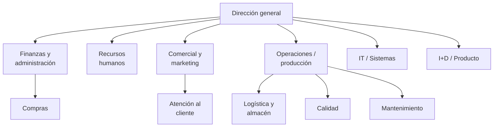

# La empresa por dentro: departamentos, sistemas y roles

## Conclusión primero

Una empresa es un conjunto de departamentos que intercambian información, y cada departamento acaba
teniendo un sistema informático que refleja cómo trabaja. Digitalizar la empresa entera consiste en
hacer que esos sistemas se hablen, y eso es imposible sin cambiar también cómo se hablan los
departamentos. **Tecnología y organización se determinan mutuamente**: un ERP impone un proceso; un
organigrama en silos produce sistemas en silos. Para un desarrollador esto significa que el
organigrama de la empresa cliente es parte del análisis técnico, no un dato administrativo.

## Los departamentos típicos

Organigrama funcional de una empresa mediana con producción propia. Las empresas de servicios o de
software no tienen planta, pero sí el resto:

Cada departamento tiene una función, un vocabulario, unos indicadores y, casi siempre, un sistema de
información propio:

| Departamento | Función | Sistema típico |
|---|---|---|
| Finanzas / administración | Contabilidad, facturación, tesorería, fiscal | **ERP** (módulo financiero), banca electrónica |
| Recursos humanos | Contratación, nóminas, formación, prevención | **HRIS** / software de nóminas, control horario |
| Comercial / ventas | Captación, presupuestos, pedidos | **CRM**, configurador de ofertas |
| Marketing | Marca, campañas, web, redes | CMS, herramientas de *email marketing*, analítica web |
| Atención al cliente / soporte | Incidencias, reclamaciones, garantías | *Ticketing* (*help desk*), centralita |
| Operaciones / producción | Fabricar el producto o prestar el servicio | **MES**, SCADA, planificación (APS) |
| Logística / almacén | Recepción, stock, expedición | **WMS**, **SGA**, TMS |
| Compras | Proveedores, aprovisionamiento | ERP (módulo compras), **SRM** |
| Calidad | Normas, trazabilidad, auditorías | **LIMS**, gestión documental |
| Mantenimiento | Que las máquinas funcionen | **GMAO** / CMMS |
| IT / sistemas | Que todo lo anterior funcione | Monitorización, *service desk*, gestión de identidades |
| I+D / producto | Diseñar lo que se vende | **PLM**, CAD, gestión de proyectos, control de versiones |

Lo importante no es memorizar las siglas sino entender el patrón: cada departamento acaba teniendo
una herramienta que refleja su manera de trabajar, y el problema difícil aparece cuando hay que hacer
que todas esas herramientas compartan datos y reglas.

**Siglas de sistemas de gestión** (una frase cada uno; el ciclo tiene un módulo dedicado que no se
presupone aquí):

- **ERP** (*Enterprise Resource Planning*): sistema central que integra finanzas, compras, ventas,
  inventario y a menudo producción sobre una base de datos común. SAP, Oracle, Microsoft Dynamics,
  **Odoo**, Sage. Es el sistema que, cuando se implanta, obliga a la empresa a unificar procesos.
- **CRM** (*Customer Relationship Management*): gestión de la relación comercial — contactos,
  oportunidades, historial. Salesforce, HubSpot, Dynamics.
- **MES** (*Manufacturing Execution System*): sigue la producción en planta en tiempo real (qué
  orden está en qué máquina, cuánto lleva hecho). Es la frontera entre IT y OT (ver
  [03](03-it-y-ot.md)).
- **WMS / SGA** (*Warehouse Management System* / sistema de gestión de almacén): ubicaciones, stock,
  picking.
- **HRIS** (*Human Resources Information System*): datos de empleados, nóminas, ausencias.
- **PLM** (*Product Lifecycle Management*): diseño y versiones del producto físico.
- **BI** (*Business Intelligence*): cuadros de mando y análisis sobre los datos de los anteriores.
  Power BI, Tableau, Looker, Metabase.

## Qué departamentos constituyen entornos IT

La expresión tiene dos lecturas, y conviene manejar las dos porque "IT" es otro término polisémico:

1. **IT como departamento.** "Los de sistemas": el departamento que administra infraestructura,
   puestos de trabajo, redes, identidades y soporte. En una PYME es una persona o un proveedor
   externo; en una gran empresa, cientos de personas con un CIO al frente.
2. **IT como entorno.** Cualquier departamento cuyo trabajo consiste en procesar *información* (no
   materia) constituye un entorno IT: finanzas, RRHH, comercial, marketing, atención al cliente,
   compras, administración. Sus herramientas son sistemas de información; su "materia prima" son
   datos. Por contraste, producción, mantenimiento y logística física operan sobre el mundo físico
   y constituyen (o incluyen) entornos **OT**, tema del siguiente apunte.

Con la segunda lectura, en una empresa de software **todos los departamentos son entornos IT**,
incluido el de producción — porque lo que produce es información. Es el caso del sector del título.

## Los roles de un equipo de desarrollo de software

El departamento de producto o ingeniería de una empresa de software (o el equipo de desarrollo
interno de cualquier empresa grande) tiene su propia estructura de roles.

| Rol | Qué hace | Tecnologías que toca | Nota sobre el término |
|---|---|---|---|
| **Desarrollador frontend** | Interfaz de usuario: lo que se ve y con lo que se interactúa | HTML/CSS/JS-TS, React, Angular, Vue, Svelte | "Frontend" no siempre significa "en el navegador" |
| **Backend** | Lógica de negocio, persistencia, APIs, integración | Java/Kotlin (Spring), C# (.NET), Python (Django/FastAPI), Node/TS, Go, PHP, bases de datos | Idem |
| **Full-stack** | Ambos lados | Las dos filas anteriores | Significa desde "hace de todo en una *startup*" hasta "frontend que sabe montar una API"; sospechar de la oferta que lo exige con diez tecnologías |
| **Móvil** | Aplicaciones para iOS/Android | Kotlin, Swift, Flutter, React Native, Kotlin Multiplatform | El móvil añade sincronización, tiendas de aplicaciones y trabajo sin conexión |
| **QA / testing** | Calidad: pruebas manuales y automatizadas | Frameworks de test, Playwright/Cypress, herramientas de carga | Cada vez más integrado en el equipo, no un departamento aparte |
| **DevOps / SRE / plataforma** | Que el software se despliegue y funcione en producción: CI/CD, infraestructura, monitorización | Docker, Kubernetes, Terraform, nube, pipelines | "DevOps" nació como cultura (unir desarrollo y operaciones), se convirtió en puesto; "SRE" es la versión de Google; "ingeniero de plataforma" es el término de 2020 en adelante |
| **Datos: ingeniero de datos** | Pipelines, almacenes, calidad del dato | SQL, Spark, Airflow, dbt, nube | Diseña cómo se mueven y transforman los datos |
| **Datos: científico / analista** | Análisis, modelos, cuadros de mando | Python/R, notebooks, BI | Idem |
| **ML / AI engineer** | Poner modelos en producción; desde 2023, construir aplicaciones sobre LLM | PyTorch, APIs de modelos, RAG, evaluación | En muchas empresas es, en la práctica, backend que integra modelos |
| **UX / UI** | Investigación de usuario, diseño de interacción, diseño visual | Figma, prototipos | UX y UI son cosas distintas que suelen contratarse juntas |
| **Product owner / product manager** | Decidir qué se construye y en qué orden | Herramientas de gestión (Jira, Linear), datos de uso | El *owner* es un rol de Scrum; el *manager* un puesto; se solapan |
| **Arquitecto** | Decisiones estructurales: qué piezas, cómo se comunican, qué tecnología | Diagramas, documentos de decisión | Es una actividad más que un puesto: en equipos pequeños la hace el *tech lead* |
| **Tech lead** | Referente técnico del equipo; revisa, decide, desbloquea | — | Suele seguir programando; el *engineering manager* no |
| **Scrum master / agile coach** | Facilitar el proceso ágil | — | Rol que muchas empresas han eliminado o fusionado desde 2023 |

Dos observaciones de 2026 sobre esta tabla:

- **La IA asistida está difuminando las fronteras entre roles.** Un desarrollador de frontend con
  un agente de código puede montar una API razonable, y viceversa. La tendencia en las ofertas es
  hacia "product engineer" (alguien que cubre de la idea al despliegue) en equipos pequeños, y hacia
  la especialización profunda solo en equipos grandes. Lo que no se difumina es la necesidad de
  *entender* ambos lados para revisar lo que el agente produce.
- **El organigrama del equipo determina el sistema que produce.** Un equipo dividido en "los de
  front" y "los de back" con un jefe cada uno produce una API con fricción en el medio; un equipo por
  funcionalidad produce funcionalidades verticales. Es la ley de Conway, desarrollada en
  [05](05-ciclos-de-vida-conway-y-el-caso-movil.md).

## Tecnología y organización se determinan mutuamente

La relación va en las dos direcciones.

**La tecnología cambia la organización.**

- Implantar un ERP obliga a unificar procesos: si contabilidad y almacén usaban códigos de producto
  distintos, alguien tiene que ceder. Los proyectos de ERP fracasan más por esto que por la técnica
  (ver casos en [05](05-ciclos-de-vida-conway-y-el-caso-movil.md)).
- Aparecen roles nuevos: CIO (*Chief Information Officer*, responsable de sistemas), CTO (*Chief
  Technology Officer*, responsable de tecnología de producto — en una empresa de software es el
  puesto técnico más alto; en una industrial, a veces ni existe), CDO (*Chief Data Officer* o
  *Chief Digital Officer*: la misma sigla para dos puestos distintos, otra polisemia), DPO
  (*Data Protection Officer*, obligatorio por RGPD en ciertos casos, ver
  [10](10-seguridad-y-regulacion.md)).
- Desaparecen tareas (teclear facturas) y aparecen otras (revisar excepciones, mantener el sistema).
- La comunicación cambia de canal: de la llamada al ticket, de la reunión al panel. Esto es
  organización tanto como tecnología.

**La organización condiciona la tecnología.**

- Departamentos que no se hablan producen sistemas que no se hablan (silos de datos). La integración
  técnica no arregla la falta de acuerdo sobre qué significa "pedido".
- *Shadow IT*: cuando el departamento de IT es lento o restrictivo, los departamentos se compran su
  propio SaaS con la tarjeta de empresa, y aparecen datos de clientes en herramientas que nadie
  controla. Es un síntoma organizativo con consecuencias de seguridad (ver
  [10](10-seguridad-y-regulacion.md)).
- IT centralizado (un departamento decide todo, coherente pero lento) frente a descentralizado (cada
  área elige, ágil pero fragmentado): es una decisión de organización que fija qué arquitectura es
  posible.
- Una empresa que factura por proyectos organiza su software en torno al proyecto; una que factura
  por suscripción, en torno al cliente. El modelo de negocio dicta el modelo de datos.

**Ejemplo integrador.** Una cadena de clínicas dentales decide "digitalizarse". Compra un software de
gestión de clínicas. En cada clínica, la recepcionista sigue llevando la agenda en papel porque el
software es lento y "así lo ve de un vistazo". Los dentistas dictan el historial y una auxiliar lo
transcribe al final del día. La central pide informes mensuales, que cada clínica prepara a mano en
Excel a partir de lo que hay en el software (incompleto) y en el papel (completo). Diagnóstico: la
tecnología se ha implantado sin cambiar la organización — nadie decidió que la agenda de papel
desaparece, nadie formó a los dentistas para dictar en el sistema, nadie definió que el informe
mensual se genera solo. Lo que hace falta no es mejor software: es una decisión organizativa
(agenda única, obligatoria, en el sistema) y formación. Este patrón — el software está pero el
proceso no cambió — es el fallo más común que se encontrará en el proyecto.

## Para debatir

- Si "cliente" significa cosas distintas en cinco departamentos, ¿debe la base de datos tener una
  tabla `Cliente` o cinco? ¿Quién decide?
- ¿Es preferible que IT elija las herramientas de toda la empresa (coherencia) o que cada
  departamento elija las suyas (rapidez)? Buscar un ejemplo en el que cada opción haya fallado.
- En una empresa de 15 personas, ¿qué roles de la tabla de desarrollo existen de verdad y cuáles
  hace la misma persona? ¿Qué se pierde?
