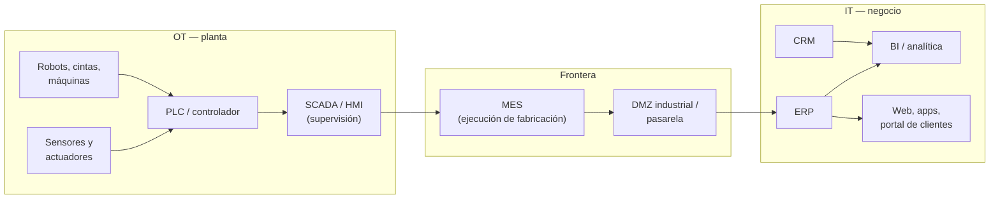

# IT y OT: dos mundos con una frontera que se mueve

## Conclusión primero

**IT** (*Information Technology*) es la tecnología que gestiona información: bases de datos, ERP,
correo, webs. **OT** (*Operational Technology*) es la tecnología que controla procesos físicos:
autómatas, sensores, robots, sistemas de supervisión. Durante cuarenta años fueron mundos separados,
con gente distinta, prioridades distintas y redes distintas. La digitalización industrial consiste
precisamente en **conectarlos**, y ahí es donde aparecen los problemas interesantes: la frontera entre
ambos no está fija, y cada tecnología nueva (Ethernet industrial, IoT, *edge computing*, IA en
planta) la desplaza.

Para un alumno de DAM el valor de este contraste es doble: es contenido en sí mismo, y es el molde de
otro contraste que sí va a manejar a diario, frontend/backend, que también son dos entornos con
prioridades distintas y una frontera móvil.

## Qué hay en cada lado

**OT, de abajo arriba:**

- **Sensores y actuadores.** Un sensor mide (temperatura, presión, posición, peso); un actuador actúa
  (abre una válvula, arranca un motor). Son el nivel físico.
- **PLC** (*Programmable Logic Controller*, autómata programable). Un ordenador industrial
  robustecido que ejecuta un programa de control en ciclos de milisegundos: lee entradas, aplica
  lógica, escribe salidas. Se programa en lenguajes de la norma IEC 61131-3 (diagrama de contactos,
  texto estructurado). Siemens, Rockwell/Allen-Bradley, Schneider, Omron.
- **DCS** (*Distributed Control System*). El equivalente del PLC para procesos continuos grandes
  (química, refinería, energía).
- **SCADA** (*Supervisory Control And Data Acquisition*) y **HMI** (*Human-Machine Interface*). El
  software de supervisión: pantallas sinópticas de la planta, alarmas, históricos. El HMI es la
  pantalla al pie de máquina; el SCADA supervisa toda la instalación.
- **Historian.** Base de datos de series temporales optimizada para almacenar millones de lecturas
  de sensores por día.
- **Robots industriales, cobots, AGV/AMR.** Robots de brazo (soldadura, pintura, paletizado);
  *cobots* que trabajan junto a personas sin jaula; vehículos autónomos de almacén guiados (AGV) o
  autónomos (AMR).

**IT, de arriba abajo:** lo descrito en [02](02-la-empresa-por-dentro.md): ERP, CRM, BI, ofimática,
correo, webs, aplicaciones móviles, bases de datos relacionales.

**En la frontera:**

- **MES** (*Manufacturing Execution System*). Recibe órdenes de fabricación del ERP, las reparte a las
  máquinas, recoge de la planta cuánto se ha producido y con qué calidad, y lo devuelve al ERP. Es
  software de IT que habla con OT.
- **DMZ industrial / pasarela.** Zona de red intermedia con cortafuegos a ambos lados, para que IT y
  OT intercambien datos sin que un ataque en la web de la empresa llegue a la prensa hidráulica.

## El modelo de Purdue: la frontera tiene nombre y número

La norma **ISA-95** (y el modelo de Purdue del que deriva) organiza todo lo anterior en niveles. Se
cita constantemente en ciberseguridad industrial y en integración IT/OT:

| Nivel | Qué hay | Escala de tiempo | Mundo |
|---|---|---|---|
| 0 | Proceso físico: sensores, actuadores | milisegundos | OT |
| 1 | Control: PLC, DCS | milisegundos–segundos | OT |
| 2 | Supervisión: SCADA, HMI | segundos–minutos | OT |
| 3 | Operaciones de planta: MES, historian, planificación | minutos–horas | frontera |
| 3.5 | DMZ industrial | — | frontera |
| 4 | Negocio: ERP, correo, BI | horas–días | IT |
| 5 | Red corporativa / Internet | — | IT |

La utilidad del modelo no es memorizar los niveles sino ver dos cosas: (1) que el **tiempo** que
importa en cada nivel es distinto — un PLC que tarda 2 segundos en reaccionar es un accidente, un ERP
que tarda 2 segundos en abrir una factura es normal — y (2) que la **frontera es el nivel 3**, y
que la digitalización industrial consiste en engrosar ese nivel: cada vez más datos suben y más
órdenes bajan.

## Diferencias

| Dimensión | IT | OT |
|---|---|---|
| **Qué gestiona** | Información | Procesos físicos |
| **Prioridad de seguridad** | Confidencialidad → integridad → disponibilidad (la tríada CIA en ese orden) | Seguridad física de las personas → disponibilidad → integridad → confidencialidad. Que la planta no pare y no hiera a nadie va antes que que nadie lea los datos |
| **Consecuencia de un fallo** | Pérdida de datos, dinero, reputación | Daño físico, lesiones, contaminación, explosión |
| **Ciclo de vida del equipo** | 3-5 años | 15-30 años: hay PLC en producción con Windows XP (o sin sistema operativo reconocible) |
| **Actualizaciones** | Frecuentes, automáticas, se reinicia | Raras, planificadas en paradas de mantenimiento; un reinicio puede parar una línea |
| **Tiempo real** | *Best effort*: si tarda un poco más, no pasa nada | Determinista: la respuesta debe llegar dentro de un plazo fijo, siempre |
| **Protocolos** | TCP/IP, HTTP, TLS, SQL | Modbus, PROFINET, EtherNet/IP, OPC UA, CAN, MQTT (para IoT) — muchos sin cifrado ni autenticación porque se diseñaron para redes aisladas |
| **Quién lo gestiona** | Departamento de IT | Ingeniería, mantenimiento, el fabricante de la máquina |
| **Cultura** | "Muévete rápido"; el cambio es normal | "No toques lo que funciona"; el cambio es un riesgo |
| **Modelo de seguridad tradicional** | Perímetro + identidad (usuario/contraseña, MFA) | Aislamiento físico (*air gap*): la red de planta no se conecta a nada |
| **Datos** | Transaccionales: pedidos, facturas, clientes | Series temporales: miles de lecturas por segundo |
| **Regulación** | RGPD, contabilidad, fiscal | Normas de seguridad de máquinas, sanitarias, medioambientales |

## Similitudes, y por qué convergen

- **Ambos son software ejecutándose en ordenadores.** Un PLC moderno lleva Linux; un SCADA es una
  aplicación con base de datos y clientes; OPC UA es una arquitectura cliente/servidor con TLS. Las
  competencias de un desarrollador aplican en ambos mundos.
- **Ambos se conectan por red**, y cada vez la misma: Ethernet industrial ha sustituido a los buses
  propietarios; MQTT (un protocolo de mensajería ligero pensado para IoT) se usa en planta y en la
  nube.
- **Ambos se atacan.** Con la conexión desapareció el *air gap*. Casos de referencia: *Stuxnet*
  (2010, malware que dañó centrifugadoras iraníes manipulando PLC Siemens); *Triton/Trisis* (2017,
  ataque a los sistemas de seguridad de una planta petroquímica); *Colonial Pipeline* (2021,
  *ransomware* en la red IT de un oleoducto estadounidense — la empresa paró el oleoducto por
  precaución porque no podía garantizar que OT no estuviera afectado, y la costa este se quedó sin
  gasolina varios días). El tercero es el más instructivo: el ataque fue en IT y el impacto en OT,
  porque la frontera ya no aísla.
- **Ambos convergen en el dato.** La razón económica de conectar IT y OT es que los datos de planta
  (cuánto produce cada máquina, cuándo falla, cuánta energía consume) tienen valor en el negocio
  (planificar, mantener, facturar). Es el tema de [06](06-extremo-a-extremo.md).

El término para esta convergencia es **IIoT** (*Industrial Internet of Things*): sensorizar máquinas
y llevar sus datos a plataformas de IT (a menudo en la nube) para analizarlos. Y **sistema
ciberfísico** (*cyber-physical system*): un sistema en el que el software y el proceso físico están
tan acoplados que no tiene sentido separarlos (un coche autónomo, una línea de envasado con visión
artificial).

## La frontera se mueve

Este es el punto conceptual del módulo aplicado a IT/OT. Dónde termina IT y empieza OT depende de la
tecnología del momento:

- **Años 80-90:** frontera nítida. OT era eléctrica y neumática; IT era el ordenador de la oficina.
  No se hablaban.
- **2000-2010:** el MES aparece como puente; SCADA pasa a Windows y a red Ethernet. La frontera es
  una pasarela.
- **2010-2020:** IIoT y nube. Los datos de la planta se analizan en un centro de datos a mil
  kilómetros. ¿Dónde está la frontera si el historian está en AWS?
- **2020-2026:** *edge computing* e IA en planta. Un modelo de visión artificial que detecta
  defectos se ejecuta en un servidor al pie de la línea (OT por localización) pero se entrena en la
  nube con herramientas de IT y se despliega con contenedores Docker. El PLC "virtual" es software en
  un servidor genérico. La frontera ya no es un lugar: es una decisión de diseño.

La misma frase describe la frontera frontend/backend: en 1995 el navegador mostraba HTML y el
servidor hacía todo; en 2015 el navegador ejecutaba la aplicación entera; en 2026 hay código de
"frontend" que se ejecuta en el servidor y código de "backend" que se ejecuta en el borde de la red.
Ese paralelo se desarrolla en [04](04-front-back-cliente-servidor.md).

## Tecnologías típicas de planta y de negocio

Basta reconocer qué es cada pieza y a qué lado pertenece; no hace falta entrar en detalle técnico.

**En planta (OT):**

| Tecnología | Para qué |
|---|---|
| PLC / DCS | Control de máquinas y procesos |
| SCADA / HMI | Supervisión y operación |
| MES | Ejecución y seguimiento de la producción |
| Sensores IoT / IIoT y pasarelas | Captura de datos de máquinas antiguas ("retrofit") |
| Robots, cobots, AGV/AMR | Manipulación, transporte interno |
| Visión artificial | Inspección de calidad, guiado de robots |
| Gemelo digital | Modelo virtual de la máquina o planta alimentado con datos reales, para simular y predecir (ver [UD2-01](../ud2-tecnologias-arquitectura/01-tecnologias-habilitadoras.md)) |
| Mantenimiento predictivo | Modelos que anticipan el fallo a partir de vibración, temperatura, consumo |
| Fabricación aditiva (impresión 3D) | Prototipos, utillaje, piezas de repuesto bajo demanda |
| Realidad aumentada | Instrucciones de montaje o mantenimiento superpuestas sobre la máquina |
| Protocolos: OPC UA, Modbus, PROFINET, MQTT | Comunicación máquina-máquina y máquina-IT |

**En negocio (IT):**

| Tecnología | Para qué |
|---|---|
| ERP, CRM, BI | Gestión integrada, relación con clientes, análisis |
| Ofimática y colaboración en la nube | Documentos, correo, videollamada |
| Comercio electrónico y portales | Venta y autoservicio del cliente |
| RPA (*Robotic Process Automation*) | Programas que imitan a una persona haciendo clics para conectar sistemas que no tienen API; automatización "de pegamento" (ver [09](09-ia-para-el-desarrollo-de-software.md)) |
| Firma electrónica, facturación electrónica | Trámites sin papel; en España la facturación electrónica entre empresas y los sistemas de facturación verificables están en despliegue normativo |
| Analítica de datos e IA | Previsión, segmentación, asistentes |
| Ciberseguridad (identidad, MFA, copias, SIEM) | Protección de todo lo anterior |

Lo relevante para un desarrollador: la columna "para qué" de la tabla de negocio es la lista de
sistemas con los que una aplicación nueva tendrá que **integrarse**. En el proyecto, el mapa de
integración debe indicar con cuál de ellos se conecta cada área digitalizada.

## Para debatir

- Un hospital: ¿la bomba de infusión conectada a la red es IT u OT? ¿Y el monitor de constantes que
  envía alarmas al móvil de la enfermera? ¿Qué prioridad de seguridad aplica?
- Un coche moderno tiene decenas de unidades de control (OT) y una pantalla con apps, mapas y
  actualizaciones por Internet (IT) en la misma red interna. ¿Dónde se pone la DMZ? ¿Qué pasó en el
  caso del Jeep Cherokee (2015, investigadores tomaron el control del coche desde Internet)?
- ¿Tiene sentido hablar de OT en una empresa de software? ¿Qué sería lo más parecido (el centro de
  datos, los sistemas de despliegue en producción)? ¿Comparten la cultura de "no toques lo que
  funciona"?
