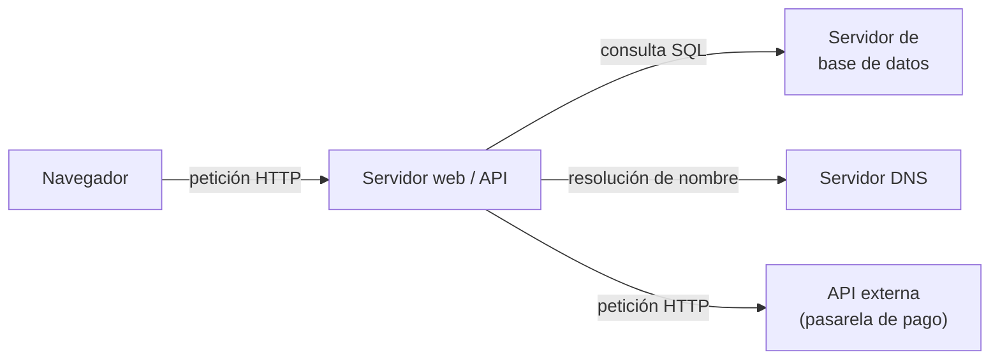
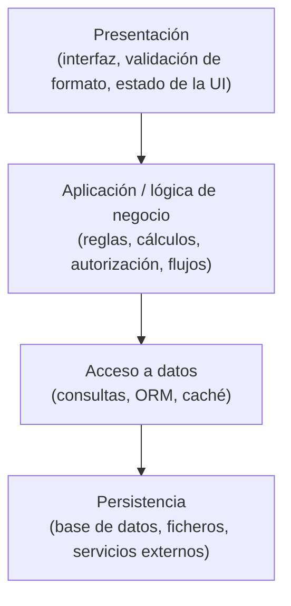
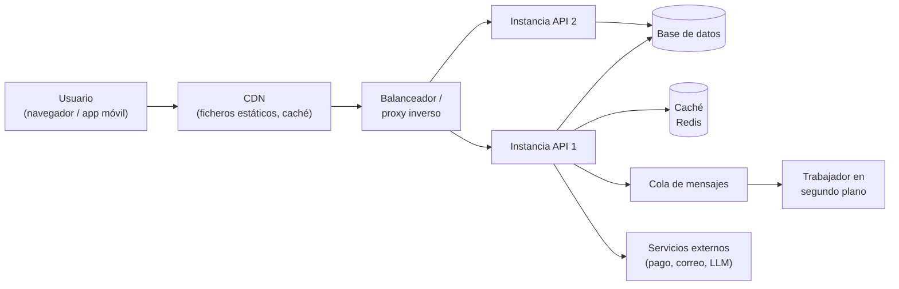

# Frontend/backend y cliente/servidor: el "IT/OT" del software

## Conclusión primero

**Cliente/servidor** es una relación entre dos procesos: uno pide, otro responde. **Frontend/backend**
es una separación de responsabilidades: uno presenta e interactúa, otro guarda y decide. Son ejes
distintos. Se confunden porque en la aplicación web típica coinciden (el frontend corre en el
cliente, el backend en el servidor), pero hay frontend que corre en el servidor, backend que corre
en el cliente, y aplicaciones con frontend y backend en el mismo proceso. Saber separar los dos ejes
es lo que permite razonar sobre **dónde debe vivir cada pieza de lógica**, que es la decisión de
arquitectura más importante de una aplicación y la que se pide en el proyecto.

## Cliente/servidor: un rol, no una máquina

En la arquitectura cliente/servidor hay un proceso que **escucha** esperando peticiones (servidor) y
procesos que **inician** peticiones y esperan respuesta (clientes). Es una relación asimétrica y
relativa:



El servidor web es *servidor* del navegador y *cliente* de la base de datos, del DNS y de la pasarela
de pago. "Cliente" y "servidor" describen quién pide y quién responde en **una conversación
concreta**, no qué máquina es cada uno. En la misma máquina puede haber un servidor (Postgres
escuchando en el puerto 5432) y un cliente (la aplicación que le consulta).

Alternativa: **peer-to-peer** (P2P), donde cada nodo es cliente y servidor a la vez (BitTorrent,
la red de Bitcoin, Git entre repositorios). No hay un centro. El contraste sirve para ver que
cliente/servidor es una elección, no una ley.

**"Servidor" tiene al menos siete acepciones en uso corriente**, y en una misma conversación de trabajo se mezclan:

| Acepción | Ejemplo de frase | Qué es realmente |
|---|---|---|
| Máquina física | "El servidor está en el armario del sótano" | Un ordenador con más memoria y sin pantalla |
| Proceso que escucha | "Arranca el servidor con `npm run dev`" | Un programa esperando conexiones en un puerto |
| Rol en una conversación | "Postgres actúa como servidor de la aplicación" | Quien responde |
| Máquina virtual / instancia en la nube | "Levantamos tres servidores en AWS" | Una VM alquilada, que puede vivir minutos |
| Contenedor | "Cada microservicio corre en su propio servidor" | Un proceso aislado dentro de una máquina compartida |
| Función *serverless* | "Esto va en un servidor *serverless*" (frase real) | Código que se ejecuta bajo demanda sin que se administre ninguna máquina; hay servidores, pero no son de quien programa |
| El backend entero | "Pregúntale al servidor si el usuario existe" | La aplicación desplegada, sea donde sea |

"Cliente" tiene el mismo problema, agravado porque en la empresa "cliente" es quien paga (ver
[02](02-la-empresa-por-dentro.md)): "el cliente quiere que el cliente no pueda ver ese campo" es una
frase perfectamente normal en una reunión de proyecto. Y "cliente" también es una biblioteca: "el
cliente de Python para la API" (SDK).

## Frontend/backend: responsabilidades, no lugares

**Frontend** es la parte que presenta información e interactúa con el usuario. **Backend** es la parte
que guarda datos, aplica reglas de negocio y coordina con otros sistemas. Es una división por
*responsabilidad*, y como tal existe en aplicaciones donde no hay red:

- Una aplicación de escritorio (un editor de fotos) tiene frontend (la ventana, los menús, el
  lienzo) y backend (el motor que aplica los filtros, el formato de archivo). Los dos en el mismo
  proceso.
- Una aplicación de línea de comandos tiene un frontend mínimo (el parseo de argumentos, la salida
  formateada) y un backend (lo que hace).
- Un **compilador** tiene *frontend* (análisis léxico y sintáctico: entiende el lenguaje fuente) y
  *backend* (generación de código para la máquina destino). LLVM es exactamente esa arquitectura:
  muchos frontends (C, Rust, Swift) sobre un backend común. Nada que ver con navegadores. Esta es la
  polisemia más útil de recordar, porque demuestra que la palabra describe *una posición en un
  flujo*, no una tecnología.
- "Backend de almacenamiento" (*storage backend*): la implementación intercambiable de una interfaz
  — "esta biblioteca soporta varios backends: disco, S3, memoria". Otra acepción distinta.

## Por qué se confunden los dos ejes

En la aplicación web canónica de los años 2010, los dos ejes se alinean:

```
        eje responsabilidad          eje red
        ─────────────────────        ──────────────
        frontend  (UI, JS)      ←→   cliente (navegador)
        backend   (API, BD)     ←→   servidor (máquina remota)
```

Cuando esto es cierto, decir "el frontend" y "el cliente" es equivalente. Pero el alineamiento es
un accidente histórico, no una regla, y la tecnología reciente lo ha roto en todas las direcciones:

| Situación | Dónde corre el frontend | Dónde corre el backend | Comentario |
|---|---|---|---|
| Web clásica (PHP, JSP, Django con plantillas) | **En el servidor** (genera HTML) y en el navegador (lo pinta) | Servidor | El "frontend" es código de servidor; el navegador es un visor |
| SPA (React/Angular/Vue con API REST) | Navegador | Servidor | El caso canónico |
| SSR / *meta-frameworks* (Next.js, Nuxt, SvelteKit) | Servidor **y** navegador (el mismo componente se renderiza en ambos) | Servidor, a menudo en el mismo proyecto | La frontera pasa por dentro de un fichero |
| React Server Components (2023–) | Parte de los componentes solo en servidor | Servidor | Código "de frontend" que nunca llega al navegador |
| Aplicación móvil nativa | Dispositivo | Servidor (API) + **una capa local** (base de datos SQLite, lógica de sincronización) | Ver [05](05-ciclos-de-vida-conway-y-el-caso-movil.md) |
| Escritorio con Electron/Tauri (VS Code, Slack) | Máquina local, con tecnología web | Local + servidores remotos | Tecnología de navegador sin navegador |
| *Edge functions* (Cloudflare Workers, Vercel Edge) | — | En cientos de puntos de la red, cerca del usuario | Backend que no está "en el servidor" sino "por todas partes" |
| BFF (*Backend For Frontend*) | Navegador/móvil | Un backend específico por cada frontend, delante del backend real | Un backend que es "del frontend" |
| Aplicación *local-first* (Obsidian con sincronización, aplicaciones construidas con Automerge o Yjs) | Local | Local, con sincronización a un servidor que solo replica | El servidor es un espejo, no la fuente de verdad. Linear y Figma toman de aquí los datos en local y la sincronización, pero su servidor sigue siendo el árbitro |

La conclusión operativa: **ante cualquier pieza de código conviene hacerse dos preguntas separadas**
— ¿qué responsabilidad tiene (presentar o decidir)? ¿dónde se ejecuta (en la máquina del usuario, en
una máquina propia, en la red de un proveedor)? — y no dar por hecho que la respuesta a una
determina la otra.

## La frontera con nombre: una API REST sobre HTTP

Entre frontend y backend — y entre cualquier par de sistemas que se integran — hay un **contrato**: qué se puede pedir, en qué formato y qué se recibe. Ese contrato es la **API** (*Application Programming Interface*). En la web casi siempre toma la forma de una **API REST sobre HTTP con JSON**, y es el estándar que más conviene dominar porque es el mismo en todas partes: la app móvil que habla con su servidor, el ERP que recibe facturas ([01](01-que-es-digitalizar.md)), el MES que entrega datos de planta ([06](06-extremo-a-extremo.md)) y la aplicación que llama a un LLM ([08](08-ia-datos-sectores-lenguajes.md)).

**HTTP: una petición y una respuesta.** HTTP es un protocolo de texto de petición/respuesta y **sin estado**: cada petición lleva todo lo necesario para atenderla, y el servidor no recuerda la anterior. Lo que parece memoria — la sesión de un usuario — se reconstruye en cada petición a partir de un *token* o una *cookie* que el cliente vuelve a enviar.

| Pieza | Petición | Respuesta |
|---|---|---|
| Primera línea | Método y ruta: `GET /api/v2/pokemon/pikachu` | Código de estado: `200 OK` |
| Cabeceras | `Accept: application/json`, `Authorization: Bearer ...` | `Content-Type: application/json`, `Cache-Control: max-age=86400` |
| Cuerpo | Vacío en un `GET`; JSON en un `POST` | El recurso, en JSON |

**REST** (Roy Fielding, 2000) es un estilo de arquitectura, no un protocolo: cada **recurso** tiene una URL (`/pokemon/25`), se manipula con los métodos de HTTP y lo que viaja es una **representación** suya, hoy casi siempre JSON.

| Método | Significado | Seguro (no cambia nada) | Idempotente (repetirlo equivale a hacerlo una vez) |
|---|---|---|---|
| `GET` | Leer | Sí | Sí |
| `POST` | Crear, o lanzar una acción | No | No |
| `PUT` | Sustituir entero | No | Sí |
| `PATCH` | Modificar una parte | No | No necesariamente |
| `DELETE` | Borrar | No | Sí |

Los **códigos de estado** dicen qué ha pasado y de quién es el error: `2xx`, bien (`200` correcto, `201` creado, `204` sin contenido); `3xx`, el recurso está en otro sitio; `4xx`, error del cliente (`400` petición mal formada, `401` sin autenticar, `403` sin permiso, `404` no existe, `429` demasiadas peticiones); `5xx`, error del servidor.

**El ejemplo de clase: PokeAPI.** Una API pública, gratuita, sin registro ni clave, y de solo lectura: solo acepta `GET`. Se prueba en el navegador o en la terminal:

```bash
curl https://pokeapi.co/api/v2/pokemon/pikachu
```

La respuesta es un `200` con `Content-Type: application/json`. Un fragmento (la respuesta entera pesa unos 300 KB, casi todo la lista de movimientos):

```json
{
  "id": 25,
  "name": "pikachu",
  "height": 4,
  "weight": 60,
  "types": [
    { "slot": 1, "type": { "name": "electric", "url": "https://pokeapi.co/api/v2/type/13/" } }
  ],
  "stats": [
    { "base_stat": 35, "effort": 0, "stat": { "name": "hp", "url": "https://pokeapi.co/api/v2/stat/1/" } }
  ]
}
```

Lo que enseña ese fragmento:

- **JSON** es texto con seis tipos de valor: objeto `{}`, lista `[]`, cadena, número, booleano y `null`. Cualquier lenguaje lo lee y lo escribe; por eso desplazó a XML en las API web.
- **Los recursos enlazan a otros recursos.** El tipo `electric` no viene entero: viene su URL (`/type/13/`), y el cliente la sigue si la necesita. Es la idea de REST de que cada respuesta lleva los enlaces para seguir navegando.
- **Las unidades son parte del contrato.** `"weight": 60` no son 60 kg: la documentación de PokeAPI da el peso en hectogramos (6 kg) y la altura en decímetros (0,4 m). Un número cuya unidad no está acordada es el problema de la báscula de [06](06-extremo-a-extremo.md), ahora en una API.
- **Las listas se paginan.** `GET /api/v2/pokemon?limit=3&offset=0` no devuelve los más de 1300 pokémon: devuelve el total (`count`), una página de `results` — cada uno con su `name` y su `url` — y la URL de la página siguiente (`next`).
- **Los errores también son respuestas.** `GET /api/v2/pokemon/noexiste` devuelve `404`, y el cliente tiene que tratarlo como un resultado posible, no romperse.

**"REST" también se mueve.** En sentido estricto, el de Fielding, REST exige además que el cliente navegue por los enlaces que le da el servidor (*hypermedia*, HATEOAS), y casi ninguna API lo cumple del todo. En el uso corriente, "API REST" significa recursos con URL, métodos HTTP y JSON. Y hay API que se llaman REST y solo usan `POST` contra una URL con un campo `accion` en el cuerpo: son llamadas a procedimiento remoto (RPC) sobre HTTP. Las alternativas con nombre propio — GraphQL, gRPC, WebSocket — están en la tabla de comunicación de más abajo.

Desde el lado del backend, la API es la frontera que hay que validar: cualquiera puede enviarle peticiones con `curl` sin pasar por la interfaz, que es exactamente la regla "nunca confíes en el cliente" de la tabla «Dónde vive cada lógica».

## Arquitectura de alto nivel de una aplicación

Independientemente de dónde corra cada cosa, casi toda aplicación se puede describir con las mismas
capas de responsabilidad:



Y el despliegue típico de una aplicación web mediana en 2026 reparte esas capas así:



Cada caja de ese diagrama es un "servidor" en alguna de las acepciones anteriores, y un desarrollador
de DAM tendrá que decidir, para cada función, en cuál vive.

**Dónde vive cada lógica: reglas que no cambian con la moda.**

| Lógica | Dónde | Por qué |
|---|---|---|
| Validación de formato (¿es un correo válido?) | Cliente **y** servidor | En cliente por experiencia de uso (respuesta inmediata); en servidor porque **el cliente no es de fiar**: cualquiera puede enviar peticiones a la API sin pasar por la interfaz |
| Autorización (¿puede este usuario ver esto?) | Servidor, siempre | Si se decide en cliente, basta con modificar el JavaScript para saltársela |
| Precios, descuentos, cálculo del total | Servidor | Un precio calculado en cliente es un precio que el usuario elige |
| Estado de la interfaz (qué pestaña está abierta) | Cliente | No le importa a nadie más |
| Renderizado | Cliente, servidor o ambos | Decisión de rendimiento y SEO, no de seguridad |
| Secretos (claves de API, credenciales de base de datos, clave del proveedor de LLM) | Servidor, nunca en cliente | Todo lo que llega al navegador o a la app es público, por mucho que se ofusque |
| Datos que deben sobrevivir sin conexión | Cliente, con sincronización | El caso móvil y *local-first* |

"**Nunca confíes en el cliente**" es la regla que resume la mitad de la tabla, y es el equivalente
exacto de la DMZ industrial de [03](03-it-y-ot.md): lo que viene del otro lado de la frontera se
valida antes de dejarlo pasar.

## Lenguajes y frameworks por lado (2026)

El lenguaje **no** define el lado: JavaScript/TypeScript corre en ambos (Node.js, Deno, Bun en el
servidor), Kotlin también (Android y Spring), Python casi solo en servidor, Swift casi solo en cliente.

| Lado | Lenguajes | Frameworks habituales | Observaciones |
|---|---|---|---|
| Frontend web | HTML, CSS, JavaScript, TypeScript | React (dominante), Vue, Angular, Svelte; meta-frameworks Next.js, Nuxt, SvelteKit, Astro | TypeScript es el estándar de facto en proyectos nuevos; los meta-frameworks difuminan el lado |
| Móvil | Kotlin (Android), Swift (iOS), Dart (Flutter), JS/TS (React Native), Kotlin Multiplatform | Jetpack Compose, SwiftUI, Flutter, React Native, Expo | Nativo frente a multiplataforma es una decisión de coste frente a acabado |
| Backend | Java/Kotlin, C#, Python, TypeScript, Go, PHP, Rust, Ruby | Spring Boot, ASP.NET Core, Django/FastAPI, Express/NestJS/Fastify, Gin, Laravel/Symfony, Axum, Rails | Java/C# dominan en empresa grande; Python en datos e IA; Go y Rust en infraestructura; TS donde el equipo es de frontend |
| Persistencia | SQL | PostgreSQL, MySQL/MariaDB, SQL Server, Oracle; MongoDB, Redis, SQLite | Postgres se ha convertido en la opción por defecto; SQLite en cliente (móvil, escritorio, navegador vía WASM) |
| Comunicación | — | REST/JSON, GraphQL, gRPC, WebSocket, colas (RabbitMQ, Kafka) | REST sigue siendo la norma; gRPC entre servicios internos; WebSocket para tiempo real |

## Monolito, microservicios y la vuelta al monolito

La otra decisión estructural: **cuántos procesos de backend hay**.

- **Monolito**: una aplicación, un despliegue, una base de datos. Simple de desarrollar y depurar;
  difícil de escalar por partes; el equipo entero pisa el mismo código.
- **Microservicios**: muchos procesos pequeños, cada uno con su base de datos, comunicándose por red.
  Escalado y despliegue independientes; equipos autónomos. A cambio: complejidad de red,
  consistencia de datos difícil, observabilidad obligatoria, coste operativo alto.
- **Monolito modular**: un despliegue, pero con fronteras internas estrictas entre módulos. La
  opción que más se recomienda en 2026 para empezar.

Caso de debate real: en 2023 el equipo de Amazon Prime Video publicó que había **fusionado** en un solo proceso su servicio de monitorización de la calidad del vídeo — construido como componentes distribuidos *serverless* — y reducido su coste de infraestructura en torno al 90 %, porque pasar los datos entre componentes (a través de almacenamiento y orquestación) era el gasto principal. Era un servicio concreto, no todo Prime Video. No es un argumento contra los microservicios en general; es un argumento a favor de **elegir la arquitectura por el problema y no por la moda** — y de que las fronteras entre procesos tienen un coste que hay que pagar solo cuando compra algo.

| Criterio | Favorece monolito | Favorece microservicios |
|---|---|---|
| Tamaño del equipo | Un equipo (< 10 personas) | Varios equipos que necesitan desplegar sin coordinarse |
| Carga | Uniforme | Una parte necesita escalar 100× más que el resto |
| Madurez del dominio | Fronteras aún no claras | Fronteras estables y conocidas |
| Capacidad operativa | Sin equipo de plataforma | Con CI/CD, contenedores, monitorización maduros |
| Coste de un error de diseño | Refactorizar dentro de un proceso es barato | Mover una frontera entre servicios es caro |

La ley de Conway ([05](05-ciclos-de-vida-conway-y-el-caso-movil.md)) explica la primera fila: los
microservicios son, ante todo, una forma de organizar **equipos**.

## El paralelo IT/OT ↔ frontend/backend, explícito

| | IT / OT | Frontend / Backend |
|---|---|---|
| Dos entornos con prioridades distintas | OT: seguridad física y disponibilidad. IT: confidencialidad e integridad | Frontend: experiencia, latencia percibida, accesibilidad. Backend: integridad, seguridad, consistencia |
| Una frontera con nombre | DMZ industrial (nivel 3.5), entre el MES y el ERP | API / BFF / capa de red |
| La frontera se mueve con la tecnología | IIoT y *edge* llevan IT a la planta | SSR y *edge functions* llevan el backend al borde y el frontend al servidor |
| Lo que cruza la frontera se valida | Cortafuegos, protocolos, DMZ | "Nunca confíes en el cliente" |
| Gente y cultura distintas | Ingeniería frente a sistemas | "Los de front" frente a "los de back" (y la ley de Conway) |

## Para debatir

- Un formulario de pedido calcula el total en JavaScript para mostrarlo al instante. ¿Debe el
  servidor recalcularlo? ¿Qué pasa si el cliente envía un total distinto? ¿Qué significa aquí "el
  cliente"?
- En un proyecto con Next.js, un componente lee de la base de datos directamente y se renderiza en el
  servidor. ¿Es frontend o backend? ¿Importa la respuesta? ¿Para quién?
- Una aplicación de escritorio con Electron que sincroniza con un servidor: ¿es cliente/servidor?
  ¿Es frontend/backend? ¿Ambas? ¿Qué cambia si funciona sin conexión durante días?
- Un equipo de 4 personas propone arrancar un producto nuevo con 12 microservicios "para que escale".
  Argumentar en contra con la tabla de criterios. Argumentar a favor en el único escenario en el que
  tendría sentido.
- PokeAPI devuelve `"weight": 60`. ¿60 qué? ¿Dónde debería estar escrito? ¿Qué pasa si una app de nutrición lo lee como kilos? Comparar con las unidades que nadie ha acordado en [06](06-extremo-a-extremo.md).
- Una API que solo acepta `POST /api` con un cuerpo `{"accion": "borrarPedido", "id": 7}`: ¿es REST? ¿Importa el nombre? ¿Qué se pierde frente a `DELETE /pedidos/7` (cachés, códigos de estado, idempotencia)?
