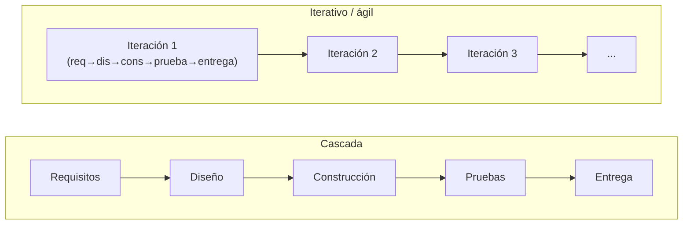
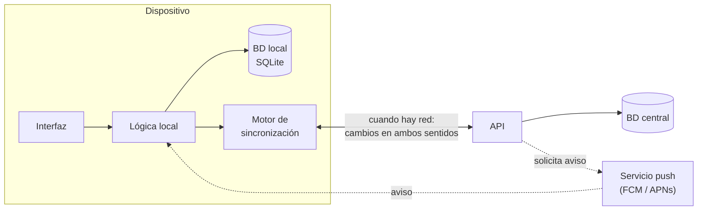

# Digitalizar de extremo a extremo: ciclos de vida, ley de Conway y el caso móvil

## Conclusión primero

Digitalizar "de extremo a extremo" significa que el dato fluye sin cortes desde donde se produce
(un sensor, un cliente que pulsa "comprar") hasta donde se decide con él (una factura, un cuadro de
mando, un modelo de predicción). Las ventajas son grandes y bien conocidas; lo que no es obvio es que
**conseguirlo es un problema de organización y de método tanto como de tecnología**: hay que elegir
cómo se construye (de golpe o por iteraciones), y el resultado reproducirá la estructura de quien lo
construya. Y cuando uno de los extremos es un dispositivo que no siempre está conectado, la
arquitectura clásica cliente/servidor deja de encajar.

## Ventajas de digitalizar de extremo a extremo

Comparado con una empresa en el peldaño 3 de la escalera de
[01](01-que-es-digitalizar.md), donde cada departamento tiene su propio sistema:

| Ventaja | Qué significa en concreto | Qué la hace posible |
|---|---|---|
| **Dato único** (*single source of truth*) | El peso de la báscula es el mismo número en producción, en almacén y en la factura | Integración: cada dato se captura una vez y el resto lo consulta |
| **Sin reintroducción** | Nadie teclea en el ERP lo que ya está en el SCADA | Conectores, APIs, MES |
| **Trazabilidad** | De una lata se sabe de qué captura salió, en qué línea se envasó y a quién se vendió | Identificadores que se propagan de sistema en sistema |
| **Visibilidad en tiempo real** | Dirección ve qué produce cada línea ahora, no en el informe del mes | Datos de planta que llegan a IT sin retardo |
| **Automatización de flujos** | Un pedido web genera la orden de fabricación, reserva material y programa el transporte sin intervención | Reglas de negocio ejecutadas sobre datos integrados |
| **Base para analítica e IA** | Predecir demanda, detectar fallos, optimizar rutas | Histórico completo, limpio y unido (ver [08](08-ia-datos-sectores-lenguajes.md)) |
| **Mejor servicio** | El cliente ve el estado de su pedido; soporte ve el historial completo | Datos compartidos entre departamentos |
| **Menos errores y menos coste** | Cada reintroducción eliminada es un error posible menos y horas que se recuperan | Todo lo anterior |

Y los riesgos, que también hay que saber argumentar:

- **Proyectos que fracasan a lo grande.** Lidl abandonó en 2018 la implantación de SAP tras siete
  años y unos 500 millones de euros; Hershey's perdió la campaña de Halloween de 1999 por un ERP que
  no llegó a tiempo; Revlon tuvo que explicar a sus accionistas en 2018 que no podía servir pedidos
  por una migración fallida. El patrón común: implantación "de golpe" (*big bang*) de un sistema que
  exigía cambiar procesos de toda la empresa a la vez.
- **Acoplamiento.** Cuando todo está conectado, un fallo se propaga. Un ataque en IT para la planta
  (Colonial Pipeline, [03](03-it-y-ot.md)).
- **Dependencia de proveedor.** El sistema que lo integra todo es difícil de sustituir.
- **Rigidez.** Un proceso automatizado de punta a punta es más difícil de cambiar que uno con
  personas en medio que improvisan. Las excepciones que antes resolvía alguien "a ojo" ahora hay que
  programarlas.

La conclusión de la lista de riesgos es la pregunta del resto del apunte: **¿cómo se construye
esto sin que sea un *big bang*?**

## Ciclos de vida: cascada, iterativo, ágil — y por qué "no todo es ágil"

Un ciclo de vida es el orden en que se hacen las actividades de un proyecto de software (entender
qué se quiere, diseñar, construir, probar, entregar, mantener) y cuántas veces se repiten.

**Cascada** (*waterfall*): las fases en secuencia, cada una termina antes de empezar la siguiente.
Requisitos → diseño → implementación → pruebas → despliegue → mantenimiento. Winston Royce la
describió en 1970 en un artículo que la presentaba como *arriesgada* y proponía iterar; la industria
adoptó el diagrama y olvidó la advertencia. Variante formalizada: el **modelo en V** (cada fase de
construcción tiene enfrente su fase de prueba), habitual en automoción, aeronáutica y dispositivos
médicos.

**Iterativo e incremental**: construir una versión pequeña que funcione, aprender de ella, ampliar.
El **modelo en espiral** (Boehm, 1986) añade análisis de riesgos en cada vuelta.

**Ágil**: nombre paraguas (Manifiesto Ágil, 2001) para métodos iterativos con entregas frecuentes,
equipo autoorganizado y requisitos que se aceptan cambiantes. **Scrum** (iteraciones fijas de 1-4
semanas, *sprints*, con roles y ceremonias definidos) y **Kanban** (flujo continuo con límite de
trabajo en curso) son los más usados. **DevOps** y **entrega continua** llevan la iteración hasta el
despliegue: cada cambio pasa por integración y pruebas automáticas y puede llegar a producción el
mismo día.

**Cuándo encaja cada uno** — la parte que no se enseña en ningún otro módulo del ciclo, y la que se
pide argumentar en la sección 7 del informe:

| Favorece cascada / modelo en V | Favorece iterativo / ágil |
|---|---|
| Requisitos conocidos, estables y verificables (una norma, un contrato, una especificación de hardware) | Requisitos inciertos o que se descubren usando el producto |
| Coste del error muy alto e irreversible (un marcapasos, el control de un avión, una planta química) | Coste del error bajo y reversible (una web, una app interna) |
| Regulación que exige documentación completa antes de operar (sanidad, aeronáutica, trazabilidad alimentaria, defensa) | Sin regulación de proceso |
| Contrato a precio cerrado con un proveedor externo | Equipo interno o contrato por tiempo y materiales |
| Componentes físicos con plazos de fabricación largos | Todo es software |
| Cliente que no puede o no quiere participar cada dos semanas | Cliente disponible para revisar cada iteración |

Ejemplos aplicados: el sistema de trazabilidad sanitaria de una conservera tiene requisitos fijados
por reglamento y una auditoría que exige documentación previa: cascada o modelo en V para el núcleo
regulado. Su tienda online es puro iterativo: se lanza mínima y se mejora con lo que hacen los
usuarios. **La misma empresa, dos ciclos de vida** — y un informe de digitalización serio dice cuál
para qué.

La realidad de la industria es híbrida y tiene nombre propio irónico: *water-scrum-fall* — cascada en
la planificación de arriba (presupuesto anual, fechas comprometidas), Scrum en el equipo de
desarrollo, cascada otra vez en el despliegue (ventanas de cambio, comités). Los marcos de "ágil a
escala" (SAFe, LeSS) intentan reconciliarlo y reciben críticas por burocratizar lo que pretendían
aligerar. Saber que existen y por qué se discuten es suficiente.

**Ágil e IA en 2026.** Los agentes de código ([09](09-ia-para-el-desarrollo-de-software.md))
aceleran la iteración hasta el punto de que el cuello de botella pasa a ser *saber qué se quiere*.
De ahí que el *spec-driven development* — escribir primero una especificación detallada que el
agente implementa — esté recuperando un artefacto de aspecto "cascada" (la especificación previa)
dentro de un bucle rapidísimo de iteración. No es una vuelta a la cascada: es que el coste de
construir ha bajado tanto que vuelve a compensar pensar antes.

## La ley de Conway

> Las organizaciones que diseñan sistemas están condenadas a producir diseños que son copias de las
> estructuras de comunicación de esas organizaciones. — Melvin Conway, 1968.

Formulación práctica: **si cuatro equipos construyen un compilador, sale un compilador de cuatro
pasadas.** El sistema reproduce las fronteras de comunicación de quien lo construye, porque una
interfaz entre módulos solo puede ser tan buena como la conversación entre las personas que los
hacen.

Consecuencias directas para este módulo:

- Departamentos que no se hablan producen sistemas que no se integran. La ventaja "dato único" de la
  tabla anterior no se consigue con un conector: se consigue cuando comercial y almacén acuerdan qué
  es un "pedido". La tecnología llega después.
- Un equipo de "los de front" y otro de "los de back" produce una API que refleja la fricción entre
  ambos; un equipo por funcionalidad produce funcionalidades completas. Los **microservicios** son,
  en esencia, la ley de Conway aplicada deliberadamente: equipos pequeños y autónomos → servicios
  pequeños y autónomos (los "equipos de dos pizzas" de Amazon).
- **Maniobra inversa de Conway**: si se quiere una arquitectura concreta, organizar los equipos
  para que la produzcan. *Team Topologies* (2019) da el vocabulario actual: equipos alineados a un
  flujo de valor (*stream-aligned*), equipos de plataforma, equipos habilitadores y equipos de
  subsistema complicado.

Para el proyecto, la ley de Conway convierte el organigrama de la sección 1 del informe en un dato de
arquitectura: si la empresa tiene dos departamentos enfrentados, el sistema que se proponga tendrá
una frontera ahí, se quiera o no, y hay que decidir si se respeta o se cambia la organización
y quién podrá operar el resultado.

## El caso móvil: cuando un extremo no está siempre conectado

Una aplicación móvil parece el cliente perfecto de una arquitectura cliente/servidor: interfaz en el
dispositivo, datos en la API. En la práctica encaja mal, y entender por qué es el mejor ejercicio de
arquitectura del módulo.

**Qué rompe el modelo clásico:**

1. **Conectividad intermitente.** El usuario entra en un ascensor, en un túnel, en un almacén sin
   cobertura. Una app que muestra un error cada vez que no hay red es inservible. Por tanto tiene que
   funcionar con datos locales: una base de datos en el dispositivo (SQLite vía Room en Android, Core
   Data/SwiftData en iOS, Realm, Drift en Flutter).
2. **Sincronización y conflictos.** Si hay datos locales y datos en el servidor, hay que sincronizar,
   y si dos dispositivos modifican lo mismo sin conexión, hay conflicto. Estrategias: "gana la
   última escritura" (simple, pierde datos), registro de operaciones que se reproducen (*event
   log*), estructuras de datos que se fusionan sin conflicto (**CRDT**, usadas por Figma, Apple
   Notes, Automerge/Yjs). No hay solución universal; cada dominio tiene la suya.
3. **El servidor inicia conversaciones.** Las notificaciones *push* invierten el sentido: el
   servidor avisa al dispositivo. Técnicamente pasan por un servicio del fabricante (FCM de Google,
   APNs de Apple), así que hay un tercero en medio de la arquitectura.
4. **No se despliega cuando se quiere.** Una web se actualiza al instante para todos; una app pasa
   por la revisión de la tienda y luego los usuarios la actualizan cuando quieren. Durante meses
   conviven versiones distintas. La API tiene que ser **compatible hacia atrás** y estar versionada.
   Esto conecta directamente con el ciclo de vida: la entrega continua pura no existe en móvil.
5. **Recursos del dispositivo.** Batería, datos móviles, almacenamiento. Sincronizar todo cada
   segundo no es una opción.
6. **Cómputo local cada vez más capaz.** Modelos de IA en el dispositivo (reconocimiento de imagen,
   dictado, modelos de lenguaje pequeños) hacen que parte de la "inteligencia" viva en el cliente por
   privacidad y latencia (ver [UD2-04](../ud2-tecnologias-arquitectura/04-edge-fog-mist.md)).

**A qué se parece entonces:**

Se parece más a una **aplicación de escritorio con sincronización** que a un cliente ligero: tiene su
propia capa de datos, su propia lógica, y el servidor es un punto de encuentro, no la única fuente de
verdad en cada instante. Es el modelo que los correos electrónicos tienen desde los años 90 (el
cliente descarga, trabaja local, sincroniza) y el que la corriente *local-first* propone hoy para
cualquier aplicación.

**La analogía que un alumno de DAM ya conoce: Git.** Git es exactamente esta arquitectura. Cada
copia es completa y funciona sin red (*commit* local); la sincronización es explícita (*push*,
*pull*); los conflictos se detectan y se resuelven en el momento de fusionar (*merge*), no se evitan;
el servidor (GitHub) es un punto de encuentro, no el dueño de los datos. Quien entiende por qué Git
funciona así entiende por qué una app móvil bien hecha se parece a Git y no a un navegador.

**Consecuencia para el proyecto:** si la empresa elegida tiene un extremo móvil (repartidores,
operarios de planta con tableta, comerciales en ruta, clientes con app), la sección 5 del informe
tiene que decir qué datos viven en el dispositivo, cómo se sincronizan y qué pasa en conflicto. "Se
conecta a la API" no es una arquitectura.

## Para debatir

- Un hospital quiere digitalizar la historia clínica de punta a punta. ¿Cascada o ágil? ¿Para qué
  parte cada uno? ¿Qué pasa con la ley de Conway entre los servicios médicos que no se hablan?
- Una app de reparto: el repartidor marca "entregado" sin cobertura y, antes de que sincronice,
  el cliente cancela el pedido desde la web. ¿Qué gana? ¿Quién decide? ¿Es un problema técnico o de
  negocio?
- Un agente de IA puede generar en una tarde lo que antes llevaba un sprint. ¿Sigue teniendo sentido
  un sprint de dos semanas? ¿Qué parte del ciclo de vida se convierte en el cuello de botella?
- Buscar un fracaso reciente de implantación de software (ERP, sistema público, banca) y clasificar
  su causa: ¿ciclo de vida, organización, tecnología?
