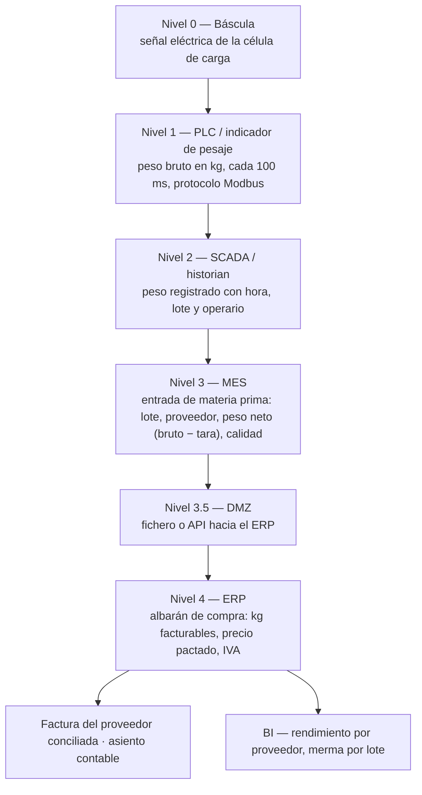
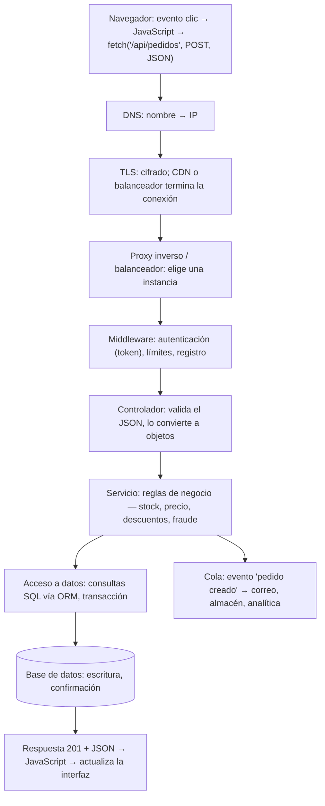

# Seguir un dato de punta a punta: la conexión IT/OT y su espejo en software

## Conclusión primero

La forma más eficaz de entender por qué importa conectar IT y OT — y de detectar dónde falla una
digitalización — es **elegir un dato y seguirlo** desde que nace en el mundo físico hasta que
aparece en una factura o en un cuadro de mando. En cada salto cambia de protocolo, de formato, de
dueño, de ritmo y, a menudo, de significado. Los puntos donde el dato se copia a mano, se pierde o
cambia de sentido sin que nadie lo sepa son los puntos donde la conexión IT/OT no existe. El mismo
ejercicio, aplicado a una petición HTTP, es la base de la observabilidad en software.

## Un dato físico hasta la factura

Una conservera recibe pescado. Un dato: **el peso de una partida**.

Lo que cambia en cada salto:

| Salto | Cambia | Ejemplo | Dónde se rompe |
|---|---|---|---|
| Sensor → PLC | Naturaleza: de señal analógica a número | 4-20 mA → 1 247,3 kg | Calibración: si la báscula deriva, el error entra en todos los sistemas aguas abajo |
| PLC → SCADA | Ritmo: de milisegundos a eventos | 10 lecturas/s → "pesada confirmada a las 06:42" | Decidir *cuál* de las lecturas es "el peso" es una regla de negocio escondida en OT |
| SCADA → MES | Contexto: se le añade lote, proveedor, operario | Un número → una entrada de materia prima | Si el operario elige el lote de una lista, el dato depende de que elija bien |
| MES → ERP | Semántica: de peso neto a peso facturable | Se descuenta hielo, agua, tara de cajas según acuerdo con cada proveedor | "Peso" ya son tres números distintos (bruto, neto, facturable) que se llaman igual |
| ERP → factura | Dueño: de operaciones a finanzas | Se concilia con la factura que envía el proveedor | Si el proveedor factura su peso y no el nuestro, hay disputa |
| ERP → BI | Agregación: de registro a indicador | Merma media por proveedor en el trimestre | Si el histórico tiene huecos (días sin sincronizar), el indicador miente |

**Dónde suele estar rota la conexión en una PYME real:**

- **El portapapeles.** El operario lee el peso en la pantalla del indicador y lo apunta en una hoja;
  alguien lo teclea en el ERP por la tarde. La frontera IT/OT es una persona. Consecuencias: errores
  de transcripción, retraso de horas, imposibilidad de saber el stock real a mediodía.
- **El CSV nocturno por FTP.** La báscula exporta un fichero a medianoche que un proceso importa al
  ERP. Mejor que el portapapeles, pero: si un peso se corrige después (recalibración), ¿el fichero
  de la noche siguiente lo sobreescribe o crea un duplicado? ¿Y si ya se ha facturado? Este caso
  concreto — la **corrección tardía** — es uno de los mejores ejercicios de modelado del módulo, y
  se retoma en [UD2-06](../ud2-tecnologias-arquitectura/06-dato-informacion-ciclo-de-vida.md):
  ¿se actualiza el dato histórico o se registra un evento nuevo?
- **Unidades y significados que nadie ha acordado.** La lonja habla en kg, planta en latas, comercial
  en cajas y palés, y el factor de conversión no es constante (merma de cocción, de frío). Los
  sistemas están "conectados" y aun así los números no cuadran.
- **Zonas horarias, calendarios, turnos.** El turno de noche produce a las 02:00 del día siguiente
  pero contabiliza en el día anterior. Cada sistema tiene su propia idea de "hoy".

**Qué se gana cuando la conexión existe:**

- Planificación con datos reales: el ERP programa la producción sabiendo qué hay en planta ahora,
  no ayer.
- Mantenimiento predictivo: solo es posible si las vibraciones y temperaturas de la máquina llegan a
  donde hay capacidad de análisis.
- Trazabilidad completa y automática, exigida por regulación en alimentación, farmacia, automoción.
- Costes reales por lote, por máquina, por turno — en vez de costes estándar estimados.
- Cierre de bucle: el negocio no solo *lee* la planta, también le *envía órdenes* (una orden de
  fabricación llega a la máquina sin que nadie la reescriba).

**Qué se arriesga:** desaparece el aislamiento. Cada conexión es una puerta, y la seguridad
industrial moderna (segmentación en zonas, DMZ, listas blancas de protocolos, monitorización pasiva)
existe para abrir puertas sin abrir la planta. La norma de referencia es **IEC 62443**; basta saber
que existe y que organiza la planta en zonas y conductos, como el modelo de Purdue de
[03](03-it-y-ot.md).

El **gemelo digital** (*digital twin*) es la versión ambiciosa de esta conexión: un modelo de la
máquina o de la planta que se alimenta continuamente de los datos de OT y sobre el que IT puede
simular ("¿qué pasa si subimos la velocidad de la línea un 10 %?") antes de tocar la realidad. Solo
tiene sentido si el flujo de datos de abajo arriba es completo y fiable.

## El espejo: una petición HTTP de punta a punta

El mismo ejercicio aplicado al software que un alumno de DAM construye. Un usuario pulsa "confirmar
pedido" en una tienda online:

La correspondencia con la cadena de la báscula es exacta:

| Cadena OT→IT | Cadena HTTP | Lo que cambia |
|---|---|---|
| Señal → número | Clic → JSON | Naturaleza |
| Modbus → OPC UA → API | HTTP → SQL → mensaje en cola | Protocolo |
| Peso → entrada de MP → albarán | JSON → objeto de dominio → fila → evento | Formato y semántica |
| Planta → operaciones → finanzas | Cliente → API → base de datos → otros servicios | Dueño |
| ms → eventos → días | ms en el navegador → transacción → correo minutos después | Ritmo |
| DMZ | "Nunca confíes en el cliente": validación en la frontera | Seguridad |

Y los puntos de rotura son los mismos:

- **La reintroducción.** El JavaScript calcula el total y lo envía; el servidor lo acepta sin
  recalcular. Es el portapapeles del operario: un dato que cruza la frontera sin verificación.
- **El proceso nocturno.** Un *cron* que sincroniza pedidos con el sistema de almacén cada hora. Si
  el pedido se cancela en ese intervalo, el almacén lo prepara igual. Es el CSV por FTP.
- **Significados distintos.** "Pedido confirmado" en la tienda, "pedido pagado" en la pasarela,
  "pedido en preparación" en almacén: tres estados que en cada sistema se llaman "pedido" y que
  no coinciden.

## Observabilidad: la trazabilidad del software

En OT, seguir el dato se llama trazabilidad y lo exige la regulación. En software se llama
**observabilidad** y lo exige la realidad de operar un sistema distribuido. Tres pilares:

- **Logs**: qué pasó, en texto, en cada componente.
- **Métricas**: cuánto y con qué frecuencia (peticiones por segundo, latencia, errores).
- **Trazas** (*traces*): el recorrido de **una** petición a través de todos los componentes, unido
  por un identificador que se propaga (*trace ID*). Es literalmente "seguir el dato de punta a
  punta". El estándar abierto es **OpenTelemetry**; herramientas: Jaeger, Grafana Tempo, Datadog,
  y los servicios de cada nube.

Sin trazas, un microservicio lento se busca a ciegas entre veinte; con trazas, se ve en qué salto se
fue el tiempo. Es la misma pregunta que hace el responsable de calidad cuando una partida sale mal:
¿en qué paso se estropeó?

Para el proyecto, la parte de integración mejora mucho si incluye un diagrama como los de este
apunte para un dato concreto de la empresa elegida: dónde nace, por dónde pasa, qué sistema lo
transforma, dónde se copia a mano hoy y dónde dejaría de copiarse.

## Para debatir

- Elegir un dato de un trabajo, un comercio o del propio instituto (una nota, una falta de
  asistencia, una compra) y dibujar su recorrido completo. ¿Cuántas veces se teclea? ¿Cuántos
  sistemas lo tocan? ¿Cambia de nombre por el camino?
- Si la báscula corrige un peso después de facturar, ¿qué debe pasar? Comparar "modificar el
  registro" con "añadir un evento de corrección". ¿Qué prefiere finanzas? ¿Y calidad? ¿Y un
  desarrollador que tiene que reproducir un error?
- En una API, ¿dónde se pone el *trace ID*? ¿Sobrevive al paso por una cola de mensajes? ¿Y a una
  llamada a un proveedor externo de LLM?
