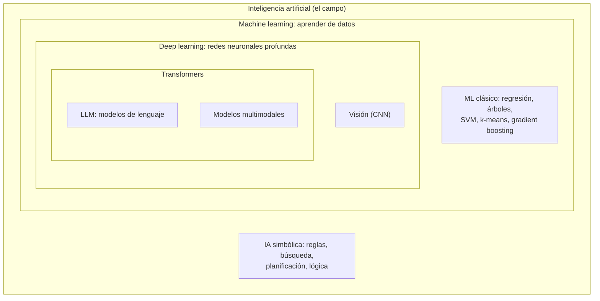

# Qué es "la IA": IA clásica, Machine Learning, Deep Learning, LLM

## Conclusión primero

"Inteligencia artificial" es un término paraguas que ha cambiado de contenido cada década. Hoy, en
una conversación corriente, "la IA" significa casi siempre un **modelo de lenguaje** (un LLM) o un
producto construido sobre uno; en un artículo académico significa un campo de setenta años; en el
envase de una lavadora significa poco. Para un desarrollador, la distinción que importa no es la de
las siglas sino la de **cómo se comporta el software**: el software tradicional ejecuta reglas
escritas por alguien y es determinista; un modelo de *machine learning* ha aprendido una función a
partir de datos y es estadístico; un LLM es un caso particular que produce texto y tiene propiedades
(no determinismo, alucinación, sensibilidad al contexto) que cambian cómo se diseña, se prueba y se
protege una aplicación.

## Setenta años en una tabla

| Época | Nombre | Qué era "la IA" | Ejemplo | Por qué se abandonó (o no) |
|---|---|---|---|---|
| 1956-1980 | IA simbólica, "GOFAI" (*good old-fashioned AI*) | Manipulación de símbolos y reglas lógicas escritas a mano; búsqueda en espacios de estados | Sistemas expertos (MYCIN, diagnóstico médico con reglas *si-entonces*), Prolog, LISP, ajedrez por búsqueda | Las reglas no escalan al mundo real; "invierno de la IA" (dos veces, años 70 y finales de los 80) |
| 1990-2010 | *Machine learning* estadístico | Aprender una función de los datos en vez de escribir reglas | Filtros de spam, máquinas de vectores soporte, árboles de decisión, *random forests*, recomendadores | No se abandonó: sigue siendo la mayor parte de la IA en producción |
| 2012-2017 | *Deep learning* | Redes neuronales profundas entrenadas con GPU sobre grandes conjuntos de datos | AlexNet (2012, visión), reconocimiento de voz, traducción automática | Idem |
| 2017-2022 | Transformers, modelos preentrenados | Una arquitectura (el *transformer*, 2017) que escala con datos y cómputo; modelos de lenguaje cada vez mayores | BERT, GPT-2, GPT-3 (2020) | — |
| 2022-2024 | IA generativa, LLM | Modelos que producen texto, imagen, código; ChatGPT (noviembre 2022) los hace de uso público | ChatGPT, Claude, Gemini, Llama, Stable Diffusion | — |
| 2024-2026 | Agentes, modelos con razonamiento, multimodalidad | LLM que usan herramientas en bucle; modelos que "piensan" antes de responder; texto, imagen, audio y vídeo en el mismo modelo | Agentes de código, asistentes que navegan y ejecutan tareas | Es el presente |

Dos observaciones sobre la tabla:

- **El "efecto IA"**: cuando algo funciona, deja de llamarse IA. El ajedrez, el OCR, el cálculo de
  rutas en un GPS, el filtro de spam fueron IA y hoy son "software". Dentro de unos años, el
  autocompletado de código será "el editor". El término siempre señala la frontera de lo que aún
  sorprende.
- **La IA clásica no ha desaparecido.** El planificador de rutas de un almacén, el motor de reglas
  de una aseguradora, la búsqueda de un motor de ajedrez siguen siendo IA simbólica y siguen siendo
  la herramienta correcta para sus problemas. Un LLM no sustituye a un algoritmo de optimización; en
  todo caso lo llama.

## Las siglas anidadas, y las que no lo están

- **IA** es el campo: hacer que las máquinas realicen tareas que asociamos con la inteligencia. Es
  una definición circular a propósito; nadie tiene otra mejor.
- **Machine learning** (ML, aprendizaje automático): el subcampo en el que el comportamiento se
  *aprende* de datos en vez de programarse. Un programa de ML no es un programa que sabe clasificar
  gatos: es un programa que, dados muchos ejemplos etiquetados, produce otro programa (el modelo)
  que clasifica gatos.
- **Deep learning** (DL, aprendizaje profundo): ML con redes neuronales de muchas capas. Su ventaja
  es que aprende las características relevantes por sí mismo (no hay que decirle qué mirar en la
  imagen). Su coste es que necesita muchos más datos y cómputo.
- **LLM** (*large language model*): una red neuronal de tipo *transformer* entrenada para predecir
  el siguiente fragmento de texto (*token*) dada una secuencia. De ese objetivo aparentemente tonto
  emergen la capacidad de conversar, resumir, traducir, programar. GPT, Claude, Gemini, Llama,
  Mistral, Qwen, DeepSeek son LLM.

Y lo que **no** está anidado, y suele confundirse:

- **Big Data** no es IA. Es un conjunto de tecnologías y prácticas para almacenar y procesar datos
  que no caben en una máquina (ver [08](08-ia-datos-sectores-lenguajes.md)). La IA moderna necesita
  Big Data para entrenarse; Big Data no necesita IA para existir — un informe de ventas agregado
  sobre diez mil millones de filas es Big Data sin una sola neurona.
- **Análisis de datos / ciencia de datos** no es IA. Es la disciplina de extraer conclusiones de
  datos, con estadística, visualización, consultas y, cuando conviene, modelos de ML. Un `GROUP BY`
  en SQL es análisis de datos. Un contraste de hipótesis es análisis de datos. Ninguno es IA (ver
  [UD2-07](../ud2-tecnologias-arquitectura/07-ciencia-de-datos.md)).
- **Estadística** y ML se solapan tanto que la diferencia es en parte de tribu: la regresión lineal
  es estadística de 1805 y también el primer algoritmo de cualquier curso de ML.

Relación honesta entre las cuatro, en una frase cada una: **Big Data** es la infraestructura que
permite tener los datos; **el análisis de datos** es lo que se hace con ellos para entenderlos; **el
ML/DL** es un conjunto de técnicas de análisis que producen modelos predictivos; **la IA** es el
campo que engloba esas técnicas y otras (simbólicas) con el objetivo de automatizar tareas
cognitivas. En una empresa real, los cuatro términos los usa el mismo departamento sobre los mismos
datos, y la etiqueta que elige depende del presupuesto que quiere pedir.

## Software determinista frente a modelo de ML frente a LLM

Esta es la distinción que un desarrollador necesita, porque cambia cómo se prueba, se depura y se
protege una aplicación.

| | Software tradicional | Modelo de ML clásico | LLM |
|---|---|---|---|
| **Cómo se construye** | Se programa: alguien escribe las reglas | Se entrena: se ajustan parámetros con datos etiquetados | Se preentrena con texto masivo, luego se ajusta con ejemplos y preferencias humanas |
| **Mismo input → mismo output** | Sí, por definición | Sí, una vez entrenado (la inferencia es determinista) | En la práctica no: se muestrea con aleatoriedad (*temperatura*); incluso a temperatura 0 hay variación por detalles numéricos del hardware y el procesamiento en lote |
| **Por qué da esa salida** | Se puede leer el código | Parcialmente explicable (importancia de variables, árboles) o casi nada (redes profundas) | No explicable como una traza de ejecución; se puede pedir que "razone" y hay técnicas de interpretabilidad útiles, pero ese texto no garantiza por sí mismo rigor causal |
| **Qué pasa fuera de lo previsto** | Error, excepción, comportamiento definido | Predicción de baja calidad, a menudo sin aviso (*fuera de distribución*) | Produce texto plausible aunque sea falso: **alucinación**, que es una propiedad estructural, no un fallo corregible |
| **Cómo se prueba** | Pruebas unitarias: entrada conocida, salida esperada | Métricas sobre un conjunto de prueba: precisión, *recall*, error | **Evaluaciones** (*evals*): conjuntos de casos con criterios de calidad, a menudo juzgados por otro LLM; no hay "la salida correcta" sino "salidas aceptables" |
| **Cómo se cambia** | Se edita el código | Se reentrena con más o mejores datos | Se cambia el *prompt*, el contexto que se le da (RAG), las herramientas, o se ajusta (*fine-tuning*) |
| **Coste por ejecución** | Despreciable | Bajo | Significativo y proporcional al texto (ver [UD2-02](../ud2-tecnologias-arquitectura/02-sostenibilidad-coste-y-mercados.md)) |
| **Memoria entre ejecuciones** | La que se programe | Ninguna | **Ninguna**: cada llamada empieza de cero; "recordar" es reenviar la conversación entera en cada petición |
| **Superficie de ataque** | Inyección SQL, XSS, etc. | Envenenamiento de datos de entrenamiento, ejemplos adversarios | Inyección de *prompt*, fuga de instrucciones, uso indebido de herramientas ([10](10-seguridad-y-regulacion.md)) |

La fila "memoria" merece énfasis porque contradice la intuición de quien usa un chat: el modelo no
recuerda nada. La aplicación de chat guarda el historial y lo reenvía completo cada vez; el "contexto"
(*context window*) es la cantidad máxima de texto que cabe en una petición, y cuando se llena, algo
se recorta. Toda la ingeniería alrededor de los LLM — RAG, resúmenes, memoria externa — existe para
gestionar esa limitación ([09](09-ia-para-el-desarrollo-de-software.md)).

**Qué es un LLM en tres frases técnicas.** Un modelo con miles de millones de parámetros (pesos
numéricos) que, dada una secuencia de *tokens* (fragmentos de palabra), calcula una distribución de
probabilidad sobre cuál es el siguiente. Generar una respuesta es repetir eso token a token,
eligiendo cada vez uno (el más probable o uno muestreado al azar según la temperatura) y añadiéndolo
a la secuencia. El "conocimiento" está comprimido en los pesos y se fijó en el momento del
entrenamiento (*fecha de corte*); todo lo posterior tiene que llegarle en el contexto.

## Taxonomía mínima del ML clásico

Para reconocer de qué habla alguien cuando dice "usamos IA":

- **Supervisado**: se aprende de ejemplos etiquetados. *Clasificación* (¿spam o no? ¿qué defecto
  tiene esta pieza?) y *regresión* (¿cuánto venderemos mañana? ¿cuánto vale esta casa?).
- **No supervisado**: sin etiquetas; se buscan estructuras. *Agrupamiento* (segmentar clientes),
  *reducción de dimensionalidad*, *detección de anomalías*.
- **Por refuerzo**: un agente aprende por prueba y error con recompensas. Juegos, robótica, control;
  y la fase final de entrenamiento de los LLM (aprendizaje por refuerzo con retroalimentación
  humana, RLHF).
- **Generativo** frente a **discriminativo**: un modelo discriminativo separa (esto es un gato);
  uno generativo produce (aquí tienes un gato). Los LLM y los modelos de imagen son generativos;
  la mayoría del ML en producción es discriminativo.

**Cuándo usar qué**, la decisión que se pide en la sección 9 del proyecto (herramienta de IA
aplicable, y cuándo no):

| Problema | Herramienta correcta | Por qué no un LLM |
|---|---|---|
| Decidir si conceder un crédito con 30 variables numéricas | Regla de negocio o *gradient boosting* sobre datos tabulares | Explicabilidad exigida por regulación; el LLM es peor con tablas y no es auditable |
| Detectar fraude en transacciones | ML clásico + reglas | Latencia de milisegundos, coste por transacción, determinismo |
| Predecir la demanda de la semana que viene | Series temporales (ARIMA, Prophet, *gradient boosting*) | El LLM no está hecho para eso |
| Clasificar 10 000 correos de soporte por tema | LLM (o un clasificador clásico si hay datos etiquetados y se quiere barato) | — |
| Extraer campos de facturas en PDF con formatos variados | LLM multimodal | La variedad de formatos mata a las reglas |
| Responder preguntas sobre la documentación interna | LLM con RAG | — |
| Optimizar la ruta de 40 furgonetas | Investigación operativa (algoritmos de optimización) | Es un problema matemático con solución óptima; un LLM inventaría una ruta plausible |
| Calcular el IVA de una factura | Código | Determinismo absoluto; un LLM se equivocará una vez de cada mil y no se sabrá cuál |

La última fila resume el criterio: **si el problema tiene una respuesta correcta calculable, se
calcula**. El LLM entra donde la entrada es lenguaje o imagen con variedad que no se puede
enumerar, y donde una respuesta aproximada revisable vale más que ninguna.

## Importancia presente y futura — con la medida justa

**Presente (2026).** La IA generativa está desplegada de forma masiva en tres ámbitos: asistencia al
trabajo del conocimiento (redacción, resumen, búsqueda), desarrollo de software (autocompletado,
agentes de código, revisión) y atención al cliente (chatbots con acceso a datos). En el ML clásico,
la implantación es más antigua y silenciosa: recomendación, publicidad, riesgo, logística, detección
de fraude, mantenimiento predictivo, inspección visual. La inversión en centros de datos y chips para
IA es la mayor de la historia de la industria tecnológica, y eso tiene una consecuencia directa en
el coste de la energía y en el debate sobre sostenibilidad
([UD2-02](../ud2-tecnologias-arquitectura/02-sostenibilidad-coste-y-mercados.md)).

**Futuro.** Tres posiciones que conviene saber argumentar, porque las tres se defienden en serio:

1. *Aceleración*: los agentes harán fracciones crecientes del trabajo cognitivo; la ciencia se
   acelera (AlphaFold, Nobel de Química 2024, predice estructuras de proteínas); el desarrollo de
   software cambia de oficio.
2. *Meseta*: los modelos mejoran cada vez menos por unidad de coste; las alucinaciones no
   desaparecen; el valor real se concentra en aplicaciones concretas y la inversión actual es una
   burbuja parcial, como la de las telecomunicaciones en 2000 (que también dejó fibra útil).
3. *Riesgos*: concentración de poder en pocas empresas, desinformación, impacto laboral, uso
   militar, y los riesgos regulatorios que la UE intenta acotar con el AI Act
   ([10](10-seguridad-y-regulacion.md)).

Para un futuro desarrollador, la posición razonable es práctica: las herramientas existen, se usan
en la industria, y el trabajo se desplaza de *escribir* hacia *especificar, revisar y decidir*. Lo
que no cambia es que hay que entender lo que se revisa. Este módulo asume esa posición y la
desarrolla en [09](09-ia-para-el-desarrollo-de-software.md).

## Para debatir

- "Nuestro termostato tiene IA." ¿Qué probabilidad hay de que sea un LLM, un modelo de ML clásico,
  una regla *si-entonces* o marketing? ¿Cómo se sabría?
- Un motor de ajedrez de 1997 vencía al campeón del mundo. ¿Era IA entonces? ¿Lo es ahora? ¿Qué
  dice eso sobre el término?
- Una empresa dice "usamos IA para detectar fraude" y en realidad usa un árbol de decisión entrenado
  en 2015. ¿Miente? ¿Cambiaría la respuesta si lo dijera en 2015?
- Si un LLM da una respuesta distinta cada vez, ¿cómo se hace una prueba unitaria de una función que
  lo llama? ¿Qué se prueba realmente?
- ¿En qué tarea concreta del propio ciclo formativo un LLM es claramente la herramienta correcta, y
  en cuál es claramente la incorrecta?
