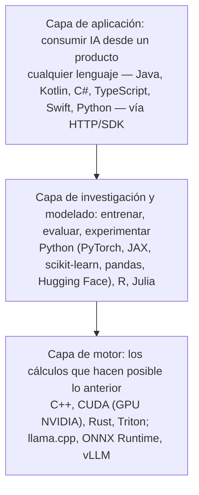

# IA y datos: por qué la IA necesita datos, dónde se aplica y con qué se programa

## Conclusión primero

Un modelo de *machine learning* es una función aprendida de datos: sin datos no hay modelo, con
datos malos hay un modelo malo, y con más datos (hasta cierto punto) hay un modelo mejor. Por eso la
IA moderna llegó *después* del Big Data y no antes, y por eso la ventaja competitiva de una empresa
en IA suele ser sus datos y no su algoritmo. La rentabilidad no viene de "tener IA" sino de tres
mecanismos concretos: predecir mejor (menos stock, menos paradas, menos fraude), automatizar tareas
de coste alto y personalizar a escala. Y el lenguaje de programación con el que se hace todo esto es
casi siempre Python en la capa visible, y C++/CUDA en el motor que nadie ve; pero *consumir* IA desde
una aplicación se hace en cualquier lenguaje, con una llamada HTTP.

## Por qué la IA necesita datos

**El mecanismo.** Entrenar un modelo es ajustar millones (o billones) de parámetros para que su
salida se parezca a los ejemplos. Cada ejemplo aporta información; con pocos ejemplos el modelo
memoriza en vez de generalizar (*sobreajuste*); con muchos y variados, aprende patrones que
funcionan con datos nuevos. En *deep learning* esto se ha cuantificado: el rendimiento mejora de
forma predecible con el tamaño del modelo, la cantidad de datos y el cómputo (**leyes de escala**,
2020). Los LLM actuales se entrenan con billones de tokens — una fracción sustancial de todo el texto
público de Internet — y ya hay debate sobre qué pasa cuando ese texto se agota o se contamina con
salidas de otros modelos.

**Los matices que un desarrollador debe conocer:**

- **Calidad antes que cantidad.** Un millón de registros con etiquetas mal puestas produce un modelo
  que aprende los errores. En ML clásico, la mayor parte del tiempo de un proyecto se va en limpiar
  datos ([UD2-07](../ud2-tecnologias-arquitectura/07-ciencia-de-datos.md)).
- **Rendimientos decrecientes.** Doblar los datos no dobla la calidad. A partir de cierto punto,
  más datos del mismo tipo no aportan; hacen falta datos *distintos*.
- **Sesgo.** El modelo aprende lo que hay en los datos, incluidas las injusticias históricas. Un
  modelo de selección de personal entrenado con las contrataciones pasadas de una empresa reproduce
  sus preferencias pasadas. Esto es lo que el AI Act clasifica como alto riesgo
  ([10](10-seguridad-y-regulacion.md)).
- **No todo problema necesita entrenar.** Con los LLM, la mayoría de las empresas no entrenan nada:
  usan un modelo ya entrenado y le dan *sus* datos en el contexto (RAG) o lo ajustan ligeramente
  (*fine-tuning*). Los datos siguen siendo la clave, pero la relación cambia: de "datos para
  entrenar" a "datos para consultar".

**El volante de datos** (*data flywheel*): más usuarios → más datos → mejor modelo → mejor producto
→ más usuarios. Es el mecanismo por el que los líderes en recomendación, búsqueda o mapas se
consolidan, y es el motivo por el que "los datos son el nuevo petróleo" se convirtió en lema. La
crítica al lema es igual de importante: el petróleo se consume y los datos no; el petróleo vale
bruto y los datos solo refinados; el petróleo no lleva datos personales y no genera obligaciones
legales por el mero hecho de almacenarlo ([10](10-seguridad-y-regulacion.md)). Almacenar datos que
no se usan no es un activo: es un coste y un riesgo.

## Cómo se convierte en rentabilidad

| Mecanismo | Ejemplo | Dónde está el dinero |
|---|---|---|
| **Predecir mejor** | Previsión de demanda en retail y distribución | Menos stock inmovilizado, menos roturas de stock, menos caducados |
| | Mantenimiento predictivo en planta | Cada hora de parada no planificada evitada en una línea de envasado o una turbina |
| | Detección de fraude en pagos | Cada transacción fraudulenta bloqueada; cada legítima no bloqueada por error |
| | Predicción de abandono (*churn*) | Retener a un cliente cuesta menos que captar uno nuevo |
| **Automatizar** | Clasificación y respuesta de tickets de soporte | Horas de agente por ticket |
| | Extracción de datos de documentos (facturas, contratos) | Horas de administrativo por documento |
| | Generación y revisión de código | Ver [09](09-ia-para-el-desarrollo-de-software.md) |
| **Personalizar** | Recomendación de productos y contenidos | Una parte relevante de las ventas de las grandes plataformas viene de recomendaciones |
| | Precios dinámicos | Margen por unidad en función de demanda y competencia |
| | Publicidad dirigida | El modelo de negocio entero de Google y Meta |

Lo que separa el discurso de la realidad: la rentabilidad exige que exista un **proceso que actúe
sobre la predicción**. Predecir que una máquina fallará el jueves no vale nada si mantenimiento no
tiene una ventana el miércoles ni la pieza en almacén. La IA es el último eslabón de la cadena de
extremo a extremo de [05](05-ciclos-de-vida-conway-y-el-caso-movil.md); sin los eslabones anteriores
(datos integrados, procesos definidos) es un proyecto piloto que no sale del piloto — el destino de
una parte importante de los proyectos de IA en empresas, según cualquier consultora que se consulte.

## Las características de Big Data

El término mismo ha pasado de moda aunque la tecnología no. "Big Data" se definió en torno a las
**V**:

| V | Qué mide | Ejemplo |
|---|---|---|
| **Volumen** | Cantidad: no cabe en una máquina | Los registros de acceso de un sitio web grande: terabytes al día |
| **Velocidad** | Ritmo de llegada y de respuesta exigida | Lecturas de sensores de una planta; transacciones de tarjeta que hay que aprobar en 100 ms |
| **Variedad** | Formatos heterogéneos: tablas, texto, imagen, logs, vídeo | Correos, PDF, fotos de incidencias y la base de datos del ERP, juntos |
| **Veracidad** | Fiabilidad, ruido, incoherencia | Sensores descalibrados, formularios mal rellenados |
| **Valor** | Lo que se puede extraer | La única V que importa al negocio, y la que justifica las otras cuatro |

Las tres primeras son la definición original (Gartner, 2001); veracidad y valor se añadieron después;
hay listas de 7 o 10 V que añaden variabilidad, visualización, etc. — inflación terminológica. Lo
importante es entender que "big" es **relativo a las herramientas**: un CSV de 10 GB no es Big Data
(cabe en un portátil con pandas o DuckDB); 10 TB diarios de logs sí, porque exige almacenamiento y
procesamiento distribuidos (Hadoop en 2010, Spark desde 2014, hoy almacenes en la nube como
BigQuery, Snowflake o Databricks). La palabra pasó de moda hacia 2018 precisamente porque la nube
hizo que lo "grande" dejara de ser un problema especial: hoy se dice "datos", "plataforma de datos"
o "*lakehouse*", y el contenido es el mismo ([UD2-08](../ud2-tecnologias-arquitectura/08-almacenamiento-y-cloud-computing.md)).

## Sectores con implantación más relevante

Ordenados aproximadamente por madurez de la implantación (no por titulares). Los informes anuales de
referencia son el *AI Index* de Stanford y las encuestas de McKinsey; las posiciones relativas son
estables desde hace años.

| Sector | Aplicaciones consolidadas | Aplicaciones en despliegue (2024-2026) |
|---|---|---|
| **Tecnología y software** | Búsqueda, recomendación, publicidad, moderación de contenido | Agentes de código, asistentes en todos los productos |
| **Finanzas y seguros** | Detección de fraude, *scoring* de crédito, *trading* algorítmico, tarificación | Asistentes de atención, análisis de documentos, cumplimiento normativo |
| **Comercio y distribución** | Recomendación, previsión de demanda, optimización logística, precios dinámicos | Búsqueda conversacional, generación de fichas de producto |
| **Sanidad y farmacia** | Análisis de imagen (radiología, dermatología), descubrimiento de fármacos | Resumen de historias clínicas, transcripción de consultas, apoyo al diagnóstico (regulado como alto riesgo) |
| **Industria manufacturera** | Inspección visual, mantenimiento predictivo, control de calidad, planificación | Asistentes para operarios, gemelos digitales con IA |
| **Automoción y transporte** | Asistencia a la conducción (ADAS), optimización de rutas, gestión de flotas | Conducción autónoma (con despliegue comercial limitado a ciudades concretas) |
| **Marketing y medios** | Segmentación, atribución, personalización | Generación de contenido, doblaje, edición |
| **Telecomunicaciones** | Optimización de red, detección de averías, *churn* | Atención al cliente automatizada |
| **Energía** | Previsión de demanda y generación renovable, gestión de red | Optimización de centros de datos (la IA optimizando su propio consumo) |
| **Agricultura** | Visión para clasificar fruta, riego de precisión | Robots de recolección |
| **Servicios profesionales y legal** | Revisión documental, búsqueda | Redacción asistida, análisis de contratos |
| **Administración pública** | Detección de fraude fiscal, gestión de colas | Asistentes ciudadanos (con requisitos de transparencia del AI Act) |

Para el sector del título — desarrollo de software — la implantación es la más profunda de todas,
porque el propio proceso de producción se ha transformado ([09](09-ia-para-el-desarrollo-de-software.md)).

## Lenguajes de programación en IA

Hay que distinguir tres capas, porque la respuesta "Python" es verdad y es incompleta:

| Lenguaje | Papel | Dónde se ve |
|---|---|---|
| **Python** | Lengua franca del modelado. No es rápido: es el pegamento que llama a bibliotecas escritas en C++/CUDA | PyTorch, TensorFlow/Keras, JAX, scikit-learn, pandas, NumPy, Hugging Face Transformers, LangChain, notebooks |
| **C++ / CUDA** | El motor. CUDA es la plataforma de NVIDIA para programar GPU; casi todo el *deep learning* corre sobre ella | Núcleo de PyTorch, TensorRT, llama.cpp (inferencia de LLM en CPU/GPU de consumo) |
| **Rust** | Sustituyendo a C++ en herramientas nuevas por seguridad de memoria | Tokenizadores de Hugging Face, motores de inferencia (Candle), bases de datos vectoriales (Qdrant) |
| **R** | Estadística académica y bioestadística; perdiendo terreno frente a Python fuera de esos nichos | Análisis, visualización (ggplot2) |
| **Julia** | Cómputo científico de alto rendimiento con sintaxis cómoda; comunidad pequeña | Simulación, optimización |
| **SQL** | Imprescindible: los datos viven en bases de datos; y los almacenes en la nube ejecutan ML dentro de SQL | BigQuery ML, Snowflake, DuckDB |
| **Java / Scala** | Ecosistema de Big Data (Spark está escrito en Scala); ML en empresas Java (DJL, Spring AI) | Pipelines, integración de LLM en aplicaciones empresariales |
| **JavaScript / TypeScript** | Aplicaciones sobre LLM (la capa de aplicación más habitual junto a Python); modelos en el navegador | Vercel AI SDK, LangChain.js, TensorFlow.js, ONNX Runtime Web, Transformers.js |
| **Kotlin / Swift** | IA en el dispositivo móvil | ML Kit, Core ML, modelos locales en la app |
| **Mojo** | Intento (2023) de un superconjunto de Python con rendimiento de C; por ver | — |
| **LISP, Prolog** | Los lenguajes de la IA simbólica; hoy históricos, pero Prolog sigue en motores de reglas y en docencia | — |

**Lo que esto significa para un alumno de DAM:** no hace falta cambiar de lenguaje para "hacer IA".
Integrar un LLM en una aplicación Kotlin, Java o C# es una llamada HTTP a una API (o un SDK
oficial), con las mismas técnicas que cualquier otra integración: manejo de errores, tiempos de
espera, reintentos, coste, y las cautelas específicas de [10](10-seguridad-y-regulacion.md). La
"ingeniería de IA" (*AI engineering*) de 2024-2026 es en gran medida desarrollo backend ordinario
alrededor de un componente no determinista. Python aparece cuando hay que entrenar, evaluar o
analizar datos — y es fácil de añadir a un perfil de DAM.

**¿Y el *prompt* es un lenguaje de programación?** No en sentido estricto: no tiene sintaxis formal
ni semántica definida, y el mismo texto produce resultados distintos con modelos distintos. Pero
hay un continuo: los *prompts* se versionan, se prueban y se componen como código; hay bibliotecas
(DSPy) que los optimizan automáticamente; y las **salidas estructuradas** (pedir JSON con un esquema)
convierten la respuesta del modelo en algo que el código puede procesar de forma fiable. La posición
razonable: el *prompt* no es código, pero se gestiona como código.

## Para debatir

- Una PYME con 8 años de historial de ventas en un ERP quiere "poner IA para predecir ventas".
  ¿Qué pregunta hay que hacer antes de aceptar el encargo? ¿Y qué proyecto es en realidad?
- Si los LLM se han entrenado con "todo Internet", ¿por qué siguen necesitando *los datos de la
  empresa*? ¿Qué relación con los datos es esa?
- "Python es lento, así que la IA debería hacerse en C++." Argumentar por qué esa frase es y no es
  verdad.
- Buscar un producto que anuncie "con IA" y clasificar en qué sector está, qué tipo de modelo
  probablemente usa y qué datos ha necesitado. ¿Podría hacerse sin esos datos?
