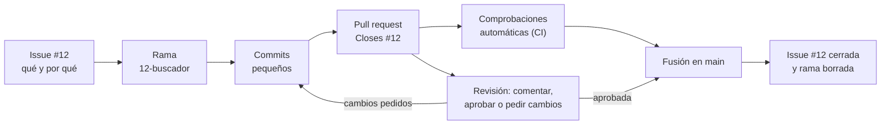

# Trabajar en equipo con GitHub: *issues*, ramas, *pull requests* y revisión

## Conclusión primero

Git guarda la historia del código; una plataforma como GitHub añade encima la capa con la que un **equipo** se coordina: la ***issue*** dice qué hay que hacer y por qué, la **rama** aísla el trabajo mientras se hace, la ***pull request*** (PR) propone el cambio para que otros lo discutan, lo revisen y lo prueben, y la **fusión** lo incorpora. Es la digitalización del proceso de trabajo del propio sector ([01](01-que-es-digitalizar.md)): el estado de cada tarea deja de vivir en la cabeza de alguien y pasa a ser un dato que se consulta. Y desde 2025 es también la puerta por la que los agentes de IA entran en un equipo ([09](09-ia-para-el-desarrollo-de-software.md)): reciben una *issue* y devuelven una *pull request*, así que lo que entregan vale lo que valgan la *issue* — la especificación — y la revisión que se haga después.

## Git y la plataforma: dos capas

| Capa | Qué aporta | Dónde vive | Ejemplos |
| --- | --- | --- | --- |
| **Git** | Historia de versiones: *commits*, ramas, fusiones. Funciona sin red | En cada copia del repositorio | `git commit`, `git switch`, `git merge` |
| **Plataforma** | Alojamiento compartido y la capa de colaboración: *issues*, *pull requests*, revisión, permisos, automatización | En un servidor | GitHub, GitLab, Bitbucket, Gitea o Forgejo |

La distinción importa porque Git es distribuido — cada copia es completa, la analogía del caso móvil de [05](05-ciclos-de-vida-conway-y-el-caso-movil.md) — pero la colaboración no lo es: las *issues*, las *pull requests* y sus comentarios existen solo en la plataforma. Clonar un proyecto trae su código y su historia, no sus discusiones.

Los nombres se mueven entre plataformas. Lo que GitHub llama *pull request* (pedir al dueño del repositorio que "tire" de tu rama) GitLab lo llama *merge request* (pedir que se fusione), y es lo mismo. "Repositorio" puede ser la carpeta `.git` local, el proyecto en GitHub o, en una conversación, el proyecto entero con sus *issues*.

## El flujo: de la *issue* a la fusión



| Pieza | Qué es | Buena práctica |
| --- | --- | --- |
| ***Issue*** | Unidad de trabajo con número (`#12`): una tarea, un fallo o una propuesta, con su discusión | Título concreto; qué se quiere y por qué; **criterios de aceptación** comprobables; etiquetas y persona asignada |
| **Rama** | Línea de trabajo aislada, creada a partir de `main` | Una por *issue*, de vida corta, con un nombre que la identifique (`12-buscador-por-nombre`) |
| ***Commit*** | Una instantánea del cambio con su mensaje | Pequeño y con sentido propio; el mensaje explica *por qué*, porque el *diff* ya dice *qué* |
| ***Pull request*** | Propuesta de fusionar una rama en otra, con el *diff*, la conversación y las comprobaciones | Descripción con qué cambia, por qué y cómo se ha probado; `Closes #12` para enlazar la *issue* y cerrarla al fusionar; pequeña, para que se pueda revisar |
| **Revisión** | Lectura del *diff* por otra persona: comentarios en líneas concretas y un veredicto (comentar, aprobar o pedir cambios) | Comentarios concretos y verificables; revisar el comportamiento y los casos límite, no solo el estilo |
| **Comprobaciones (CI)** | Pruebas, *linter* y compilación que se ejecutan solos en cada *push*, por ejemplo con GitHub Actions | Obligatorias para fusionar: es la integración continua de [01](01-que-es-digitalizar.md) |
| **Fusión** | Incorporar la rama a `main` | Solo con la revisión aprobada y las comprobaciones en verde; `main` protegida con reglas de la plataforma |

Las palabras que enlazan y cierran una *issue* son `close`, `fix` y `resolve` con sus variantes (`Closes #12`, `Fixes #12`, `Resolves #12`), y cierran la *issue* cuando la *pull request* se fusiona en la rama por defecto. Al fusionar se elige también cómo queda la historia: un *commit* de fusión que conserva los de la rama, o *squash*, que los junta en uno. Si dos ramas cambiaron las mismas líneas hay **conflicto**, y se resuelve a mano en ese momento, como se vio en [05](05-ciclos-de-vida-conway-y-el-caso-movil.md).

**Rama o *fork*.** Dentro del propio equipo, cada uno crea ramas en el repositorio común. Para contribuir a un proyecto ajeno en el que no se tiene permiso de escritura — el caso del software libre —, se hace un *fork* (una copia del repositorio en la cuenta propia), se trabaja en una rama del *fork* y se abre la *pull request* hacia el repositorio original. El flujo de revisión es el mismo.

## Por qué el sector trabaja así

Cada pieza del flujo responde a una idea de apuntes anteriores:

| Idea | Dónde se vio | Cómo aparece en el flujo |
| --- | --- | --- |
| Digitalizar es que el dato se capture una vez y fluya | [01](01-que-es-digitalizar.md) | Quién hace qué y en qué estado está se responde mirando *issues* y *pull requests*, sin preguntar a nadie; la *issue* enlaza con la PR, la PR con los *commits* y los *commits* con el código |
| Nunca confíes en lo que cruza la frontera sin validar | [04](04-front-back-cliente-servidor.md) | Ningún cambio llega a `main` sin revisión y sin pruebas, aunque venga de alguien del equipo |
| Ley de Conway | [05](05-ciclos-de-vida-conway-y-el-caso-movil.md) | Quién revisa qué refleja la estructura del equipo (GitHub lo declara en un fichero `CODEOWNERS`); una PR que necesita la aprobación de tres equipos tarda lo que tardan tres conversaciones |
| Iterar en pasos pequeños | [05](05-ciclos-de-vida-conway-y-el-caso-movil.md) | Ramas cortas y PR pequeñas son iteraciones pequeñas; una rama que vive tres meses es una cascada escondida que termina en un conflicto enorme |
| Trazabilidad y observabilidad | [06](06-extremo-a-extremo.md) | De una línea de código en producción se llega a la PR que la introdujo, a su revisión y a la *issue* que la pidió |

## Dónde entra el agente

Los agentes asíncronos de [09](09-ia-para-el-desarrollo-de-software.md) usan exactamente este flujo: se les asigna una *issue*, trabajan en una rama dentro de un entorno aislado y abren una *pull request* que revisa una persona; si se les comenta la PR, vuelven a trabajar sobre ella. En GitHub es el agente en la nube de Copilot (*Copilot cloud agent*); y los agentes de revisión comentan PR ajenas como lo haría un compañero. Tres consecuencias:

1. **La *issue* es la especificación.** "Arreglar el buscador" produce una PR que arregla algo; una *issue* con objetivo, criterios de aceptación y casos límite produce una PR que se puede comprobar contra ellos. Es SDD a escala de tarea (el ejemplo de la sección de SDD de [09](09-ia-para-el-desarrollo-de-software.md) es una *issue* así).
2. **La revisión pasa a ser el trabajo.** Un agente produce PR más deprisa de lo que una persona puede leerlas; el tamaño razonable de una tarea lo marca lo que se puede revisar de verdad, no lo que el agente es capaz de escribir.
3. **El texto de una *issue* es contenido no confiable.** En un repositorio público cualquiera puede abrir una *issue*. Un agente que la lee, tiene acceso al repositorio y puede publicar algo reúne la tríada letal de [10](10-seguridad-y-regulacion.md). Las reglas de protección de `main` — revisión humana obligatoria, comprobaciones en verde — son la última barrera.

## Lo mínimo para practicar

```bash
gh issue create --title "Buscar pokémon por nombre"   # o desde la web; el cuerpo lleva los criterios
git switch -c 12-buscador-por-nombre                   # rama nueva a partir de main
git add . && git commit -m "Muestra 'No encontrado' cuando la API devuelve 404"
git push -u origin 12-buscador-por-nombre
gh pr create --fill                                    # abre la PR; añadir "Closes #12" a la descripción
gh pr checkout 15                                      # traer a local la PR de otra persona para revisarla
gh pr review 15 --approve                              # o --request-changes / --comment, con -b "texto"
gh pr merge 15 --squash --delete-branch
```

Todo se puede hacer también desde la web de GitHub o desde VS Code; la terminal tiene la ventaja de que se ve exactamente qué ocurre, y es lo que ejecuta un agente. Este flujo es el del informe colaborativo de [UD2-01](../ud2-tecnologias-arquitectura/01-tecnologias-habilitadoras.md), y en el proyecto de UD3 el historial del repositorio forma parte de la nota ([proyecto](../../proyecto/README.md)).

## Para debatir

- Un agente entrega en diez minutos una PR de 2000 líneas que pasa todas las pruebas. ¿Se aprueba? ¿Cómo se revisa? Si falla en producción, ¿quién es responsable: quien la pidió, quien la aprobó o el agente?
- Escribir la misma *issue* dos veces: "arreglar el buscador" y una versión con criterios de aceptación. ¿Qué haría con cada una un compañero recién llegado? ¿Y un agente? ¿Qué tiene que ver con SDD?
- Si todos los del equipo son de confianza, ¿para qué proteger `main`? Argumentar con "nunca confíes en el cliente" de [04](04-front-back-cliente-servidor.md) y con la defensa en profundidad de [10](10-seguridad-y-regulacion.md).
- Aplicar el test de cinco preguntas de [01](01-que-es-digitalizar.md) a un equipo que se coordina por WhatsApp y se pasa el código en un ZIP. ¿Está digitalizado? ¿Qué pieza del flujo arregla cada "no"?
- Un repositorio público tiene un agente que lee las *issues* nuevas, puede hacer *push* y responde comentarios. ¿Qué capacidad se le quita para que sea aceptable? ¿Qué se pierde?
