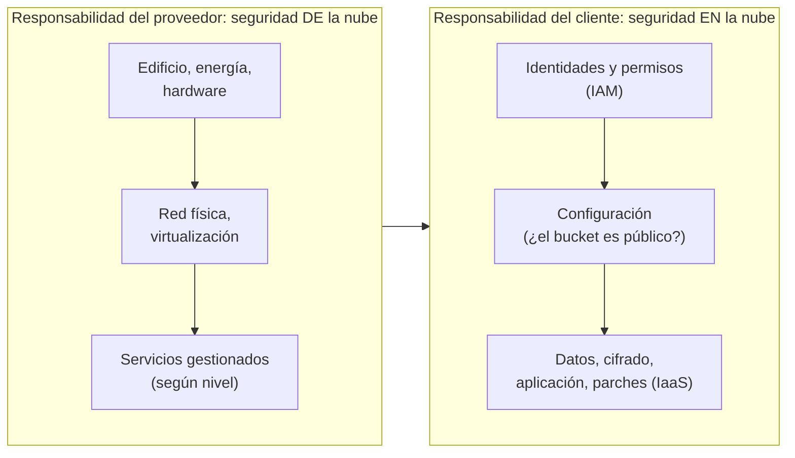

# La nube: niveles, modelos de despliegue y funciones

## Conclusión primero

"La nube" es alquilar capacidad de cómputo, almacenamiento y servicios a un proveedor, por uso, a
través de Internet, sin ver ni administrar el hardware. Se organiza en **niveles de servicio** según
cuánto administra el proveedor y cuánto quien alquila (infraestructura, plataforma, software, y las
variantes intermedias), y en **modelos de despliegue** según de quién es la infraestructura
(pública, privada, híbrida, multinube). Sus **funciones** son las de cualquier centro de datos —
ejecutar aplicaciones, guardar datos, procesarlos, comunicarlos — con la diferencia de que se
contratan en minutos y se pagan por hora. Para un desarrollador de DAM, la decisión práctica es qué
nivel usar para desplegar una aplicación: cuanto más alto, menos trabajo y menos control.

## "Niveles" tiene dos lecturas

En la industria hay dos cosas que se llaman "niveles de la nube", y conviene conocer ambas:

1. **Niveles de servicio** (IaaS, PaaS, SaaS...): *qué* se alquila. Es la lectura habitual y la que
   se desarrolla a continuación.
2. **Niveles geográficos** (región, zona de disponibilidad, punto de presencia en el borde): *dónde*
   está físicamente lo alquilado. Se trata al final del apunte y enlaza con [04](04-edge-fog-mist.md).

## Niveles de servicio: quién administra qué

La forma más clara de entender IaaS, PaaS y SaaS es la pila de responsabilidades: para ejecutar
cualquier aplicación hacen falta unas capas, y cada nivel de nube mueve la línea entre lo que
administra el proveedor y lo que administra el cliente.

```
                 Local        IaaS         PaaS         SaaS
               (on-prem)
Aplicación       cliente      cliente      cliente      proveedor
Datos            cliente      cliente      cliente      proveedor*
Entorno de       cliente      cliente      proveedor    proveedor
  ejecución
Sistema          cliente      cliente      proveedor    proveedor
  operativo
Virtualización   cliente      proveedor    proveedor    proveedor
Servidores       cliente      proveedor    proveedor    proveedor
Red y            cliente      proveedor    proveedor    proveedor
  almacenamiento
Edificio,        cliente      proveedor    proveedor    proveedor
  energía
```

(*En SaaS los datos son del cliente, pero los custodia el proveedor.)

| Nivel | Qué se alquila | Quién administra qué | Ejemplos | Para un desarrollador |
|---|---|---|---|---|
| **IaaS** (*Infrastructure as a Service*) | Máquinas virtuales, discos, redes | El proveedor: hardware, virtualización. El cliente: sistema operativo hacia arriba | AWS EC2, Azure Virtual Machines, Google Compute Engine, Hetzner, OVH, Scaleway | Una VM con Linux donde se instala Docker y se despliega lo que sea. Control total, trabajo total (parches, copias, seguridad) |
| **CaaS** (*Containers as a Service*) | Ejecución de contenedores | El proveedor gestiona los nodos; el cliente da imágenes | Kubernetes gestionado (EKS, AKS, GKE), AWS Fargate, Google Cloud Run, Azure Container Apps | Se entrega una imagen Docker; el proveedor la ejecuta y escala. El punto medio más habitual en 2026 |
| **PaaS** (*Platform as a Service*) | Entorno de ejecución para código | El proveedor: todo hasta el runtime. El cliente: código y datos | Heroku, Render, Railway, Fly.io, Azure App Service, Google App Engine, Vercel/Netlify (para frontend y funciones) | `git push` y está desplegado. Menos control, cero administración |
| **FaaS / *serverless*** (*Functions as a Service*) | Ejecución de funciones individuales bajo demanda | El proveedor: todo; se paga por milisegundo de ejecución | AWS Lambda, Azure Functions, Google Cloud Functions, Cloudflare Workers | Código que se ejecuta cuando llega un evento y desaparece. Sin servidor que mantener, con límites de tiempo y de estado |
| **BaaS** (*Backend as a Service*) | Backend completo prefabricado: base de datos, autenticación, almacenamiento, funciones | El proveedor: todo el backend genérico | Firebase, Supabase, Appwrite | Una app móvil o web sin escribir backend propio. Muy rápido para empezar, con dependencia fuerte |
| **DBaaS** y otros "XaaS" | Base de datos gestionada, colas, caché, ML... | El proveedor administra el servicio; el cliente lo usa | RDS, Cloud SQL, MongoDB Atlas, Neon, Upstash | Postgres con copias, parches y réplicas sin administrar nada |
| **SaaS** (*Software as a Service*) | Una aplicación terminada | El proveedor: todo | Microsoft 365, Google Workspace, Salesforce, Slack, Notion, GitHub | Se usa; no se programa (salvo integraciones vía API) |

La analogía clásica es la de la pizza: hacerla en casa (local), comprar la masa y hornearla (IaaS),
pedirla a domicilio (PaaS), cenar en la pizzería (SaaS). Sirve para recordar el gradiente; no sirve
para decidir, porque la decisión real depende de lo que aparece en la última columna: **control
frente a trabajo**.

***Serverless* merece una nota.** Es el nivel donde la palabra "servidor" se vuelve más ambigua
([UD1-04](../ud1-digitalizacion-ia-software/04-front-back-cliente-servidor.md)): hay servidores,
muchos, pero quien programa no ve ninguno; el código se ejecuta en respuesta a un evento (una
petición HTTP, un fichero subido, un mensaje en cola), en un entorno que se crea y destruye, sin
estado persistente entre ejecuciones (el estado va a una base de datos o a una caché), con un
tiempo máximo de ejecución y con un "arranque en frío" la primera vez. Es barato a poco uso y puede
ser caro a mucho uso; es ideal para tareas esporádicas e irregulares y una mala idea para procesos
largos o con estado.

## Modelos de despliegue: de quién es la infraestructura

| Modelo | Qué es | Cuándo |
|---|---|---|
| **Nube pública** | Infraestructura del proveedor, compartida entre clientes (con aislamiento lógico) | Por defecto: máxima elasticidad y menor coste inicial |
| **Nube privada** | Infraestructura dedicada a una organización, propia o alquilada en exclusiva, con las mismas herramientas de autoservicio | Regulación, control, cargas muy estables y grandes |
| **Híbrida** | Privada + pública conectadas; se decide qué va dónde | Lo habitual en empresas con sistemas heredados: el ERP en casa, la web en la nube |
| **Multinube** | Varios proveedores públicos | Evitar dependencia, aprovechar lo mejor de cada uno; a cambio, más complejidad |
| **Nube soberana** | Nube operada bajo jurisdicción y control de la UE (o de un país), sin acceso posible de autoridades extranjeras | Sector público y regulado europeo; en crecimiento desde 2024 por tensiones geopolíticas y por el conflicto entre el RGPD y la ley estadounidense (CLOUD Act) — ver [08](08-almacenamiento-y-cloud-computing.md) |
| **Local / *on-premises*** | Servidores propios en instalaciones propias | Lo que había antes; sigue siendo válido para cargas estables, latencia crítica o datos que no salen |

**Proveedores.** Tres hiperescaladores dominan (AWS, Microsoft Azure, Google Cloud, en ese orden de
cuota); detrás, Alibaba y Oracle; en Europa, OVHcloud, Scaleway, Hetzner, IONOS y otros, más pequeños
y con precios a menudo mucho más bajos en IaaS; y desde 2023, "neonubes" especializadas en GPU para
IA (CoreWeave, Lambda). Una empresa mediana española en 2026 suele estar en Azure (por Microsoft 365)
o en AWS, con alguna pieza en un proveedor europeo.

## Modelo de responsabilidad compartida

Cada nivel implica un reparto de la **seguridad**, que es el error de comprensión más caro:



La mayoría de las brechas en la nube no son fallos del proveedor: son *buckets* de almacenamiento
configurados como públicos, credenciales filtradas en un repositorio, permisos excesivos. El
proveedor garantiza que nadie entra en su centro de datos; no garantiza que el cliente no deje la
puerta abierta.

## Funciones de la nube

Procesar datos, intercambiar información y ejecutar aplicaciones son las funciones más evidentes.
La lista es abierta; el catálogo de un proveedor grande tiene cientos de servicios, pero se agrupan
en una docena de familias:

| Función | Qué cubre | Servicios típicos | En el proyecto |
|---|---|---|---|
| **Ejecución de aplicaciones** (cómputo) | VMs, contenedores, funciones, GPU | EC2, Cloud Run, Lambda, instancias con GPU | Dónde corre el backend |
| **Almacenamiento** | Objetos (ficheros), bloques (discos), ficheros compartidos, archivo frío | S3, Blob Storage, GCS; EBS; EFS; Glacier | Documentos, imágenes, copias ([08](08-almacenamiento-y-cloud-computing.md)) |
| **Bases de datos** | Relacionales y NoSQL gestionadas, caché, series temporales, vectoriales | RDS, Cloud SQL, Cosmos DB, DynamoDB, Firestore, ElastiCache | Los datos del negocio |
| **Procesamiento de datos** | Por lotes y en flujo; almacenes analíticos; *lakehouse* | BigQuery, Redshift, Snowflake, Databricks, Dataflow, Kinesis | Analítica, cuadros de mando ([07](07-ciencia-de-datos.md)) |
| **Intercambio de información** (red y mensajería) | Redes virtuales, balanceadores, CDN, DNS, colas, buses de eventos, APIs gestionadas | VPC, ALB, CloudFront, Route 53, SQS/SNS, Pub/Sub, Event Grid, API Gateway | Cómo se hablan las piezas ([UD1-06](../ud1-digitalizacion-ia-software/06-extremo-a-extremo.md)) |
| **Identidad y seguridad** | Usuarios, roles, permisos, secretos, claves de cifrado, cortafuegos | IAM, Entra ID, Key Vault/KMS, WAF | Quién puede qué |
| **IoT** | Ingesta de dispositivos, gestión de flotas, *edge* gestionado | IoT Core, IoT Hub, Greengrass | Conectar la planta ([04](04-edge-fog-mist.md)) |
| **IA y ML** | Modelos por API, entrenamiento gestionado, GPU, búsqueda vectorial | Bedrock, Azure OpenAI/AI Foundry, Vertex AI, SageMaker | La sección 9 del informe |
| **Observabilidad** | Logs, métricas, trazas, alertas | CloudWatch, Azure Monitor, Cloud Logging | Saber qué pasa |
| **Continuidad** | Copias, réplicas entre regiones, recuperación ante desastres | Backup, replicación | Que no se pierda |
| **Desarrollo y despliegue** | Repositorios, CI/CD, registros de contenedores, infraestructura como código | GitHub Actions, Cloud Build, ECR, Terraform | Cómo llega el código a producción |

Lo que une todas las filas es el **autoservicio programable**: cada servicio se crea, configura y
destruye desde una API o desde código (**infraestructura como código**: Terraform, Pulumi,
CloudFormation, Bicep). La nube no es solo alquiler de hardware; es que la infraestructura se ha
vuelto software, y se versiona y despliega como tal. Esta es la digitalización del propio sector
descrita en [UD1-01](../ud1-digitalizacion-ia-software/01-que-es-digitalizar.md).

## Cómo se despliega una aplicación de DAM en cada nivel

Para una aplicación típica de proyecto de ciclo (API en Spring Boot o Node, frontend en React, base
de datos Postgres):

| Nivel | Cómo | Esfuerzo | Control | Coste a poca carga |
|---|---|---|---|---|
| IaaS | Una VM en Hetzner/OVH/AWS; Docker Compose con los tres contenedores; un proxy con TLS | Alto: hay que administrar la máquina | Total | Muy bajo (unos euros/mes) |
| CaaS | Imagen del backend en Cloud Run / Container Apps; Postgres gestionado; frontend en un CDN | Medio | Alto | Bajo, escala a cero |
| PaaS | Render/Railway/Fly.io: conectan el repositorio, detectan el lenguaje, despliegan | Bajo | Medio | Bajo, con capa gratuita limitada |
| BaaS | Supabase o Firebase como backend entero; la app habla directamente con ellos | Muy bajo | Bajo: lo que el proveedor permita | Gratis al principio |
| FaaS | Cada endpoint una función; frontend estático; base de datos *serverless* | Medio (arquitectura distinta) | Medio | Casi cero mientras no haya tráfico; con carga sostenida deja de ser la opción barata |

No hay una opción correcta: hay una opción por situación. Un desarrollador que solo conoce un nivel
elige mal cuando la situación cambia.

## Niveles geográficos: región, zona, borde

La segunda lectura de "niveles". Un proveedor grande organiza su infraestructura en:

- **Regiones**: ubicaciones geográficas independientes (Irlanda, Fráncfort, París, Madrid, Virginia
  del Norte...). Se elige por latencia, por precio y, sobre todo, por **jurisdicción**: los datos en
  la región de Madrid están en España, bajo derecho europeo — lo que importa para el RGPD
  ([UD1-10](../ud1-digitalizacion-ia-software/10-seguridad-y-regulacion.md)).
- **Zonas de disponibilidad**: varios centros de datos dentro de una región, separados físicamente
  pero con red de baja latencia entre ellos. Desplegar en varias zonas protege frente al fallo de un
  centro de datos; no protege frente al fallo de la región (ocurre: la caída de la región principal
  de AWS en octubre de 2025 dejó fuera de servicio durante horas a miles de aplicaciones que no
  estaban preparadas para ello).
- **Puntos de presencia en el borde** (*edge locations*): cientos de instalaciones pequeñas cerca
  de los usuarios, para CDN, DNS y funciones ligeras. Es donde la nube se convierte en *edge*
  ([04](04-edge-fog-mist.md)).

## Ventajas e inconvenientes, para argumentar

| A favor de la nube | En contra |
|---|---|
| Sin inversión inicial; se paga por uso | A carga alta y estable, puede costar varias veces más que servidores propios |
| Se aprovisiona en minutos, se escala en segundos | Dependencia del proveedor (*lock-in*): los servicios gestionados no son portables |
| Servicios gestionados: bases de datos, colas, IA, sin administrarlos | Menor control; el proveedor cambia precios y condiciones |
| Alcance global y redundancia | Latencia si los usuarios o las máquinas están lejos; caídas del proveedor que afectan a todos a la vez |
| Seguridad física y de plataforma de primer nivel | La seguridad de la configuración sigue siendo del cliente |
| Acceso a GPU y a modelos de IA que nadie compraría | Coste de salida de datos (*egress*); soberanía y jurisdicción |

Caso de debate real: en 2023 la empresa 37signals (Basecamp, HEY) abandonó la nube pública y volvió
a servidores propios, con un ahorro declarado de varios millones de dólares en cinco años, porque su
carga era grande, estable y predecible. No es un argumento contra la nube: es la demostración de que
la respuesta depende del perfil de carga, y de que la "repatriación" es una opción legítima que
conviene evaluar cada pocos años.

## Para debatir

- Una app móvil de un gimnasio con 2 000 socios: ¿BaaS, PaaS o una VM? ¿Qué cambia si pasan a ser
  200 000? ¿Y si hay que cumplir un contrato con la administración que exige datos en España?
- Un sistema de control de una depuradora. ¿Nube? ¿Qué parte sí y qué parte no?
- "Estamos en la nube, así que estamos seguros." Enumerar qué cubre el proveedor y qué no.
- *Serverless* para una tienda online: ¿qué partes encajan (carrito, pago, notificaciones) y
  cuáles no (generación de informes de una hora)? ¿Dónde vive el estado?
