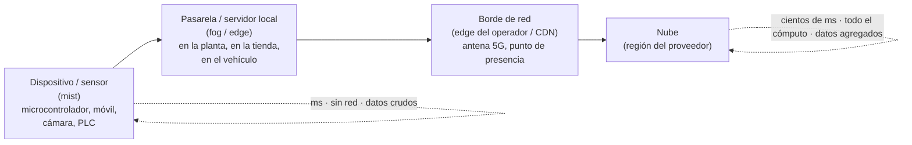

# Edge, fog y mist: cómputo cerca del dato, y un LLM en el portátil

## Conclusión primero

*Edge computing* es procesar los datos **cerca de donde se generan** en lugar de enviarlos a un
centro de datos lejano. Se hace por cuatro razones que la nube no puede resolver: latencia (la
respuesta tiene que llegar en milisegundos), ancho de banda (no se pueden enviar todos los datos),
autonomía (tiene que funcionar sin conexión) y privacidad o soberanía (los datos no pueden salir).
*Fog* y *mist* son nombres para capas intermedias de ese mismo continuo — términos que la industria
usa cada vez menos, absorbidos por "edge". La mejor forma de entender el continuo es ejecutar un
modelo de lenguaje en el propio portátil, en un servidor del aula y en la API de un proveedor, y
comparar latencia, coste, capacidad y qué datos salen del edificio.

## El continuo nube–edge–dispositivo



De izquierda a derecha aumentan la capacidad de cómputo, la latencia y la dependencia de la red;
disminuyen la autonomía y el control sobre dónde están los datos. Ningún punto del continuo es
"mejor": cada decisión de dónde ejecutar algo es un equilibrio entre esas variables — la misma
decisión que se toma para el frontend y el backend
([UD1-04](../ud1-digitalizacion-ia-software/04-front-back-cliente-servidor.md)), ahora con el eje
físico de por medio.

## Edge computing

**Qué es.** Cómputo situado en el borde de la red, próximo a la fuente de datos o al usuario, que
procesa localmente y envía a la nube solo lo necesario (resultados, agregados, excepciones). No
sustituye a la nube: la complementa. El patrón habitual es **entrenar en la nube, ejecutar en el
borde**: el modelo de visión artificial se entrena con millones de imágenes en un centro de datos y
se despliega en un servidor pequeño al pie de la línea de producción, que decide en 20 ms si la
pieza es defectuosa sin que la imagen salga de la planta.

**Por qué** (las cuatro razones, con ejemplos):

| Razón | Ejemplo | Por qué la nube no sirve |
|---|---|---|
| **Latencia** | Un vehículo autónomo que detecta un peatón; un robot que se detiene al tocar a una persona; un videojuego en la nube | Un viaje de ida y vuelta a la nube son 20-200 ms; la decisión tiene que tomarse en 5 |
| **Ancho de banda** | 50 cámaras de alta resolución en una fábrica; sensores de vibración a 10 kHz | Enviar todo a la nube costaría más que el proceso que se vigila; se envían solo alarmas y resúmenes |
| **Autonomía** | Una plataforma petrolífera, un barco, un tractor, una tienda cuando cae la línea | Tiene que seguir funcionando sin conexión |
| **Privacidad y soberanía** | Datos médicos, biometría, imágenes de personas, datos industriales confidenciales | Regulación o contrato que impide que salgan; o el simple riesgo de que lo hagan |

A las cuatro se suele añadir el **coste**: procesar en un dispositivo ya comprado es gratis por
unidad; procesar en la nube se paga por uso ([02](02-sostenibilidad-coste-y-mercados.md)).

**"Edge" es polisémico**, y en una conversación sobre arquitectura conviene preguntar de cuál se
habla:

| Acepción | Qué es | Quién lo dice |
|---|---|---|
| *Edge* industrial / IoT | Servidor o pasarela en la planta que procesa datos de máquinas | Automatización, IIoT |
| *Edge* del operador (MEC, *multi-access edge computing*) | Cómputo en la antena o la central del operador de telecomunicaciones, a pocos ms del móvil | Operadores, 5G |
| *Edge* de CDN / *edge functions* | Código que se ejecuta en los cientos de puntos de presencia de una red de distribución de contenido | Cloudflare Workers, Vercel Edge, Deno Deploy, desarrolladores web |
| *Edge* AI / IA en el dispositivo | Modelos que se ejecutan en el móvil, el portátil o el sensor | Apple, Google, Qualcomm; "modelos en el dispositivo" |
| El navegador | Cómputo en el cliente (WebAssembly, WebGPU) | Desarrolladores web |

Las dos últimas acepciones son las que más han crecido en 2024-2026: los sistemas operativos móviles
incorporan modelos de lenguaje pequeños que funcionan sin red (dictado, resumen, traducción); Apple
combina ejecución local con una nube propia diseñada para no retener datos (*Private Cloud
Compute*); los portátiles se venden con aceleradores de IA (NPU). El resultado es que "la IA" deja
de ser sinónimo de "una llamada a un servidor lejano" — otro caso de término cuyo referente se ha
movido.

**Relación con la nube.** Tres patrones:

1. **Nube como cerebro, *edge* como reflejos**: la nube entrena, analiza históricos y decide
   políticas; el borde ejecuta y reacciona. Es el patrón dominante en industria.
2. ***Edge* como caché y filtro**: el borde retiene, agrega y reenvía; la nube guarda y analiza.
3. ***Edge* como respaldo**: todo va a la nube, pero el borde sigue funcionando en modo degradado
   si se pierde la conexión (una tienda que sigue cobrando).

Los proveedores de nube venden *edge* gestionado (AWS Greengrass y Outposts, Azure IoT Edge y Arc,
Google Distributed Cloud): el mismo modelo de programación de la nube desplegado en hardware del
cliente. Es la nube "bajando" a la planta, y el nivel 3 del modelo de Purdue
([UD1-03](../ud1-digitalizacion-ia-software/03-it-y-ot.md)) es exactamente donde se instala.

## Fog y mist

Son términos de un momento concreto y hoy poco usados fuera de la literatura académica y de algunos
catálogos de proveedores; basta con saber qué designan y dónde se aplican.

- ***Fog computing*** (Cisco, 2012): una capa de cómputo **entre** los dispositivos y la nube —
  pasarelas, servidores locales, routers con capacidad de proceso — que agrega, filtra y toma
  decisiones de ámbito local (una planta, un edificio, un barrio). El consorcio OpenFog (2015)
  publicó una arquitectura de referencia y se integró en 2019 en el Industrial Internet Consortium;
  desde entonces el término se ha ido fundiendo con "edge". Zona de aplicación: **nivel de
  instalación**: control en tiempo real de una línea, agregación de cientos de sensores de un
  edificio, semáforos de un distrito.
- ***Mist computing***: cómputo **en los propios dispositivos** del extremo — microcontroladores,
  sensores con capacidad de proceso, el "borde del borde". Zona de aplicación: **nivel de sensor**:
  filtrar lecturas antes de transmitirlas, detectar un umbral y avisar, ejecutar un modelo diminuto
  (**TinyML**: redes neuronales en un chip de un euro que detecta una palabra clave o una vibración
  anómala).

La relación entre los tres términos y el continuo: *mist* = dispositivo; *fog* = pasarela e
instalación; *edge* = todo lo que no es la nube central (y por tanto incluye a los dos anteriores
en el uso actual). En un examen o una conversación, "fog" y "mist" sitúan la capa; "edge" es el
término genérico.

## La demostración: el mismo modelo en tres lugares

La forma más directa de experimentar el continuo es un modelo de lenguaje, porque es un servicio
que se puede ejecutar en cualquiera de las capas y las diferencias son inmediatas.

**Ollama** es una herramienta que descarga y ejecuta modelos de lenguaje abiertos en un ordenador
normal. Al arrancar, levanta un servidor HTTP local (por defecto en `localhost:11434`) con una API
parecida a la de los proveedores comerciales — de modo que una aplicación escrita contra la API de
OpenAI o Anthropic puede apuntarse a un modelo local cambiando una URL. LM Studio hace lo mismo con
interfaz gráfica; llama.cpp es el motor que hay debajo de ambos.

```bash
ollama pull llama3.2:3b        # descarga un modelo pequeño (~2 GB)
ollama run llama3.2:3b         # chat interactivo en el terminal
curl http://localhost:11434/api/generate -d '{"model":"llama3.2:3b","prompt":"Qué es edge computing"}'
```

Obsérvese la polisemia en acción: al ejecutar `ollama serve`, **el portátil es el servidor**, y el
terminal (o la aplicación) es el cliente; "servidor" aquí es un proceso en la misma máquina
([UD1-04](../ud1-digitalizacion-ia-software/04-front-back-cliente-servidor.md)).

**Lo que se compara**, con la misma pregunta en los tres sitios:

| | Portátil del alumno (*mist/edge*) | Servidor del aula (*fog*) | API de un proveedor (nube) |
|---|---|---|---|
| **Modelo** | 1-8 mil millones de parámetros, cuantizado | 8-70 mil millones, con GPU | Cientos de miles de millones (estimado; no se publica) |
| **Calidad** | Suficiente para tareas acotadas; se equivoca en razonamiento y en hechos | Buena para la mayoría de tareas | La mejor disponible |
| **Latencia hasta la primera palabra** | Segundos en CPU; menos con GPU | Menos de un segundo | 0,5-2 s más la red |
| **Velocidad de generación** | 5-30 tokens/s | 30-100 tokens/s | 50-200 tokens/s |
| **Coste marginal** | Cero (electricidad) | Cero (el servidor ya está pagado) | Por token |
| **Coste fijo** | El portátil | El servidor con GPU (miles de euros) | Ninguno |
| **Qué sale del edificio** | **Nada** | Nada (red local) | El *prompt* y el contexto completos |
| **Funciona sin Internet** | Sí | Sí | No |
| **Contexto máximo práctico** | Pequeño (limitado por memoria) | Medio | Grande |
| **Herramientas, agentes** | Los modelos pequeños las manejan mal | Aceptable | Lo mejor |

Términos que aparecen al hacerlo:

- **Parámetros** (7B, 70B): el tamaño del modelo en miles de millones de pesos. Más parámetros, más
  capacidad, más memoria.
- **Cuantización** (Q4, Q8): reducir la precisión numérica de los pesos para que el modelo ocupe
  menos memoria (un modelo de 7B en 16 bits ocupa ~14 GB; en 4 bits, ~4 GB) a cambio de una pérdida
  pequeña de calidad. Es lo que permite ejecutar modelos razonables en un portátil.
- **VRAM**: la memoria de la GPU es el límite real: el modelo tiene que caber en ella (o repartirse
  con la RAM, mucho más lento).
- **Modelos abiertos** (pesos descargables, con licencias variadas): Llama (Meta), Mistral, Qwen
  (Alibaba), Gemma (Google), Phi (Microsoft), DeepSeek. "Abierto" no siempre significa "libre": hay
  que leer la licencia.

**La conclusión de la demostración** es la del apunte entero: la elección de dónde ejecutar un
modelo — y por extensión cualquier cómputo — no la decide la capacidad sino el equilibrio entre
capacidad, latencia, coste y qué datos pueden salir. Para un sistema que procesa historiales
médicos, el modelo pequeño local puede ser la única opción legal; para un asistente de programación
sobre código público, la API es mejor y más barata que un servidor propio; para una fábrica con
mala conexión, el servidor de planta es la única opción que funciona el lunes por la mañana.

## Para debatir

- Un sistema de cámaras que detecta si los operarios llevan casco. ¿Dónde se ejecuta el modelo?
  ¿Qué datos van a la nube? ¿Qué dice el RGPD sobre las imágenes? ¿Y el AI Act sobre vigilar a
  trabajadores?
- Una app de notas con "resumen con IA". Resumen local (modelo pequeño, gratis, privado, peor) o
  en la nube (mejor, con coste, los datos salen). ¿Qué elegir? ¿Debe elegir el usuario?
- Un tractor autónomo en una finca sin cobertura. Dibujar qué hay en el tractor, qué en la nave de
  la explotación y qué en la nube. ¿Cuál es el *mist*, cuál el *fog*?
- Si un modelo local de 3B responde peor que uno de nube pero no cuesta nada ni filtra datos, ¿para
  qué tareas del propio ciclo sería suficiente? Probarlo.
