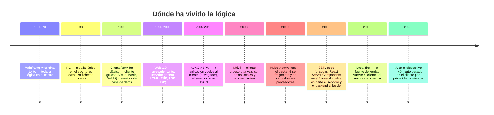

# Dónde vive la lógica: el péndulo cliente–servidor y las ventajas de la nube en sistemas conectados

## Conclusión primero

La pregunta "¿esto lo hace el cliente o el servidor?" no tiene una respuesta fija: la ha tenido
distinta en cada época, y cada cambio lo ha provocado una tecnología (el PC, el navegador, AJAX, el
móvil, la nube, los modelos en el dispositivo). Lo que sí es fijo son los **criterios** con los que
se decide — seguridad, consistencia, latencia, disponibilidad sin red, coste, despliegue, privacidad,
capacidad de cómputo — y el hecho de que la nube ha cambiado el peso de varios de ellos: ha hecho
barato y rápido centralizar, y por eso "sistemas conectados" significa hoy, casi siempre, "muchos
clientes alrededor de una nube". Las ventajas de esa centralización son reales y enumerables; sus
límites también, y el caso móvil y el *edge* son la prueba de que el péndulo no se ha parado.

## El péndulo, en cincuenta años

Cada oscilación tiene una causa técnica concreta:

| Movimiento | Qué lo provocó | Qué se ganó | Qué se perdió |
|---|---|---|---|
| Centro → PC | Hardware barato en el escritorio | Respuesta inmediata, autonomía | Datos dispersos, sin control central, sin copias |
| PC → cliente/servidor | Redes locales, bases de datos relacionales | Dato único | Despliegue del cliente en cada puesto (el "infierno de las DLL") |
| Cliente/servidor → web | El navegador como cliente universal | Despliegue instantáneo, sin instalar nada | Interfaz pobre, cada clic un viaje al servidor |
| Web → SPA | JavaScript rápido, AJAX, frameworks | Interfaz rica, menos carga en servidor | Complejidad en el cliente, SEO, dos bases de código |
| Escritorio/web → móvil | El teléfono como dispositivo principal | Ubicuidad, sensores | Conectividad intermitente, ciclos de despliegue lentos |
| Propio → nube | Virtualización, pago por uso | Elasticidad, servicios gestionados, alcance global | Dependencia, coste a escala, latencia, soberanía |
| SPA → SSR/edge | Rendimiento percibido, SEO, redes de borde | Primera carga rápida, menos JS en el cliente | La frontera front/back pasa por dentro de un fichero |
| Nube → *local-first* / *edge* AI | Colaboración en tiempo real, privacidad, modelos pequeños | Funciona sin red, datos del usuario en su máquina | Sincronización y conflictos: el problema más difícil vuelve |

El péndulo no vuelve nunca al mismo sitio: cada vuelta conserva algo de la anterior. Un desarrollador
que solo conoce la posición actual del péndulo no entiende por qué está ahí ni sabrá reconocer la
siguiente oscilación.

## Los criterios que no cambian

Sea cual sea la época, la lógica se coloca respondiendo a las mismas preguntas:

| Criterio | Empuja hacia el servidor / nube | Empuja hacia el cliente / borde |
|---|---|---|
| **Seguridad** | Todo lo que no debe poder manipular el usuario: autorización, precios, validación definitiva, secretos | — (nada de seguridad se confía al cliente) |
| **Consistencia** | Un único estado verdadero que todos ven igual (stock, saldo, reservas) | Cuando la consistencia inmediata no importa (borradores, preferencias) |
| **Latencia percibida** | — | Respuesta instantánea: interfaz, validación de formato, previsualización, "UI optimista" (mostrar el resultado antes de que el servidor confirme) |
| **Disponibilidad sin red** | — | Todo lo que tiene que funcionar en un túnel, en una planta, en el campo |
| **Coste de cómputo** | Cómputo pesado que el cliente no puede hacer (entrenar, analizar millones de filas) | Cómputo que el cliente ya tiene pagado: cada ciclo de CPU del usuario es gratis para la empresa |
| **Despliegue** | Cambiar una vez y que todos lo vean (corregir un error de cálculo, cambiar una regla) | — (el cliente se actualiza cuando el usuario quiere; en móvil, tras la revisión de la tienda) |
| **Privacidad y regulación** | Datos que la empresa necesita centralizar y proteger (y de los que es responsable) | Datos que es mejor que **no** lleguen a la empresa (biometría, contenido personal, salud): lo que no se tiene no se filtra |
| **Capacidad de cómputo** | GPU, memoria, modelos grandes | Modelos pequeños, cálculos ligeros, renderizado |
| **Integración** | Lo que tiene que hablar con otros sistemas (ERP, pagos, correo) | Lo que solo concierne al usuario |
| **Observabilidad** | Lo que hay que poder medir y depurar centralmente | — |

La primera fila es absoluta; el resto son equilibrios. Y las filas "latencia", "disponibilidad sin
red" y "privacidad" son las que la nube **no** resuelve y por las que el cliente grueso, el móvil
con datos locales y el *edge* siguen existiendo.

## Las ventajas de la nube en sistemas conectados

Un "sistema conectado" es cualquier conjunto de clientes — navegadores, apps, sensores, máquinas,
vehículos — que comparten estado a través de la red. Lo que la nube aporta a ese sistema, y que
antes exigía comprar y operar un centro de datos:

| Ventaja | Qué significa para el sistema conectado | Ejemplo |
|---|---|---|
| **Punto de encuentro global** | Todos los clientes, estén donde estén, hablan con el mismo backend con direcciones estables | Una app con usuarios en tres continentes; una flota de máquinas en veinte fábricas |
| **Elasticidad** | El backend crece con los clientes conectados y se reduce cuando se van; se paga por lo usado | La app de un evento que pasa de 100 a 100 000 usuarios el día del sorteo |
| **Estado compartido consistente** | Un único lugar donde vive la verdad: stock, saldo, posición del pedido | Todos los repartidores ven la misma asignación |
| **Servicios gestionados para lo difícil** | Mensajería, colas, tiempo real, notificaciones *push*, autenticación, bases de datos replicadas — sin construirlos | Firebase para una app en una semana; Pub/Sub para millones de mensajes de sensores |
| **Ingesta y análisis centralizados** | Los datos de todos los clientes en un sitio donde se pueden analizar juntos y entrenar modelos | Mantenimiento predictivo sobre todas las máquinas del parque, no una a una |
| **Despliegue inmediato del backend** | Una corrección llega a todos los clientes conectados al instante | Cambiar una regla de precios sin actualizar ninguna app |
| **Resiliencia** | Réplicas en varias zonas; copias automáticas; recuperación | Que el fallo de un centro de datos no pare el sistema |
| **Seguridad de plataforma** | Cifrado, identidad, parches de la infraestructura, cumplimiento certificado | Una PYME con seguridad física y de red que nunca podría pagar |
| **Alcance de IA y cómputo** | GPU, modelos, procesamiento masivo por horas | Analizar imágenes de todos los dispositivos con un modelo grande |
| **Integración** | Los servicios de la nube ya se hablan entre sí y con SaaS de terceros | Del sensor al ERP al cuadro de mando con conectores estándar |

Y sus límites, para no convertir la lista en publicidad:

- **Latencia física**: la luz tarda lo que tarda. Nada en la nube responde en menos de decenas de
  milisegundos; lo que necesite menos va al borde ([04](04-edge-fog-mist.md)).
- **Dependencia**: cuando la nube cae, caen todos los clientes a la vez. Las caídas de octubre y
  noviembre de 2025 (una región principal de AWS; la red de Cloudflare) dejaron sin servicio
  simultáneamente a miles de aplicaciones que no habían diseñado ningún modo degradado.
- **Coste a escala**: lo que es barato para mil clientes puede ser ruinoso para cien millones (la
  repatriación de 37signals, [03](03-niveles-y-funciones-de-la-nube.md)).
- **Soberanía**: el estado compartido vive bajo la jurisdicción del proveedor
  ([08](08-almacenamiento-y-cloud-computing.md)).
- **Lock-in**: los servicios gestionados que hacen fácil lo difícil son los que más cuesta abandonar.

## Patrones con nombre

Para reconocerlos en un diagrama o en una oferta de trabajo:

| Patrón | Dónde vive la lógica | Cuándo |
|---|---|---|
| **Cliente ligero** (*thin client*) | Casi todo en servidor; el cliente presenta | Web clásica; kioscos; terminales; cuando el cliente no es de fiar o no tiene recursos |
| **Cliente grueso** (*thick/fat client*) | Mucha lógica y datos en el cliente | Escritorio, móvil, juegos, herramientas profesionales |
| **SPA + API** | Interfaz completa en el navegador; el servidor expone datos y reglas | La mayoría de las aplicaciones web de gestión de 2015-2025 |
| **SSR / híbrido** | Renderizado inicial en servidor, interacción en cliente | Comercio electrónico, contenido, cuando importan la primera carga y el SEO |
| **BFF** (*Backend for Frontend*) | Un backend intermedio por cada tipo de cliente (web, móvil), que adapta y agrega | Cuando los clientes tienen necesidades muy distintas del mismo backend |
| **API Gateway** | Un punto de entrada que enruta, autentica y limita | Microservicios; exposición pública de APIs |
| ***Serverless*** | Funciones en la nube que se ejecutan por evento | Cargas irregulares, integraciones, tareas cortas |
| ***Edge functions*** | Lógica ligera en el punto de presencia más cercano al usuario | Personalización, redirecciones, autenticación, geolocalización con latencia mínima |
| ***Offline-first* / *local-first*** | Los datos y la lógica principal en el cliente; el servidor sincroniza | Móvil en campo, herramientas de colaboración, aplicaciones que deben funcionar siempre |
| **Motor de sincronización** | Un componente (a menudo un producto: PowerSync, ElectricSQL, Replicache, Automerge/Yjs) que replica y resuelve conflictos | La implementación de lo anterior sin escribirla a mano |
| **PWA** (*Progressive Web App*) | Una web que se instala, funciona sin red (caché con *service worker*) y recibe *push* | Cuando se quiere el alcance de la web con parte del comportamiento de una app |
| **Autoridad del servidor con predicción en cliente** | El cliente simula el resultado al instante; el servidor tiene la última palabra y corrige | Videojuegos en red (anti-trampas); UI optimista en aplicaciones |

El último patrón merece atención porque resume el módulo en un mecanismo: el cliente hace lo que
sea necesario para que la experiencia sea inmediata, y el servidor hace lo que sea necesario para
que nadie haga trampa. Las dos lógicas conviven, y la misma regla ("¿puedo pagar este artículo con
este descuento?") se evalúa dos veces, en dos sitios, con dos propósitos distintos.

## Casos trabajados

**Un punto de venta (TPV) para una cadena de tiendas.**

| Función | Dónde | Por qué |
|---|---|---|
| Cobrar, imprimir ticket, abrir cajón | Local (el TPV) | Tiene que funcionar si cae Internet; latencia cero |
| Catálogo y precios | Local, sincronizado desde la nube | Se consultan mil veces al día; cambian una vez por semana |
| Stock de la tienda | Local con sincronización; la nube consolida | La tienda necesita saberlo sin red; la central necesita el total |
| Pago con tarjeta | Nube del banco, siempre | No hay pago sin autorización remota; modo *offline* con límite y riesgo |
| Fidelización, historial de cliente | Nube, con caché local | Es de toda la cadena |
| Informes, previsión, reposición | Nube | Cómputo sobre todas las tiendas |
| Reglas de descuento | Nube define, local ejecuta, nube verifica al sincronizar | Cambiar la regla una vez; aplicarla sin red; detectar abuso después |

**Un asistente con LLM dentro de una aplicación.**

| Función | Dónde | Por qué |
|---|---|---|
| Construir el *prompt* con los datos del usuario | Servidor | Los datos que se le dan al modelo hay que controlarlos y filtrarlos |
| La clave de API del proveedor de LLM | Servidor, en un gestor de secretos | En el cliente sería pública en minutos; cualquiera gastaría el presupuesto |
| Llamar al modelo | Servidor (o borde) | Coste, límites por usuario, registro, cambio de proveedor sin actualizar clientes |
| Mostrar la respuesta en *streaming* | Cliente, con conexión persistente al servidor | Experiencia |
| Un modelo pequeño para autocompletar o clasificar en local | Cliente | Latencia cero, privacidad, gratis; y funciona sin red |
| Historial de conversaciones | Servidor (si hay que compartir entre dispositivos) o cliente (si es privado) | Depende del producto y del RGPD |

**Una máquina industrial conectada (mantenimiento predictivo).**

| Función | Dónde | Por qué |
|---|---|---|
| Control de la máquina | PLC (OT) | Determinismo, seguridad ([UD1-03](../ud1-digitalizacion-ia-software/03-it-y-ot.md)) |
| Lectura de sensores a alta frecuencia y detección de umbrales | *Edge* de planta | Ancho de banda, latencia |
| Modelo de detección de anomalías | Entrenado en la nube, ejecutado en el *edge* | Cómputo para entrenar; latencia y autonomía para ejecutar |
| Histórico de todas las máquinas, entrenamiento, cuadros de mando | Nube | Análisis conjunto |
| Orden de trabajo de mantenimiento | Nube (GMAO/ERP) | Integración con negocio |

En los tres casos la respuesta correcta no es "nube" ni "cliente": es una **tabla**. La sección 5 del
informe del proyecto es esa tabla para la empresa elegida.

## Para debatir

- Una app de reservas de pistas de pádel: ¿dónde se comprueba que la pista está libre? ¿Qué pasa
  si dos usuarios reservan a la vez sin red? ¿Es aceptable un "lo siento, alguien se adelantó"?
- Si el cómputo del cliente es gratis para la empresa, ¿por qué no hacer todo en el cliente? Listar
  las tres razones más fuertes en contra.
- Una aplicación *local-first* de notas con sincronización. ¿Qué ventajas de la tabla de la nube
  conserva? ¿Cuáles pierde? ¿Es "un sistema conectado"?
- Argumentar que el péndulo va a oscilar otra vez en los próximos cinco años. ¿Hacia dónde? ¿Qué
  tecnología lo provocaría?
- Tomar una aplicación de otro módulo del ciclo y hacer su tabla de "dónde vive cada lógica".
  ¿Hay algo en el cliente que debería estar en el servidor?
