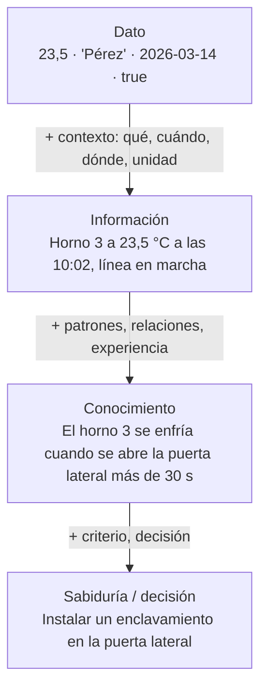
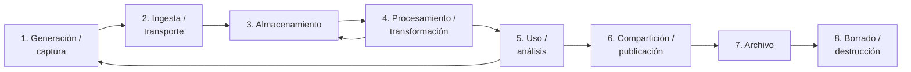

# Dato e información; el ciclo de vida del dato

## Conclusión primero

Un **dato** es una representación de un hecho sin contexto suficiente para actuar: `23,5`.
**Información** es el dato con el contexto que le da significado: *la temperatura del horno 3 a las
10:02 era 23,5 °C, por debajo del umbral de 180 °C, con la línea en marcha*. La diferencia no está
en el dato sino en lo que lo rodea — metadatos, relaciones, reglas — y por eso digitalizar bien es
capturar el contexto junto con el dato, no solo el número. El **ciclo de vida** describe qué le pasa
a un dato desde que se genera hasta que se destruye, y su importancia práctica es que cada etapa
tiene un responsable, un coste y una obligación legal; el error más común es diseñar solo la captura
y el uso y olvidar el archivo y el borrado.

## Dato, información, conocimiento

La jerarquía clásica (**DIKW**: *data, information, knowledge, wisdom*, Ackoff, 1989):

Qué aporta cada salto, con los términos que usa la industria:

| Nivel | Qué es | Cómo se representa en un sistema | Ejemplo en una tienda online |
|---|---|---|---|
| **Dato** | Un valor registrado; símbolo sin interpretación | Un campo, una celda, un byte | `37`, `"azul"`, `2026-03-14T10:02:00Z` |
| **Información** | Datos organizados con contexto: qué representan, en qué unidad, de qué entidad, cuándo | Una fila con sus columnas nombradas y tipadas; un registro con **metadatos** | "El pedido 4471 del cliente Pérez contiene 37 unidades del producto azul, realizado el 14/03/2026 a las 10:02 UTC" |
| **Conocimiento** | Patrones y relaciones extraídos de mucha información, que permiten predecir | Un informe, un modelo de ML, una regla de negocio, la experiencia de una persona | "Los pedidos de más de 30 unidades del producto azul en marzo son de revendedores; se devuelven un 12 %" |
| **Decisión** | Aplicar el conocimiento a un objetivo | Un proceso, una política | "Pedir confirmación telefónica a pedidos > 30 unidades en marzo" |

**Metadato** — "dato sobre el dato" — es la palabra que separa el primer nivel del segundo: nombre
del campo, tipo, unidad, origen, fecha de captura, quién lo modificó. Un CSV sin cabecera es datos;
con cabecera y un diccionario de datos es información. Un modelo de datos (sección 4 del proyecto)
es, en esencia, la declaración de qué contexto acompaña a cada dato.

**Crítica a la pirámide**, para no tomarla como ley: los niveles no son estancos (una regla de
negocio es conocimiento para el negocio y un dato para el sistema que la almacena); el "dato crudo"
no existe del todo, porque alguien decidió qué medir y cómo; y la pirámide sugiere que la sabiduría
"emerge" de acumular datos, cuando la experiencia de cualquier proyecto es la contraria: **primero se
decide qué pregunta se quiere responder, y luego se captura el dato que la responde**.

**Otras acepciones que se cruzan** (ver [`glosario-vivo.md`](../glosario-vivo.md)):

- En teoría de la información (Shannon, 1948), "información" es una magnitud medible en bits que
  cuantifica la sorpresa de un mensaje; no tiene que ver con el significado. Aparece en compresión,
  criptografía y en la función de pérdida con la que se entrenan los LLM (la entropía cruzada).
- En español de bases de datos, "dato" suele ser un campo y "datos" un conjunto o *dataset*.
- En el RGPD, "dato personal" es toda información sobre una persona identificable — la ley usa
  "dato" donde la pirámide diría "información", lo que muestra lo poco fija que es la frontera.
- "Datos" como sector, activo o departamento ("los de datos", "estrategia de datos").

## El ciclo de vida del dato

Cada dato pasa por etapas, y cada etapa tiene un responsable, un coste, un riesgo y, cuando el
dato es personal, una obligación legal.

| Etapa | Qué pasa | Decisiones y riesgos | Ejemplo (pedido de tienda online) |
|---|---|---|---|
| **1. Generación / captura** | El dato nace: un sensor mide, un usuario rellena, un sistema registra, un modelo infiere | ¿Qué se captura y qué no (minimización)? ¿Con qué calidad (validación en origen)? ¿Con qué contexto (metadatos)? Un dato mal capturado contamina todo lo posterior | El usuario confirma el carrito; el navegador envía JSON; el servidor añade fecha, IP, usuario |
| **2. Ingesta / transporte** | El dato viaja del origen al almacén: API, cola, fichero, ETL | ¿En tiempo real o por lotes? ¿Cifrado en tránsito? ¿Qué pasa si se pierde o se duplica? | La API escribe en la base de datos y publica un evento en una cola |
| **3. Almacenamiento** | Se guarda: base de datos, ficheros, almacén analítico, caché | ¿Dónde (jurisdicción)? ¿Cifrado en reposo? ¿Copias? ¿Cuánto tiempo? ¿Caliente o frío? ([08](08-almacenamiento-y-cloud-computing.md)) | Fila en Postgres; copia diaria; réplica en otra zona |
| **4. Procesamiento / transformación** | Se limpia, valida, enriquece, agrega, convierte a otros formatos | Aquí se introduce o se corrige la mayor parte de los errores; la **calidad del dato** es esta etapa | Se calcula el total, se aplica el IVA, se une con el catálogo, se copia al almacén analítico |
| **5. Uso / análisis** | Se consulta, se muestra, se analiza, alimenta modelos, sostiene decisiones | ¿Quién puede ver qué? ¿Se usa para la finalidad para la que se recogió? | El almacén lo prepara; el cuadro de mando lo suma; el modelo de previsión lo aprende |
| **6. Compartición / publicación** | Sale de la organización o del sistema: a un proveedor, a un cliente, a un tercero, a un modelo de IA, a datos abiertos | Contratos, anonimización, transferencias internacionales; **es la etapa que más brechas produce** | Se envía a la empresa de transporte; se comparte con el proveedor de LLM del asistente |
| **7. Archivo** | Ya no se usa, pero hay que conservarlo (obligación legal, histórico) | Almacenamiento frío; ¿sigue accesible para ejercer derechos? ¿Cifrado? | Facturas: conservación fiscal obligatoria durante años |
| **8. Borrado / destrucción** | Se elimina de forma irreversible, incluidas copias, réplicas, índices y caches | Es una **función que hay que diseñar**: el derecho de supresión del RGPD no se cumple con un `DELETE` si quedan copias de seguridad, un índice vectorial y un CSV en el correo de alguien | Al cabo del plazo, se borra el pedido y se anonimiza el histórico agregado |

Dos flechas del diagrama merecen explicación: el procesamiento devuelve al almacenamiento (los
datos transformados se guardan como nuevas versiones) y el uso realimenta la generación (un modelo
de recomendación genera nuevos datos: qué se recomendó y si funcionó). El ciclo no es lineal.

## Los conceptos que se cuelgan del ciclo

**Gobierno del dato** (*data governance*): quién es responsable de cada dato (el **propietario**
de negocio, el **custodio** técnico), qué reglas de calidad tiene, quién puede acceder, cuánto se
conserva. En una PYME es una tabla; en una gran empresa, un departamento. Para el proyecto, la
sección 3 (glosario) es la parte del gobierno del dato que define qué significa cada término, y la
parte de tratamiento de datos debe decir quién hace qué en cada etapa.

**Calidad del dato**: exactitud, completitud, coherencia, actualidad, unicidad. La mayor parte del
tiempo de cualquier proyecto de datos se va en la etapa 4 arreglando lo que la etapa 1 hizo mal.
Validar en origen es barato; limpiar después es caro; no limpiar es carísimo (decisiones sobre datos
falsos).

**Linaje** (*data lineage*) y **procedencia**: saber de dónde viene cada dato y por qué
transformaciones ha pasado. Es la trazabilidad del apunte
[UD1-06](../ud1-digitalizacion-ia-software/06-extremo-a-extremo.md) aplicada a los datos: cuando un
número del cuadro de mando es sospechoso, el linaje dice de qué tabla salió, con qué filtro, cuándo
se cargó. Las plataformas de datos modernas lo registran automáticamente (dbt, catálogos de datos).

**Dato maestro** (*master data*): las entidades de referencia que todos los sistemas comparten —
cliente, producto, proveedor, empleado — y que por eso son las que más conflictos de definición
generan ([UD1-02](../ud1-digitalizacion-ia-software/02-la-empresa-por-dentro.md)). La gestión de
datos maestros (MDM) es decidir cuál es el registro "oro" cuando cinco sistemas tienen cinco
versiones del mismo cliente.

**Retención**: cuánto se conserva cada dato y por qué. Hay mínimos legales (facturas, nóminas,
historiales) y máximos legales (datos personales: no más de lo necesario para la finalidad). La
política de retención es lo que convierte las etapas 7 y 8 en algo que ocurre de verdad.

## El caso de la corrección tardía: modificar o registrar

El caso de [UD1-06](../ud1-digitalizacion-ia-software/06-extremo-a-extremo.md) resuelto desde el
ciclo de vida. Una báscula envía pesos que se facturan; días después llega una corrección porque la
báscula estaba descalibrada. Dos formas de tratar el dato:

| | **Modificar el registro** (*update in place*) | **Registrar un evento nuevo** (*append-only*, *event sourcing*) |
|---|---|---|
| Qué se hace | Se sobreescribe el peso antiguo con el nuevo | Se añade "corrección de peso: de X a Y, motivo, fecha, quién" y el valor actual se calcula |
| Estado actual | Inmediato: es lo que hay en la fila | Se deriva de la secuencia de eventos |
| Historia | Se pierde, salvo que haya un log aparte | Completa por construcción: se puede saber qué se sabía en cada momento |
| Auditoría y regulación | Débil: ¿por qué cambió? | Fuerte: cada cambio es un hecho registrado |
| Reproducir un error | Difícil: los datos ya no son los que causaron el error | Directo: se reproduce la secuencia |
| Complejidad | Baja | Alta: consultas, proyecciones, volumen |
| Qué prefiere | El que consulta hoy (simple) | Finanzas, calidad, cualquiera que audite; el desarrollador que depura |
| Lo que sí o sí exige finanzas | — | La factura emitida **no se modifica**: se emite una rectificativa. Es *event sourcing* impuesto por ley desde hace siglos |

La respuesta profesional casi siempre es un híbrido: el sistema operativo guarda el estado actual
(rápido de consultar) **y** un registro inmutable de cambios (auditable). Lo que no es aceptable es
no haber decidido — que es lo que pasa en la PYME del CSV nocturno, donde la corrección crea un
duplicado o se pierde según el día.

## Para debatir

- Un formulario de alta pide fecha de nacimiento, DNI, teléfono y dirección para enviar una
  *newsletter*. Recorrer el ciclo de vida de cada campo: ¿para qué se captura, dónde se guarda,
  quién lo usa, cuándo se borra? ¿Cuáles sobran?
- Un usuario ejerce su derecho de supresión. Enumerar todos los lugares del sistema de la tienda
  online donde vive su dato (incluida la copia de seguridad, el índice de búsqueda, el histórico de
  envíos al proveedor de LLM, el Excel de marketing). ¿Se puede borrar de todos? ¿Qué se anonimiza en
  vez de borrar?
- "El dato es objetivo; la interpretación es subjetiva." Argumentar en contra con el ejemplo de la
  báscula: ¿qué decisiones humanas hay antes de que exista el número?
- Elegir una entidad del proyecto propio (cliente, pedido, cita, lote) y escribir su ciclo de vida
  completo en ocho filas. ¿Qué etapa no se había pensado?
