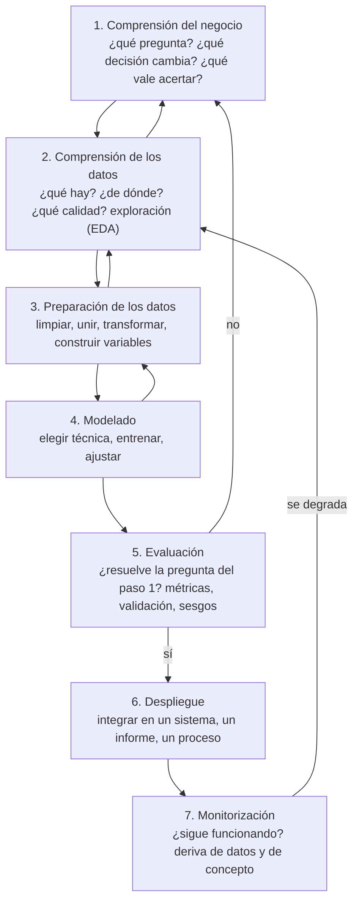

# Ciencia de datos: etapas, objetivos en la empresa y roles

## Conclusión primero

La ciencia de datos es la disciplina de responder preguntas de negocio con datos, combinando
estadística, programación y conocimiento del dominio. Su proceso es un **ciclo**, no una secuencia:
entender el problema, entender los datos, prepararlos (la etapa que consume la mayor parte del
tiempo), modelar, evaluar, desplegar y — lo que los modelos de los años 90 no incluían —
**monitorizar**, porque un modelo en producción se degrada cuando el mundo cambia. Los objetivos en
la empresa se ordenan por ambición en cuatro niveles — describir qué pasó, explicar por qué, predecir
qué pasará, prescribir qué hacer — y la mayoría de las empresas obtienen la mayor parte del valor de
los dos primeros, que no necesitan ningún modelo de IA.

## Las etapas

El modelo de referencia sigue siendo **CRISP-DM** (*Cross-Industry Standard Process for Data
Mining*, 1999), porque ningún sustituto ha conseguido reemplazarlo; lo que la industria ha hecho es
añadirle las etapas de operación (**MLOps**).

| Etapa | Qué se hace | Quién | Herramientas | Tiempo típico | Lo que suele salir mal |
|---|---|---|---|---|---|
| **1. Comprensión del negocio** | Traducir "queremos usar los datos" a una pregunta concreta con una decisión detrás y un valor medible | Negocio + analista | Conversaciones, documentos | Poco, y es el error | Saltársela: se construye un modelo excelente para una pregunta que no importa |
| **2. Comprensión de los datos** | Inventariar fuentes, cargar, explorar: distribuciones, valores ausentes, rarezas (**EDA**, análisis exploratorio) | Analista / científico | SQL, notebooks, pandas, visualización | Medio | Descubrir tarde que el dato clave no existe o es basura |
| **3. Preparación** | Limpiar (duplicados, ausentes, errores), unir fuentes, normalizar, construir variables derivadas (*feature engineering*), dividir en entrenamiento/prueba | Científico + ingeniero de datos | SQL, pandas, Spark, dbt | **La mayor parte** (la cifra folclórica es el 80 %) | Fuga de información (*leakage*): usar en el entrenamiento un dato que en producción no se tendría, con resultados espectaculares y falsos |
| **4. Modelado** | Elegir y entrenar técnicas: desde una media móvil hasta *gradient boosting* o una red; ajustar hiperparámetros | Científico | scikit-learn, XGBoost, PyTorch, AutoML | Menos de lo que se cree | Empezar por el modelo complejo sin una línea base simple con la que compararlo |
| **5. Evaluación** | Medir en datos no vistos con la métrica que corresponde a la decisión; comprobar sesgos, robustez, coste de los errores; volver al paso 1 si no sirve | Científico + negocio | Métricas, validación cruzada, análisis de errores | Medio | Optimizar la métrica equivocada (*accuracy* en un problema con el 1 % de positivos) |
| **6. Despliegue** | Que el resultado llegue a quien decide: un cuadro de mando, una API que devuelve la predicción, un proceso automático | Ingeniero de ML / backend | APIs, contenedores, orquestadores, BI | Más de lo previsto | El modelo funciona en el notebook y no se integra nunca — destino de la mayoría de pruebas de concepto |
| **7. Monitorización** | Vigilar que los datos de entrada siguen pareciéndose a los del entrenamiento (**deriva de datos**) y que la relación que aprendió sigue siendo válida (**deriva de concepto**); reentrenar | Ingeniero de ML | Métricas en producción, alertas | Continuo | Nadie lo hace; el modelo de 2019 sigue decidiendo en 2026 |

Las etapas **no son secuenciales**. La evaluación devuelve a la comprensión del negocio (la pregunta estaba mal); el
modelado devuelve a la preparación (falta una variable); la monitorización devuelve a los datos (el
mundo cambió). Un proyecto de datos se planifica como iteraciones, y por eso encaja mejor con los
ciclos iterativos de [UD1-05](../ud1-digitalizacion-ia-software/05-ciclos-de-vida-conway-y-el-caso-movil.md)
que con una cascada — con la excepción de la etapa 1, que sí conviene cerrar antes de gastar.

**Dos matices de 2024-2026:**

- Con los LLM, para muchos problemas de texto las etapas 3-4 se comprimen: no se entrena, se
  escribe un *prompt* y se construye un conjunto de evaluación. Pero las etapas 1, 5, 6 y 7 son
  **idénticas**, y la 5 (evaluación) es donde fracasan los proyectos de IA generativa que se
  lanzaron sin conjunto de pruebas.
- Los LLM se usan también *dentro* del proceso: generar SQL desde lenguaje natural, explorar datos
  en un notebook con un agente, extraer estructura de documentos, generar datos sintéticos. Cambian
  la velocidad de las etapas 2-3, no su necesidad.

## Objetivos de la ciencia de datos en la empresa

Los cuatro niveles de la analítica, en orden creciente de ambición, dificultad y valor por
respuesta (y en orden decreciente de frecuencia con la que las empresas los alcanzan):

| Nivel | Pregunta | Herramienta típica | Necesita IA |
|---|---|---|---|
| **Descriptiva** | ¿Qué pasó? | Cuadros de mando, informes, SQL, BI | No |
| **Diagnóstica** | ¿Por qué pasó? | Análisis exploratorio, segmentación, estadística | No (a veces ML para encontrar factores) |
| **Predictiva** | ¿Qué pasará? | Modelos de ML: regresión, clasificación, series temporales | Sí (ML clásico casi siempre) |
| **Prescriptiva** | ¿Qué deberíamos hacer? | Optimización, simulación, sistemas de recomendación, experimentación (A/B) | A veces; y siempre un proceso que actúe |

La observación honesta: la mayoría de las empresas obtiene la mayor parte del valor de los dos
primeros niveles, y muchas que compran "IA" necesitaban un cuadro de mando fiable. Los dos últimos
solo aportan si existe un proceso que **actúe** sobre la predicción
([UD1-08](../ud1-digitalizacion-ia-software/08-ia-datos-sectores-lenguajes.md)).

**Objetivos concretos por departamento**, para reconocerlos y para el proyecto:

| Departamento | Objetivo | Nivel | Ejemplo |
|---|---|---|---|
| Dirección | Ver el negocio en un vistazo con datos fiables | Descriptiva | Un cuadro de mando con ventas, margen, caja, con datos del ERP sin retocar a mano |
| Comercial | Priorizar oportunidades; prever ventas | Predictiva | *Lead scoring*: qué contactos tienen más probabilidad de comprar |
| Marketing | Segmentar clientes; medir qué campaña funciona | Diagnóstica, prescriptiva | Segmentación por comportamiento; experimentos A/B |
| Operaciones / producción | Prever demanda; evitar paradas; controlar calidad | Predictiva | Previsión de demanda semanal; mantenimiento predictivo; detección de defectos |
| Logística | Optimizar rutas, stock, ubicaciones de almacén | Prescriptiva | Optimización de rutas (investigación operativa, no LLM) |
| Finanzas | Detectar fraude; prever tesorería; evaluar riesgo | Predictiva | Detección de anomalías en pagos; *scoring* de crédito (alto riesgo en el AI Act) |
| Atención al cliente | Reducir tiempo de respuesta; anticipar abandono | Predictiva | Clasificación automática de tickets; predicción de *churn* |
| Recursos humanos | Prever rotación; planificar plantilla | Predictiva | Con cautela: decisiones sobre personas → alto riesgo en el AI Act ([UD1-10](../ud1-digitalizacion-ia-software/10-seguridad-y-regulacion.md)) |
| Producto (software) | Saber qué funcionalidades se usan; decidir qué construir | Descriptiva, prescriptiva | Analítica de producto; experimentos |
| Cualquiera | Convertir documentos no estructurados en datos | — | Extracción con LLM de facturas, contratos, correos: la aplicación más rentable de la IA generativa en empresa |

**Cuándo no hacer ciencia de datos**, que también es un objetivo (decidir que no):

- No hay pregunta con una decisión detrás ("queremos un dashboard" sin saber para qué).
- No hay datos suficientes o son de mala calidad: primero el ciclo de vida
  ([06](06-dato-informacion-ciclo-de-vida.md)).
- Una regla simple resuelve el 95 %: "avisar si el stock baja de 10" no necesita un modelo.
- No hay verdad con la que evaluar: si nadie sabe qué es un resultado correcto, no se puede medir.
- El coste del error es inaceptable y el modelo no es explicable.

**Errores clásicos** que conviene reconocer en una presentación ajena o en la propia:

| Error | Qué es | Ejemplo |
|---|---|---|
| Correlación no es causalidad | Dos cosas varían juntas sin que una cause la otra | Las ventas de helado y los ahogamientos suben juntos: los une el verano |
| Fuga de información | Entrenar con un dato que en el momento de predecir no existiría | Predecir impagos usando el campo "fecha de reclamación" |
| Sesgo de supervivencia | Analizar solo lo que sobrevivió | Estudiar qué hacen los clientes fieles ignorando a los que se fueron |
| Ley de Goodhart | Cuando una métrica se convierte en objetivo, deja de ser buena métrica | Optimizar "tickets cerrados" produce tickets cerrados sin resolver |
| Sobreajuste | El modelo memoriza el ruido de los datos de entrenamiento | Perfecto en entrenamiento, inútil en producción |
| Métrica inadecuada | Medir lo fácil en vez de lo que importa | 99 % de *accuracy* detectando fraude cuando el 99 % de las transacciones no lo son |

## Los roles, y por qué se confunden

"Los de datos" son al menos cuatro perfiles distintos, y las ofertas de trabajo los mezclan:

| Rol | Qué hace | Con qué | Lo que lo distingue |
|---|---|---|---|
| **Analista de datos** | Responde preguntas de negocio: informes, cuadros de mando, análisis puntuales | SQL, Excel, BI (Power BI, Tableau, Looker), algo de Python | Niveles descriptivo y diagnóstico; interlocutor de negocio |
| **Científico de datos** | Construye modelos y análisis avanzados; experimenta | Python/R, estadística, ML, notebooks | Niveles predictivo y prescriptivo; el término de moda de 2012 que hoy se ha diluido |
| **Ingeniero de datos** | Construye y opera las tuberías: ingesta, almacenamiento, transformación, calidad | SQL, Spark, Airflow, dbt, Kafka, nube | Sin este rol, los otros dos no tienen datos limpios; es el perfil más demandado y el más cercano a DAM |
| **Ingeniero de ML / MLOps** | Lleva modelos a producción y los mantiene | Python, contenedores, APIs, monitorización | Etapas 6-7 |
| **Ingeniero de analítica** (*analytics engineer*) | Modela los datos del almacén para que el analista los use (2020 en adelante, con dbt) | SQL, dbt | Entre el ingeniero de datos y el analista |
| **Ingeniero de IA** (*AI engineer*) | Construye aplicaciones sobre LLM: RAG, agentes, evaluación | Backend, APIs de modelos, bases vectoriales | Etiqueta de 2023; en la práctica, desarrollo backend con un componente no determinista ([UD1-09](../ud1-digitalizacion-ia-software/09-ia-para-el-desarrollo-de-software.md)) |

Para un alumno de DAM, los perfiles con más continuidad natural son **ingeniero de datos** e
**ingeniero de IA**: ambos son ingeniería de software aplicada a datos y modelos, y ambos se aprenden
añadiendo SQL avanzado, Python y nube a lo que el ciclo ya da.

## Aplicación al proyecto

La sección de tratamiento de datos del informe responde, para el área elegida: qué pregunta de
negocio se quiere responder con datos (etapa 1); qué datos existen ya y cuáles habría que empezar a
capturar (etapa 2 y ciclo de vida); qué nivel de analítica es realista en un primer año
(descriptiva casi siempre); qué modelo, si alguno, tendría sentido después y con qué datos; y qué
personas o proveedores se encargarían. Un informe que propone "IA predictiva" para una empresa que
no tiene ni cuadro de mando fiable tiene un problema de etapa 1.

## Para debatir

- Un gimnasio quiere "predecir qué socios se darán de baja". Recorrer las siete etapas: ¿qué
  pregunta de negocio hay detrás? ¿Qué datos tiene? ¿Qué haría con la predicción? ¿Necesita un modelo
  o una regla ("no ha venido en 3 semanas")?
- Un modelo de previsión de demanda entrenado en 2019 y desplegado sin monitorización. ¿Qué pasó en
  marzo de 2020? ¿Qué etapa lo habría detectado?
- Una oferta de trabajo pide "científico de datos" para "hacer dashboards en Power BI y mantener
  el pipeline de carga nocturna". ¿Qué rol es realmente? ¿Importa?
- ¿Qué pregunta de negocio del propio instituto se podría responder con analítica descriptiva usando
  datos que ya existen? ¿Cuál necesitaría un modelo? ¿Cuál no debería responderse nunca?
