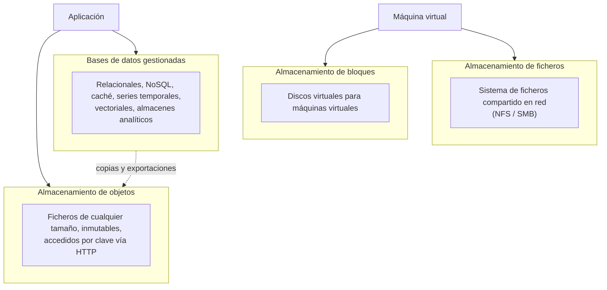

# Almacenamiento de datos en la nube y la importancia del cloud computing

## Conclusión primero

"Guardar en la nube" significa cosas distintas para un usuario (Google Drive) y para un
desarrollador (un *bucket* de objetos, una base de datos gestionada, un almacén analítico). Aquí
interesa lo segundo. La nube ofrece **cuatro familias de almacenamiento** — objetos, bloques,
ficheros y bases de datos gestionadas — cada una con un modelo de acceso, un coste y unos
procedimientos propios (subir, versionar, replicar, mover a niveles fríos, cifrar, controlar acceso,
borrar). Elegir la familia correcta es la primera decisión de cualquier diseño en la nube. Y la
importancia del *cloud computing* se resume en que ha convertido la infraestructura en un servicio
programable, accesible a cualquier empresa, con las consecuencias económicas, técnicas y de
soberanía que eso implica.

## Dos "nubes" que se llaman igual

| | Nube de consumo | Nube de infraestructura |
|---|---|---|
| Qué es | Un servicio de ficheros con interfaz de usuario | Servicios de almacenamiento que consume el software |
| Ejemplos | Google Drive, OneDrive, Dropbox, iCloud | S3, Azure Blob Storage, Google Cloud Storage, RDS, BigQuery |
| Quién lo usa | Personas | Aplicaciones, mediante API |
| Modelo | Carpetas y ficheros; sincronización con el escritorio | Objetos, bloques, tablas; sin "carpetas" reales |
| Coste | Suscripción por capacidad | Por GB almacenado al mes + por operación + por GB transferido hacia fuera |

Una empresa que "tiene los datos en la nube" puede estar en cualquiera de las dos, y la diferencia
es importante para el proyecto: una PYME con las facturas en una carpeta de OneDrive compartida está
en el nivel de ofimática de [UD1-01](../ud1-digitalizacion-ia-software/01-que-es-digitalizar.md), no
en un sistema digitalizado. (Los servicios de consumo, por debajo, están construidos sobre los de
infraestructura.)

## Las cuatro familias de almacenamiento

| Familia | Qué es | Modelo de acceso | Para qué | Ejemplos | Coste relativo |
|---|---|---|---|---|---|
| **Objetos** (*object storage*) | Un espacio plano de "objetos" (ficheros + metadatos) identificados por una clave, dentro de un contenedor (*bucket*). No hay carpetas reales: `2026/03/factura-4471.pdf` es una clave con barras | HTTP: `PUT`, `GET`, `DELETE`; SDK en cualquier lenguaje; URLs firmadas con caducidad para dar acceso temporal | Documentos, imágenes, vídeo, copias de seguridad, datos para analítica (Parquet), sitios estáticos, todo lo que se escribe entero y se lee entero | S3 (el estándar de facto: casi todos los proveedores ofrecen "API compatible con S3"), Azure Blob, Google Cloud Storage; MinIO para tenerlo en local | Muy bajo por GB; se paga también por operación y por salida |
| **Bloques** (*block storage*) | Un disco virtual que se conecta a una máquina virtual; el sistema operativo lo formatea y lo usa como cualquier disco | Como un disco: el sistema de ficheros de la VM | El disco del sistema y de las bases de datos que corren en VMs propias | EBS, Azure Managed Disks, Persistent Disk | Medio-alto; se paga por capacidad reservada, no por uso |
| **Ficheros** (*file storage*) | Un sistema de ficheros de red que varias máquinas montan a la vez | NFS / SMB: rutas, carpetas, permisos POSIX | Aplicaciones heredadas que esperan un directorio compartido; contenido común entre servidores | EFS, Azure Files, Filestore | Alto |
| **Bases de datos gestionadas** (DBaaS) | El proveedor instala, parchea, replica, hace copias y escala el motor; el cliente solo usa la base de datos | El protocolo del motor (SQL, MongoDB, Redis...) | Los datos transaccionales y analíticos de la aplicación | Relacionales: RDS/Aurora, Cloud SQL, Azure SQL, Neon, Supabase. NoSQL: DynamoDB, Cosmos DB, Firestore, MongoDB Atlas. Caché: ElastiCache, Upstash. Analíticos: BigQuery, Redshift, Snowflake, Databricks | Variable; se paga por instancia o por uso (*serverless*) |

**La regla práctica**: los ficheros van a objetos, los datos estructurados a una base de datos
gestionada, y bloques y ficheros solo cuando una VM o una aplicación heredada lo exigen. El error
más común de un desarrollador que llega a la nube es guardar imágenes en la base de datos o en el
disco de la VM en vez de en un *bucket*.

## Los procedimientos

Lo que se hace con el almacenamiento en la nube, con los términos que aparecen en las consolas y
en las APIs:

| Procedimiento | Qué es | Cómo se hace | Por qué importa |
|---|---|---|---|
| **Subir / descargar** | Poner y obtener datos | API/SDK desde código; CLI (`aws s3 cp`, `az storage blob upload`); consola web; subida por partes para ficheros grandes; **URLs firmadas** para que un cliente suba directamente sin pasar por el backend | Que el navegador o la app suban el fichero al *bucket* directamente descarga al servidor propio |
| **Organizar** | *Buckets*, prefijos, etiquetas, metadatos | Nombres de clave con estructura (`cliente/año/mes/`), etiquetas para coste y política | No hay carpetas: la organización es una convención de nombres |
| **Controlar el acceso** | Quién puede leer/escribir qué | Políticas de identidad (IAM), políticas de *bucket*, URLs firmadas, **por defecto privado** | La mayoría de las fugas de datos en la nube son *buckets* públicos por error |
| **Cifrar** | En tránsito (TLS) y en reposo | Activado por defecto en casi todos los proveedores; con claves del proveedor o propias (KMS) | Cumplimiento; y que el proveedor no pueda leer, si se usan claves propias |
| **Versionar** | Conservar versiones anteriores de un objeto | Activar versionado en el *bucket* | Recuperar de un borrado o sobrescritura accidental (o de *ransomware*) |
| **Replicar** | Copiar automáticamente a otra región o zona | Replicación entre regiones configurada; las bases gestionadas ofrecen réplicas | Continuidad frente a caída de una región; latencia para usuarios lejanos; **cuidado**: replicar fuera de la UE es una transferencia internacional |
| **Niveles y ciclo de vida** | Mover datos a almacenamiento más barato según su edad y uso | **Reglas de ciclo de vida**: a los 30 días a nivel "frío", a los 365 a "archivo", a los 7 años borrar | Es la implementación técnica de las etapas 7 y 8 de [06](06-dato-informacion-ciclo-de-vida.md) |
| **Retención y bloqueo** | Impedir borrado o modificación durante un plazo | Bloqueo de objetos, retención legal (*legal hold*), inmutabilidad | Cumplimiento (facturas, registros), defensa frente a *ransomware* |
| **Copias de seguridad** | Instantáneas de discos y bases de datos; exportaciones a objetos | Programadas por el proveedor; verificar restauración | Una copia no probada no es una copia |
| **Borrar** | Eliminar de verdad | Borrar objeto y todas sus versiones, réplicas, instantáneas; borrado seguro | El derecho de supresión del RGPD llega hasta aquí |
| **Medir y pagar** | Capacidad, operaciones, salida | Facturación por GB-mes, por mil operaciones, por GB de *egress* | El *egress* es la partida sorpresa: sacar los datos de la nube cuesta; meterlos, no |

**Niveles de almacenamiento** (*storage tiers* / *classes*), porque son la conexión más directa con
el ciclo de vida del dato:

| Nivel | Para datos | Coste por GB | Coste por acceso | Tiempo de recuperación |
|---|---|---|---|---|
| **Caliente** (*hot / standard*) | De uso frecuente | Alto | Bajo | Inmediato |
| **Templado / infrecuente** (*cool / infrequent access*) | Se leen pocas veces al mes | Medio | Medio | Inmediato |
| **Frío** (*cold*) | Rara vez | Bajo | Alto | Inmediato o minutos |
| **Archivo** (*archive / Glacier / Deep Archive*) | Casi nunca; retención legal | Muy bajo (céntimos por GB al año) | Muy alto, y mínimo de permanencia | Horas |

## Plataformas de datos: dónde va lo analítico

Los datos de la aplicación (transaccionales, en una base de datos relacional) no son los datos para
analizar (históricos, agregados, unidos con otras fuentes). La nube ha estandarizado tres
arquitecturas para lo segundo:

| Arquitectura | Qué es | Formato | Cuándo |
|---|---|---|---|
| **Almacén de datos** (*data warehouse*) | Base de datos analítica: SQL sobre tablas estructuradas, optimizada para consultas grandes, no para transacciones | Tablas | Analítica descriptiva y BI sobre datos ya estructurados |
| **Lago de datos** (*data lake*) | Todo en crudo en almacenamiento de objetos: ficheros, logs, JSON, imágenes; se estructura al leer | Ficheros (Parquet, JSON, CSV) | Ciencia de datos, ML, datos no estructurados; barato de almacenar, fácil de convertir en un pantano |
| ***Lakehouse*** | Lago de objetos con una capa de tablas transaccionales encima (formatos abiertos: Apache Iceberg, Delta Lake) | Ficheros con metadatos de tabla | La convergencia de 2020 en adelante: un solo almacén para BI y ML |

Y el flujo típico: **ETL** (extraer, transformar, cargar) o su variante moderna **ELT** (cargar en
crudo y transformar dentro del almacén, con SQL — dbt), por lotes (cada noche) o en flujo (Kafka,
Kinesis, Pub/Sub). La convención de capas **bronce / plata / oro** (crudo / limpio / listo para
negocio) es la organización habitual del *lakehouse*, y coincide con las etapas 2-5 del ciclo de
vida.

## La importancia del cloud computing

Recogiendo lo de [03](03-niveles-y-funciones-de-la-nube.md) y [05](05-donde-vive-la-logica.md), en
cinco dimensiones:

1. **Económica.** Convierte inversión (comprar servidores para el pico de carga, que están ociosos
   el resto del tiempo) en gasto por uso; elimina la barrera de entrada: una persona con una
   tarjeta tiene la misma infraestructura que una multinacional. A cambio, un gasto variable que hay
   que gobernar (FinOps, [02](02-sostenibilidad-coste-y-mercados.md)).
2. **Técnica.** Servicios gestionados que antes exigían un equipo especialista (bases de datos
   replicadas, colas, búsqueda, GPU, modelos de IA); elasticidad; alcance global; la infraestructura
   como código.
3. **Organizativa.** Los equipos de desarrollo pueden desplegar sin pedir un servidor a sistemas;
   DevOps y la entrega continua son posibles porque la infraestructura es una API. La nube cambió
   la organización tanto como la tecnología ([UD1-02](../ud1-digitalizacion-ia-software/02-la-empresa-por-dentro.md)).
4. **Para los datos y la IA.** Todo lo de este apunte: almacenar cualquier volumen, analizarlo con
   SQL sin instalar nada, entrenar con GPU por horas, llamar a modelos por API. La IA generativa
   actual **no existiría sin la nube**: nadie fuera de un puñado de laboratorios tiene los centros
   de datos para entrenar un modelo frontera, y casi nadie los tiene para servirlo.
5. **Geopolítica y de soberanía.** Tres empresas estadounidenses concentran la mayor parte del
   mercado mundial. El **CLOUD Act** (EE. UU., 2018) permite a las autoridades estadounidenses
   exigir datos a empresas de su país estén donde estén los servidores, lo que choca con el RGPD.
   La respuesta europea son las **nubes soberanas** (operadas por entidades europeas, o por los
   hiperescaladores bajo estructuras jurídicas separadas), iniciativas como Gaia-X, y el Data Act
   (portabilidad entre nubes). En 2025-2026 el tema ha pasado de académico a decisión de compra en
   administraciones y sectores regulados.

Los límites — dependencia, coste a escala, latencia, caídas correlacionadas — se argumentaron en
[03](03-niveles-y-funciones-de-la-nube.md) y [05](05-donde-vive-la-logica.md). La posición
razonable no es "nube sí" o "nube no": es **saber qué va a la nube, a cuál, en qué región, en qué
nivel de almacenamiento y con qué salida prevista**. Esa frase es la sección 5 y parte de la 8 del
informe del proyecto.

## Para debatir

- Una clínica guarda radiografías (DICOM, cientos de MB cada una), historiales (texto estructurado)
  y una agenda. Asignar cada cosa a una familia de almacenamiento, un nivel y una región. ¿Qué
  reglas de ciclo de vida? ¿Qué no puede salir de la UE?
- Un *bucket* con facturas, configurado como público "para que el cliente pueda descargar la suya
  desde el enlace". ¿Qué está mal? ¿Cómo se hace bien (URLs firmadas)?
- Una empresa lleva tres años en la nube y quiere irse a otro proveedor. Enumerar los costes de
  salida: *egress*, servicios no portables, formatos. ¿Qué habría hecho la migración más barata?
- "Los datos están en la región de Fráncfort de un proveedor estadounidense, así que cumplimos el
  RGPD." Argumentar por qué esa frase es incompleta.
