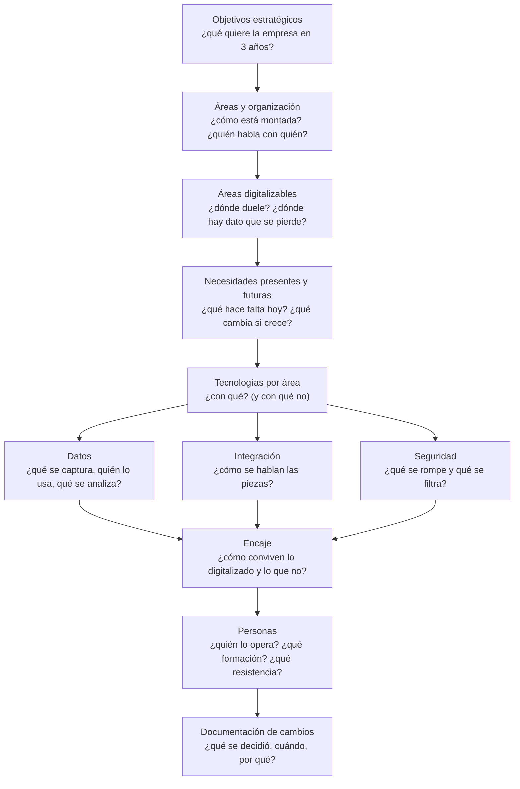

# Metodología del proyecto de transformación digital

**Relación con otros apuntes:** este documento no introduce tecnología nueva; enlaza en cada paso
con el apunte de UD1 o UD2 donde se explicó. El formato del informe (9 secciones), el guion de la
exposición y las reglas de uso de IA están en la carpeta del proyecto
([`../../proyecto/`](../../proyecto/)); aquí está el **método** para llegar a cada sección con
contenido defendible. Un caso completo trabajado con este método:
[02-ejemplo-trabajado.md](02-ejemplo-trabajado.md).

## Conclusión primero

Un proyecto de transformación digital no es una lista de tecnologías que se le ponen a una empresa:
es un razonamiento en cadena que empieza en **qué quiere conseguir la empresa**, pasa por **cómo
está organizada y qué áreas tiene**, decide **qué áreas conviene digitalizar y en qué orden**, y
solo entonces elige **con qué tecnología**, **con qué datos**, **con qué riesgos** y **con qué
personas**. Cada eslabón justifica al siguiente. Un informe en el que la sección de tecnologías se
podría haber escrito sin leer la de objetivos es un informe que un agente de IA produce en un
minuto y que no sobrevive a la primera pregunta de la exposición. El método de este apunte existe
para que cada decisión tenga una razón que se pueda explicar en voz alta.

## El razonamiento en cadena



El orden no es el de las secciones del informe (que es el orden de lectura), sino el del
razonamiento. Se puede — se debe — volver atrás: descubrir en la seguridad que un dato no puede
salir de la empresa cambia la tecnología, y eso puede cambiar el alcance.

## 1. Objetivos estratégicos

**Qué se pide.** Decir para qué existe la empresa y qué quiere conseguir en un horizonte de dos a
tres años, en términos que se puedan medir. No es el eslogan de la web: es lo que decidiría el
dueño si tuviera que elegir entre dos inversiones.

**Cómo se obtiene.**

- Si la empresa es real y accesible: preguntar. "¿Qué le quita el sueño?" produce mejores objetivos
  que "¿cuál es su estrategia?".
- Si es conocida pero no accesible: memorias anuales, entrevistas, ofertas de empleo (dicen qué
  están construyendo), reseñas de clientes (dicen qué falla).
- Si es inventada: decidirlos explícitamente y escribirlos antes de todo lo demás, porque el resto
  del informe depende de ellos.

**Cómo se escriben.** Tres a cinco objetivos, cada uno con un indicador. Formatos útiles:

| Formato | Ejemplo |
|---|---|
| Objetivo + métrica + plazo | "Reducir el plazo de entrega medio de 5 a 2 días en 18 meses" |
| OKR (objetivo + resultados clave) | O: "Ser el taller de referencia en vehículo eléctrico de la comarca". KR1: 30 % de la facturación en VE. KR2: certificación del fabricante. KR3: tiempo de diagnóstico < 1 h |
| Análisis DAFO reducido a decisiones | De "amenaza: la cadena X abre a 2 km" se deriva "objetivo: fidelizar el 70 % de los clientes actuales con servicio que la cadena no da" |

**Errores típicos.** Objetivos que son tecnologías ("implantar un CRM" no es un objetivo; "no
perder ningún presupuesto por falta de seguimiento" sí); objetivos sin métrica; objetivos que
cualquier empresa tendría ("crecer", "ser más eficiente").

**Dónde se explicó:** [UD1-01](../ud1-digitalizacion-ia-software/01-que-es-digitalizar.md) (qué
es y qué no es digitalizar; el nivel de madurez es un objetivo en sí mismo).

## 2. Áreas de la empresa y su alineación

**Qué se pide.** Un mapa de las áreas de la empresa — de producción u operaciones, de negocio, y
las de comunicación entre ellas y con el exterior — y una comprobación de que cada área sirve a
algún objetivo del paso anterior ("alineadas").

**Cómo se obtiene.** Dos herramientas, una de ellas basta:

- **Organigrama funcional**: quién depende de quién y qué hace cada bloque
  ([UD1-02](../ud1-digitalizacion-ia-software/02-la-empresa-por-dentro.md)). En una PYME, cinco
  o seis cajas; muchas las ocupa la misma persona, y eso se anota.
- **Cadena de valor** (Porter): las actividades primarias (aprovisionar, producir, entregar,
  vender, atender) y las de apoyo (administración, RRHH, tecnología, compras). Es mejor que el
  organigrama para empresas pequeñas, porque describe *lo que se hace* y no *quién manda*.

Y para cada área, tres datos: qué produce (un servicio, un documento, un producto), con qué otras
áreas intercambia información, y por qué canal (correo, papel, WhatsApp, un sistema, "a voces").
Ese tercer dato es el que más importa, porque los canales de comunicación son donde vive el
desperdicio ([UD1-06](../ud1-digitalizacion-ia-software/06-extremo-a-extremo.md)) y lo que la ley
de Conway convertirá en fronteras del sistema
([UD1-05](../ud1-digitalizacion-ia-software/05-ciclos-de-vida-conway-y-el-caso-movil.md)).

**Alineación.** Una tabla áreas × objetivos con una marca donde el área contribuye. Un área que no
contribuye a ningún objetivo es una señal (o sobra, o falta un objetivo); un objetivo al que no
contribuye ninguna área es un deseo, no un objetivo.

**Comunicaciones.** En una empresa industrial son literalmente las redes
(IT/OT, [UD1-03](../ud1-digitalizacion-ia-software/03-it-y-ot.md)); en una de servicios, los
canales con el cliente (teléfono, web, correo, redes, mensajería) y entre áreas. Conviene tratarlas
como un área más con su propio mapa, porque la digitalización casi siempre las cambia primero.

## 3. Áreas susceptibles de digitalizarse y alcance

**Qué se pide.** De todas las áreas, cuáles conviene digitalizar, y cuáles se eligen para el
alcance del informe (dos o tres; no todas).

**Criterios para puntuar cada área** (una tabla con estas columnas y una puntuación de 1 a 3 en
cada una da un orden objetivo):

| Criterio | Pregunta | Señal de "sí" |
|---|---|---|
| Dolor | ¿Es donde se pierden horas, clientes o dinero? | Quejas, retrasos, errores repetidos |
| Dato que se pierde | ¿Se genera información que no se captura o se teclea varias veces? | Papel, Excel, WhatsApp, "lo lleva Fulano" ([UD1-01](../ud1-digitalizacion-ia-software/01-que-es-digitalizar.md), el test de cinco preguntas) |
| Repetición | ¿Es un proceso que se hace muchas veces igual? | Volumen alto, reglas claras |
| Contacto con el cliente | ¿El cliente lo ve? | Afecta a la percepción y a la fidelidad |
| Contribución a objetivos | ¿Sirve a un objetivo del paso 1? | Marca en la tabla de alineación |
| Viabilidad | ¿Se puede hacer con el presupuesto, el plazo y las personas que hay? | Sin dependencias imposibles |
| Riesgo de hacerlo mal | ¿Qué pasa si falla? | Regulación, seguridad física ([UD1-03](../ud1-digitalizacion-ia-software/03-it-y-ot.md)) |

**La decisión de "no".** El informe gana si nombra explícitamente un área que **no** conviene
digitalizar ahora y por qué: porque funciona bien en papel, porque el volumen no lo justifica,
porque el riesgo regulatorio exige un proyecto aparte, porque primero hay que arreglar el proceso.
Es la mejor prueba de criterio, y encaja con la regla "digitalizar un proceso malo lo empeora".

**Casos de uso** (sección 2 del informe). Para cada área elegida, dos o tres casos de uso con
actor, precondición, flujo principal y flujos alternativos. El flujo alternativo es donde está la
complejidad real ("¿y si el cliente no tiene correo?", "¿y si el pedido se cancela cuando ya está
en reparto?") y donde se demuestra que se ha entendido el dominio y no solo copiado un caso genérico.

## 4. Necesidades presentes y futuras

**Qué se pide.** Distinguir lo que hace falta hoy de lo que hará falta si la empresa cumple sus
objetivos — y diseñar para lo primero sin cerrar la puerta a lo segundo.

**Cómo.** Para cada área elegida, dos columnas: "hoy" (volumen, usuarios, ubicaciones, integraciones)
y "en tres años si se cumplen los objetivos" (el doble de pedidos, una segunda tienda, venta online,
un cliente que exige facturación electrónica). Y para cada diferencia, una de tres respuestas:

- **Se diseña ya para ello** (barato ahora, caro después): un modelo de datos con `tienda_id`
  aunque solo haya una tienda; identificadores que no dependan de la sede.
- **Se deja preparado el punto de extensión** sin construirlo: una API en vez de acceso directo a la
  base de datos; un nivel de nube que escala sin migrar
  ([UD2-03](../ud2-tecnologias-arquitectura/03-niveles-y-funciones-de-la-nube.md)).
- **Se pospone conscientemente** y se anota como riesgo: la app móvil se hará "cuando haya
  repartidores propios".

**El error simétrico.** Diseñar para el futuro imaginado (microservicios para una tienda; Big Data
para mil clientes) cuesta hoy y probablemente no sirva mañana
([UD1-04](../ud1-digitalizacion-ia-software/04-front-back-cliente-servidor.md), la tabla monolito
frente a microservicios). El informe tiene que argumentar el tamaño correcto, no el máximo.

## 5. Tecnologías por área

**Qué se pide.** Para cada área digitalizada, qué tecnología se propone y por qué esa y no otra.
Incluye tres subdecisiones que el informe trata en secciones distintas:

| Subdecisión | Sección del informe | Dónde se explicó |
|---|---|---|
| **Arquitectura**: dónde vive cada lógica (cliente, servidor, nube, *edge*, dispositivo) | 5 | [UD1-04](../ud1-digitalizacion-ia-software/04-front-back-cliente-servidor.md), [UD2-05](../ud2-tecnologias-arquitectura/05-donde-vive-la-logica.md), [UD2-04](../ud2-tecnologias-arquitectura/04-edge-fog-mist.md) |
| **Tecnologías y frameworks**: comprar (SaaS), adaptar (plataforma) o construir; lenguajes y frameworks si se construye; nivel de nube | 6 | [UD2-01](../ud2-tecnologias-arquitectura/01-tecnologias-habilitadoras.md), [UD2-03](../ud2-tecnologias-arquitectura/03-niveles-y-funciones-de-la-nube.md) |
| **Ciclo de vida**: cascada o iterativo, y para qué parte | 7 | [UD1-05](../ud1-digitalizacion-ia-software/05-ciclos-de-vida-conway-y-el-caso-movil.md) |
| **Herramienta de IA aplicable, y cuándo no** | 9 | [UD1-07](../ud1-digitalizacion-ia-software/07-que-es-la-ia.md), [UD1-09](../ud1-digitalizacion-ia-software/09-ia-para-el-desarrollo-de-software.md) |

**Comprar, adaptar o construir** es la primera decisión y la que más se olvida. Un alumno de DAM
tiende a construir; una empresa real casi siempre compra (un SaaS de gestión de talleres, de
clínicas, de restaurantes existe para cualquier sector) y construye solo lo que la diferencia. El
informe debe decir qué se compra, qué se adapta y qué se construye, y justificar lo tercero.

**La tabla de arquitectura** que se pide en la sección 5 es la de
[UD2-05](../ud2-tecnologias-arquitectura/05-donde-vive-la-logica.md): función por función, dónde
vive y por qué. "Una app que se conecta a una API" no es una arquitectura.

**La sección 9 (IA).** Una herramienta concreta — asistente, agente, flujo con paso LLM, RAG, MCP,
modelo clásico — para un problema concreto del área, con la razón por la que ese tipo y no otro
([UD1-09](../ud1-digitalizacion-ia-software/09-ia-para-el-desarrollo-de-software.md), tabla de
automatización), y **al menos un caso en el que no se usa IA aunque se podría**: porque hay una
regla que lo resuelve, porque el coste del error es inaceptable, porque el AI Act lo clasifica como
alto riesgo, porque los datos no pueden salir, porque no hay datos.

## 6. Datos

**Qué se pide.** Qué datos maneja cada área digitalizada, cómo se tratan y qué análisis se hace con
ellos.

**Cómo.** Tres piezas:

- **Glosario** (sección 3): definición propia de las cinco a diez entidades del dominio, con la
  ambigüedad resuelta explícitamente ("cliente: quien paga la factura; el vehículo tiene su propia
  entidad; el conductor habitual, otra"). Es la parte del informe que más se pregunta en la
  exposición, porque es donde una IA produce definiciones limpias y equivocadas
  ([UD1-02](../ud1-digitalizacion-ia-software/02-la-empresa-por-dentro.md), la tabla de qué llama
  "cliente" cada departamento).
- **Modelo de datos** (sección 4): entidades, relaciones y **las cardinalidades problemáticas**
  nombradas — la que es N:M cuando parece 1:N, la fecha que son cuatro fechas, el dato que se
  corrige después de usarse ([UD2-06](../ud2-tecnologias-arquitectura/06-dato-informacion-ciclo-de-vida.md),
  la corrección tardía).
- **Ciclo de vida y análisis**: para las dos o tres entidades principales, las ocho etapas del ciclo
  de vida en una tabla ([UD2-06](../ud2-tecnologias-arquitectura/06-dato-informacion-ciclo-de-vida.md)),
  y qué nivel de analítica es realista — descriptiva primero
  ([UD2-07](../ud2-tecnologias-arquitectura/07-ciencia-de-datos.md)) — con la pregunta de negocio
  que responde.

## 7. Integración

**Qué se pide.** Cómo se hablan los datos, las aplicaciones y las plataformas que los soportan —
entre las áreas digitalizadas, y con los sistemas que ya existen.

**Cómo.** Un diagrama con todas las piezas (las nuevas y las existentes: el programa de contabilidad
del gestor, la pasarela de pago, el SaaS que se compra, la hoja de cálculo que se mantiene) y una
flecha por cada intercambio de datos, con tres etiquetas: **qué** dato, **cómo** (API, fichero,
cola, a mano) y **cuándo** (tiempo real, cada noche, cuando alguien se acuerda). Las flechas "a
mano" y "cuando alguien se acuerda" son las que el proyecto elimina — o justifica.

**Patrones** para nombrar lo que se dibuja: punto a punto (cada sistema con cada sistema; simple
hasta que hay cinco); *hub* o bus (todos con uno central: el ERP, un iPaaS como n8n/Make, una cola
de eventos); API primero (cada sistema expone una API y los demás la consumen). Un dato **maestro**
(cliente, producto) con un sistema dueño y los demás lectores
([UD2-06](../ud2-tecnologias-arquitectura/06-dato-informacion-ciclo-de-vida.md)).

**El recorrido de un dato** ([UD1-06](../ud1-digitalizacion-ia-software/06-extremo-a-extremo.md)):
elegir uno — un pedido, una cita, una pieza — y seguirlo por el diagrama de punta a punta. Si en
algún salto cambia de nombre o se copia a mano, ahí está el trabajo.

## 8. Encaje entre lo digitalizado y lo que no

**Qué se pide.** Cómo conviven las áreas digitalizadas entre sí y con las que no se digitalizan (en
este proyecto o nunca).

**Cómo.** Es el paso que más se olvida, porque la tentación es diseñar como si todo fuera nuevo.
Tres preguntas por cada frontera entre un área digitalizada y una que no:

- ¿Qué dato cruza la frontera y en qué formato llega al lado no digital? (Un PDF impreso; un
  aviso por WhatsApp; una llamada.) ¿Es aceptable durante cuánto tiempo?
- ¿Qué pasa cuando el lado no digital se equivoca o se retrasa? (El taller anota a mano una pieza
  que no está en el sistema.)
- ¿Quién es el dueño del dato en la frontera? (Si el almacén sigue en papel, ¿el sistema muestra
  un stock que no es verdad?)

Y entre áreas digitalizadas: ¿comparten el mismo glosario? Si "pedido" significa cosas distintas
en la tienda online y en el taller, el encaje falla aunque la integración técnica funcione.

**El plan por fases.** El encaje se resuelve en el tiempo: qué se digitaliza en la fase 1, qué en
la 2, y qué se mantiene como está. Es lo que convierte el informe en un proyecto y no en un catálogo.

## 9. Seguridad por área

**Qué se pide.** Las brechas de seguridad posibles en cada área, y las medidas.

**Cómo.** La tabla de [UD1-10](../ud1-digitalizacion-ia-software/10-seguridad-y-regulacion.md):
por área, el dato más sensible, su categoría (personal, especial, secreto de negocio, operativo),
qué principio de la tríada CIA pesa más, **la brecha más probable** (un correo con un Excel; un
*bucket* público; una contraseña compartida; un móvil perdido con la app abierta; un proveedor de
IA al que se envía lo que no se debe), la medida, y la norma que aplica (RGPD siempre que haya
personas; AI Act si hay decisiones automáticas sobre ellas; NIS2 o sectoriales si procede).

**Lo que distingue un informe bueno:** que la brecha sea *de esa empresa* y no genérica. "Ataque
de *ransomware*" es genérico; "el gestor externo recibe cada mes un Excel con las nóminas por
correo sin cifrar" es de esa empresa.

## 10. Personas

**Qué se pide.** Si la empresa tiene las personas adecuadas para operar lo propuesto, y qué hacer si
no. En este proyecto se trata en un párrafo bien pensado, no en una sección larga.

**Cómo.** Por cada área digitalizada: quién la va a usar (perfil, edad, familiaridad con
herramientas), quién la va a administrar (¿hay alguien de IT? ¿un proveedor?), qué formación hace
falta, qué tarea desaparece y qué pasa con quien la hacía, y **dónde va a haber resistencia**
(el caso de las clínicas dentales de
[UD1-02](../ud1-digitalizacion-ia-software/02-la-empresa-por-dentro.md): el software está, la agenda
sigue en papel). Un proyecto que no dice quién lo va a operar el día después es un proyecto que se
apaga solo.

## 11. Documentar los cambios

**Qué se pide.** Un registro de qué cambió en el proyecto y por qué, en función de la estrategia.

**Cómo.** Dos instrumentos, ambos de uso real en la industria:

- **Historial de versiones** del informe: qué cambió entre el borrador de los primeros talleres y
  la entrega, y por qué (una tabla: fecha, sección, cambio, motivo). Es la evidencia más ligera
  del proyecto y la exige el formato del informe.
- **Registros de decisiones de arquitectura** (*Architecture Decision Records*, ADR): un fichero
  corto por decisión importante — contexto, opciones consideradas, decisión, consecuencias. Es una
  práctica estándar en equipos de software desde 2011, y es exactamente el material del que se
  pregunta en la exposición ("¿qué alternativa descartaste y por qué?"). Tres o cuatro ADR en el
  informe (por qué SaaS y no construir; por qué la lógica de precios en servidor; por qué no IA en
  X) valen más que cualquier párrafo de justificación.

Plantilla mínima de un ADR:

```markdown
# ADR-003: Precios y descuentos se calculan solo en el servidor

**Contexto.** La app del taller muestra el presupuesto al cliente en el móvil; la primera versión
calculaba el total en la app para responder al instante.

**Opciones.** (a) Calcular en la app. (b) Calcular en el servidor y mostrar "calculando".
(c) Calcular en la app para mostrar y recalcular en el servidor al confirmar.

**Decisión.** (c).

**Consecuencias.** Se mantiene la respuesta instantánea; el servidor es la autoridad; hay que
mantener la lógica en dos sitios (mitigado: la app recibe las reglas del servidor al arrancar).
```

## El uso de IA en el proyecto: cómo hacerlo bien

Está permitido y se anima; lo que se pide es trazabilidad. Lo que funciona:

- **Usar el agente para lo que hace bien**: investigar la empresa y el sector, proponer estructuras,
  redactar borradores, hacer de "comité" (pedirle que haga las preguntas más difíciles a cada
  sección), generar el diagrama a partir de una descripción.
- **No usar su salida para lo que hace mal**: decidir. Cada decisión de la cadena (qué área, qué
  tecnología, dónde vive la lógica, qué no digitalizar) la toma el alumno y la puede explicar; el
  agente propone opciones.
- **Verificar todo lo que afirme sobre el mundo**: precios, normas, fechas, nombres de productos,
  referencias. Inventa con soltura.
- **Detectar el modelo limpio y equivocado**: cuando el agente devuelve un glosario o un modelo de
  datos sin ninguna ambigüedad, es que no ha entendido el dominio. Las cardinalidades problemáticas
  no las encuentra un agente que no ha hablado con la empresa.
- **La nota de uso de IA**: qué se le pidió, qué se aceptó, qué se corrigió y por qué. Cuanto más
  honesta, más útil es como evidencia de comprensión.

**Lo que no funciona**, y se detecta en la exposición: pedir "hazme un informe de transformación
digital de una empresa de X" y entregar el resultado. Produce un texto correcto, genérico, sin
decisiones, con un glosario limpio, sin ningún "no", y con una sección de IA que recomienda "un
chatbot". La primera pregunta del comité lo desmonta.

## Para debatir en los talleres

- Elegir un objetivo estratégico de la empresa propia y seguir la cadena hasta una decisión
  técnica concreta. ¿En qué eslabón se rompe la justificación?
- ¿Qué área de la empresa propia **no** conviene digitalizar ahora? Defenderlo ante un compañero
  que opine lo contrario.
- Intercambiar glosarios con otro alumno cuya empresa esté en un sector parecido. ¿Definen igual
  "cliente", "pedido", "cita"? ¿Deberían?
- Pedirle a un agente el informe entero de la empresa propia. Compararlo con el que se está
  escribiendo. ¿Qué tiene el del agente que no debería estar? ¿Qué le falta?
