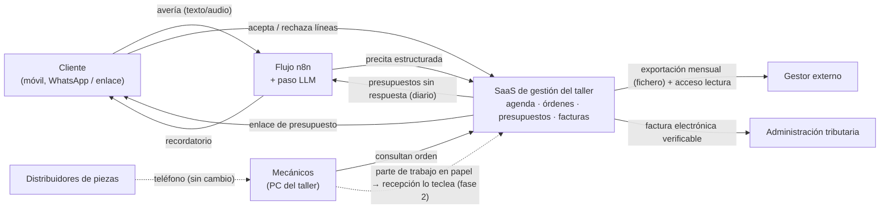

# Ejemplo trabajado: un taller mecánico de ocho personas

Aplicación abreviada del método de [01-metodologia-del-proyecto.md](01-metodologia-del-proyecto.md)
a una empresa inventada, para ver qué aspecto tiene cada decisión cuando está justificada. Es
**deliberadamente más corto** que un informe real (no incluye los casos de uso completos ni el
modelo de datos entero) y de un sector que probablemente no coincide con el de ningún alumno:
sirve para ver el razonamiento, no para copiarlo.

## La empresa

**Talleres Louzao**, taller mecánico multimarca en una localidad de 20 000 habitantes. Ocho
personas: el dueño (que también hace de jefe de taller y de comercial), cuatro mecánicos, una
persona de recepción y administración, un aprendiz, y un gestor externo para contabilidad y
nóminas. Unos 40 vehículos a la semana. Trabajo actual: agenda en un cuaderno; orden de reparación
en papel autocopiativo; presupuestos en Word, enviados por WhatsApp desde el móvil del dueño;
piezas pedidas por teléfono a dos distribuidores; facturas en un programa de escritorio antiguo;
cobro en efectivo o datáfono; el gestor recibe cada mes una caja con facturas y tickets.

## 1. Objetivos estratégicos

Obtenidos en una conversación de una hora con el dueño, reformulados con métrica:

| Objetivo | Indicador | Plazo |
|---|---|---|
| O1. Dejar de perder trabajo por no hacer seguimiento a presupuestos | Presupuestos aceptados / enviados, de ~40 % a 60 % | 12 meses |
| O2. Entrar en vehículo eléctrico e híbrido antes que la competencia local | 20 % de la facturación en VE/híbrido; certificación de un fabricante | 24 meses |
| O3. Que el dueño deje de ser el cuello de botella de todo | Horas semanales del dueño en administración: de ~15 a 5 | 12 meses |
| O4. Cumplir la facturación electrónica y verificable que exige la normativa | Sin sanciones; sin trabajo extra del gestor | Según calendario legal |

Obsérvese que ninguno dice "poner un software". O3 es el que más digitalización implica y el que el
dueño formuló como "que me dejen trabajar".

## 2. Áreas y alineación

Cadena de valor, porque el organigrama son dos niveles:

| Área | Qué produce | Se comunica con | Canal actual | O1 | O2 | O3 | O4 |
|---|---|---|---|---|---|---|---|
| Recepción y cita | Cita, recepción del vehículo, orden de reparación | Cliente, taller | Cuaderno, teléfono, papel | ✓ | | ✓ | |
| Diagnóstico y presupuesto | Presupuesto | Cliente, distribuidores | Word, WhatsApp, teléfono | ✓ | ✓ | ✓ | |
| Reparación | Vehículo reparado, partes de trabajo | Recepción, compras | Papel, a voces | | ✓ | | |
| Compras de piezas | Piezas | Distribuidores, reparación | Teléfono | | | ✓ | |
| Facturación y cobro | Factura, cobro | Cliente, gestor | Programa antiguo, caja de papeles | | | ✓ | ✓ |
| Comunicación con el cliente | Avisos, seguimiento | Cliente | WhatsApp del dueño | ✓ | | ✓ | |
| Gestión externa (gestor) | Contabilidad, nóminas, impuestos | Facturación | Caja mensual | | | ✓ | ✓ |

Todas las áreas sirven a algún objetivo; O2 (eléctrico) depende de formación y equipamiento más que
de software — se deja anotado para el plan de personas y fuera del alcance digital salvo en la
gestión de citas de diagnóstico especializado.

## 3. Áreas digitalizables y alcance

| Área | Dolor | Dato perdido | Repetición | Cliente lo ve | Viabilidad | Total |
|---|---|---|---|---|---|---|
| Recepción y cita | 3 | 3 | 3 | 3 | 3 | **15** |
| Presupuesto y seguimiento | 3 | 3 | 3 | 3 | 3 | **15** |
| Facturación | 2 | 2 | 3 | 1 | 3 | 11 |
| Comunicación con el cliente | 2 | 2 | 3 | 3 | 3 | 13 |
| Compras | 1 | 2 | 2 | 0 | 2 | 7 |
| Reparación (partes de trabajo) | 1 | 2 | 2 | 0 | 1 | 6 |

**Alcance elegido:** (1) cita y recepción, (2) presupuesto y seguimiento, con la comunicación con
el cliente como transversal a ambas. Facturación se incluye como integración obligatoria (O4), no
como área a rediseñar.

**Lo que no se digitaliza ahora, y por qué:** los **partes de trabajo del mecánico**. Un mecánico con
las manos manchadas no va a teclear en una tableta cada media hora; una pantalla en cada puesto
cuesta más que lo que ahorra con cuatro mecánicos; y el dato que se perdería (tiempo real por
reparación) no sirve a ningún objetivo del año 1. Se revisará si O2 lleva a más volumen. **Compras**
tampoco: dos proveedores por teléfono funcionan; digitalizar exigiría que los distribuidores
tuvieran API (uno la tiene, el otro no).

**Caso de uso ejemplo (abreviado): "Aceptar presupuesto".** Actor: cliente. Precondición: presupuesto
enviado. Flujo: recibe enlace → ve desglose → acepta o rechaza → el taller recibe aviso y la cita
pasa a "autorizada". Alternativos: el cliente acepta *parte* del presupuesto (hay que modelar líneas
aceptadas por separado — esto cambió el modelo de datos); el cliente no responde en 3 días (aviso
automático, O1); el cliente llama en vez de pulsar (recepción lo marca a mano: el flujo no digital
sigue existiendo).

## 4. Necesidades presentes y futuras

| | Hoy | Si se cumplen O1-O3 | Respuesta |
|---|---|---|---|
| Volumen | 40 vehículos/semana | 55-60 | Cualquier solución lo aguanta; no condiciona |
| Ubicaciones | 1 | 1 (quizá una nave anexa para VE) | Sin `taller_id`; no merece la pena |
| Usuarios | 3 (dueño, recepción, y el móvil del dueño) | 5 (dos mecánicos consultan órdenes) | Roles desde el principio: barato |
| Integraciones | Gestor por caja | Gestor por exportación; distribuidor con API | API del SaaS elegido como criterio de compra |
| Móvil | El del dueño con WhatsApp | El del cliente (enlace web, no app) | Web responsive; **no** app nativa: no compensa la tienda de aplicaciones para 40 clientes/semana ([UD1-05](../ud1-digitalizacion-ia-software/05-ciclos-de-vida-conway-y-el-caso-movil.md)) |

## 5-7. Tecnologías, arquitectura, ciclo de vida

**Comprar, adaptar o construir.** Existen SaaS de gestión de talleres (varios en España, de 30 a 80
euros al mes) con cita, orden de reparación, presupuesto, factura electrónica y avisos por
WhatsApp/SMS. **Se compra.** Se construye solo lo que ninguno hace: un flujo de seguimiento de
presupuestos con recordatorios y el enlace de aceptación por líneas — y solo si el SaaS elegido tiene
API; si no, se usa su función de aviso aunque sea peor. Un alumno de DAM que propone construir un
sistema de gestión de talleres desde cero para ocho personas ha respondido mal a la pregunta.

**Arquitectura (sección 5), función por función:**

| Función | Dónde vive | Por qué |
|---|---|---|
| Agenda, órdenes, presupuestos, facturas | SaaS (nube pública del proveedor, región UE) | Comprado; el proveedor opera; datos personales en la UE |
| Enlace de aceptación del cliente | Web pública del SaaS o una página propia mínima | Sin instalación; funciona en cualquier móvil |
| Reglas de precios y descuentos | Servidor (SaaS) | Nunca en el navegador del cliente ([UD1-04](../ud1-digitalizacion-ia-software/04-front-back-cliente-servidor.md)) |
| Recordatorios de presupuestos sin respuesta | Flujo automatizado (n8n en una VM pequeña o el propio SaaS si lo hace) | Determinista; barato; no necesita IA |
| Consulta de órdenes por los mecánicos | Navegador en un PC del taller (no tableta por puesto) | Coste; manos sucias; se consulta poco |
| Exportación al gestor | Fichero mensual generado por el SaaS + acceso de solo lectura para el gestor | Elimina la caja; el gestor no quiere API |
| Copias de seguridad | Del proveedor + exportación mensual propia | No depender de un solo sitio |

**Ciclo de vida (sección 7).** Iterativo para todo el proyecto — es software comprado y un flujo
pequeño; se empieza con la agenda (dos semanas), se añade presupuesto, luego seguimiento. **Con una
excepción en cascada**: la facturación electrónica verificable tiene requisitos legales cerrados y
una fecha; se hace de una vez, con el proveedor, sin iteración. Es el "no todo es ágil" aplicado.

**Sección 9, IA.** Herramienta aplicable: un **flujo con un paso de LLM** que, cuando llega un
audio o texto de WhatsApp del cliente describiendo la avería ("hace un ruido al frenar y el testigo
naranja"), lo convierte en una precita estructurada (síntoma, sistema probable, urgencia) para que
recepción la confirme — el LLM hace lo que solo él hace (texto libre a estructura), y una persona
decide ([UD1-09](../ud1-digitalizacion-ia-software/09-ia-para-el-desarrollo-de-software.md)).
Cuándo **no** usar IA: en el diagnóstico y el presupuesto. El dueño lo formuló mejor que el AI Act:
"si el presupuesto lo hace una máquina y se equivoca, el que paga soy yo". Tampoco un chatbot de
atención: 40 clientes por semana, la mayoría conocidos, prefieren a la persona de recepción; el
coste de una mala experiencia supera al ahorro.

## 8. Datos y glosario

Tres términos que resultaron ambiguos al hacer el glosario, y la decisión:

| Término | Ambigüedad | Decisión |
|---|---|---|
| **Cliente** | ¿La persona que trae el coche, la que paga, o la empresa dueña de la flota? Una furgoneta de una empresa la trae el conductor y la paga la empresa | Tres entidades: `Persona de contacto`, `Cliente facturable`, `Vehículo`; un vehículo tiene un cliente facturable y puede tener varios contactos |
| **Presupuesto** | ¿El documento enviado, o el que se aceptó (parcialmente)? | `Presupuesto` con `Líneas`, cada línea con estado (propuesta, aceptada, rechazada); la orden de reparación se genera de las líneas aceptadas |
| **Cita** | ¿Para traer el coche o para recogerlo? ¿Y la fecha prometida de entrega, que cambia? | `Cita` de entrada; `Fecha prevista de entrega` como atributo de la orden, con historial de cambios (una corrección tardía que hay que registrar, no sobrescribir — el cliente pregunta "¿por qué me dijisteis el jueves?") |

**Cardinalidad problemática nombrada:** un presupuesto puede generar cero, una o varias órdenes de
reparación (el cliente acepta hoy los frenos y dentro de un mes la distribución), y una orden puede
juntar líneas de dos presupuestos. N:M, no 1:N como se dibuja por instinto.

**Analítica:** descriptiva, y solo tres números: presupuestos enviados/aceptados por semana (O1),
horas de administración del dueño (O3, medido a mano un mes antes y un mes después), y días desde
el presupuesto hasta la respuesta. Ningún modelo. Dentro de un año, si hay datos: qué tipo de
presupuesto se rechaza más.

## 9. Integración y encaje

**Fronteras con lo no digital**, y su tratamiento:

- **Parte de trabajo en papel** → recepción teclea las piezas y el tiempo al cerrar la orden. Es
  una reintroducción aceptada conscientemente en fase 1; el dato que importa (piezas facturables)
  se captura una vez al día, no se pierde.
- **Distribuidores por teléfono** → la pieza pedida no existe en el sistema hasta que llega. Se
  acepta; el riesgo es facturar una pieza que no se pidió, mitigado porque la factura sale de las
  líneas aceptadas del presupuesto.
- **El cliente que llama en vez de pulsar** → recepción registra la aceptación a mano. El proceso
  digital tiene que tener una entrada manual para no obligar al cliente.

**Fases:** 1 (mes 1-2): agenda y órdenes en el SaaS; 2 (mes 3-4): presupuestos con enlace y
recordatorios; 3 (mes 5-6): facturación electrónica y exportación al gestor; 4 (año 2, si O2 crece):
partes de trabajo digitales.

## 10. Seguridad

| Área | Dato más sensible | Categoría | Pesa más | Brecha más probable | Medida | Norma |
|---|---|---|---|---|---|---|
| Cita y recepción | Nombre, teléfono, matrícula, dirección | Personal | Confidencialidad | El móvil del dueño con WhatsApp de todos los clientes, sin bloqueo, y compartido con el aprendiz | WhatsApp Business en un número del taller, con acceso controlado; el SaaS como registro, no el chat | RGPD |
| Presupuesto y seguimiento | Historial de reparaciones (revela ubicación, hábitos, a veces accidentes) | Personal | Confidencialidad, integridad | Enlaces de presupuesto adivinables o reenviados | Enlaces con token largo y caducidad | RGPD |
| Facturación | Datos fiscales, importes | Personal / legal | Integridad, disponibilidad | Perder el histórico si cierra el proveedor del SaaS | Exportación mensual propia; cláusula de portabilidad | RGPD, normativa fiscal |
| Flujo con LLM | El audio o texto del cliente describiendo la avería | Personal | Confidencialidad | Enviar el texto a un proveedor de LLM con plan de consumo que entrena con los datos | Plan de API sin retención, región UE; o un modelo pequeño local si el volumen lo justifica ([UD2-04](../ud2-tecnologias-arquitectura/04-edge-fog-mist.md)); nunca datos de pago ni matrícula en el *prompt* | RGPD; AI Act (riesgo mínimo: la persona decide) |
| Gestor externo | Nóminas | Personal | Confidencialidad | La caja de papeles; o un Excel por correo | Acceso de solo lectura al SaaS; contrato de encargado de tratamiento | RGPD |

## 11. Personas

Recepción es quien opera el sistema el 90 % del tiempo: dos días de formación con el proveedor y
un mes de doble registro (cuaderno y sistema) que el dueño quería evitar y que se justifica como
seguro. El dueño tiene que **dejar de** responder presupuestos desde su WhatsApp personal — la
resistencia previsible está ahí, no en recepción. Los mecánicos no cambian nada en fase 1 (decisión
deliberada). El aprendiz, que es quien más cómodo está con herramientas digitales, hace de apoyo a
recepción y es el candidato a administrar el flujo de n8n. Para O2 (vehículo eléctrico) hace falta
formación técnica certificada de dos mecánicos, que no es digitalización pero condiciona las citas
de diagnóstico especializado del sistema.

## 12. Documentación de cambios

**Historial de versiones del informe** (extracto):

| Fecha | Sección | Cambio | Motivo |
|---|---|---|---|
| Taller I | 3 (alcance) | Se quitan los partes de trabajo del alcance | El dueño explicó que los mecánicos no van a teclear; el dato no sirve a O1-O3 |
| Taller II | 4 (modelo) | `Presupuesto` pasa a tener líneas con estado | El caso de uso "aceptar parte" no cabía en el modelo |
| Taller II | 9 (IA) | Se descarta el chatbot de atención | 40 clientes/semana conocidos; coste de mala experiencia |
| Taller III | 8 (seguridad) | Se cambia el proveedor de LLM del flujo por plan de API sin retención | El plan gratuito entrenaba con los datos |

**ADR-001: Comprar un SaaS de gestión de talleres en vez de construir.** Contexto: ocho personas,
sin IT. Opciones: construir a medida; SaaS del sector; ERP genérico adaptado. Decisión: SaaS, con
API como criterio de elección. Consecuencias: dependencia del proveedor (mitigada con exportación
mensual); solo se construye el flujo de seguimiento.

**ADR-002: Web responsive con enlace, no app nativa, para el cliente.** Contexto: el cliente
interactúa dos veces por reparación. Opciones: app nativa; PWA; enlace web. Decisión: enlace web.
Consecuencias: sin notificaciones *push* (se usa WhatsApp/SMS); sin instalación; sin tienda de
aplicaciones.

**ADR-003: IA solo en la entrada de texto libre, con confirmación humana.** Contexto: O3 pide quitar
trabajo al dueño; la tentación es automatizar el presupuesto. Opciones: LLM que presupuesta; LLM
que estructura la avería; sin IA. Decisión: la segunda. Consecuencias: ahorro pequeño pero seguro;
la responsabilidad del presupuesto sigue en el taller; el coste es de céntimos al mes.

## Preguntas que este informe tendría que aguantar en la exposición

- "Si el taller doblara de tamaño, ¿qué decisión cambiaría?" — Los partes de trabajo pasarían al
  sistema (fase 4), y probablemente una tableta por puesto; el SaaS aguanta; la app nativa seguiría
  sin compensar.
- "¿Qué te propuso la IA que descartaste?" — Un chatbot de atención, un sistema a medida con
  microservicios y un modelo de "predicción de averías" con datos que no existen.
- "Tu `Cliente` son tres entidades; ¿qué otra opción descartaste?" — Una sola entidad `Cliente`
  con un campo "tipo"; se descartó porque la furgoneta de empresa tiene dos personas distintas con
  papeles distintos, y la factura va a una y los avisos a otra.
- "¿Cuál es el dato más sensible y qué le mandarías a un agente?" — El historial de reparaciones
  por matrícula; al LLM solo llega la descripción de la avería, sin matrícula ni nombre.
- "¿Por qué cascada en la factura electrónica y ágil en lo demás?" — Requisitos cerrados por ley
  con fecha frente a un flujo que se mejora con el uso.
